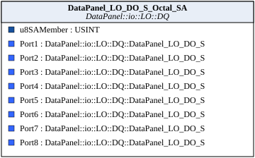

# DataPanel_LO_DO_S_Octal_SA

* * * * * * * * * *

## Einleitung

Beschreibung aus dem Kommentar des Typs: DataPanel Modules with low IO density DO Struct + Source Address

Paket: `DataPanel::io::LO::DQ`

## Schnittstellenstruktur

### **Felder**

-   **u8SAMember** (Typ: `USINT`): Node SA 217..224 (Vorgabewert: `LO_00`)
-   **Port1** (Typ: `DataPanel::io::LO::DQ::DataPanel_LO_DO_S`): Identify the Port 1A..4B (Vorgabewert: `InvalidL`)
-   **Port2** (Typ: `DataPanel::io::LO::DQ::DataPanel_LO_DO_S`): Identify the Port 1A..4B (Vorgabewert: `InvalidL`)
-   **Port3** (Typ: `DataPanel::io::LO::DQ::DataPanel_LO_DO_S`): Identify the Port 1A..4B (Vorgabewert: `InvalidL`)
-   **Port4** (Typ: `DataPanel::io::LO::DQ::DataPanel_LO_DO_S`): Identify the Port 1A..4B (Vorgabewert: `InvalidL`)
-   **Port5** (Typ: `DataPanel::io::LO::DQ::DataPanel_LO_DO_S`): Identify the Port 1A..4B (Vorgabewert: `InvalidL`)
-   **Port6** (Typ: `DataPanel::io::LO::DQ::DataPanel_LO_DO_S`): Identify the Port 1A..4B (Vorgabewert: `InvalidL`)
-   **Port7** (Typ: `DataPanel::io::LO::DQ::DataPanel_LO_DO_S`): Identify the Port 1A..4B (Vorgabewert: `InvalidL`)
-   **Port8** (Typ: `DataPanel::io::LO::DQ::DataPanel_LO_DO_S`): Identify the Port 1A..4B (Vorgabewert: `InvalidL`)

Hinweis: Diese Seite wurde aus der Typdefinition (`DataPanel_LO_DO_S_Octal_SA.dtp`) erzeugt und gibt nur die Schnittstelle wieder. Eine ausführliche Beschreibung des Verhaltens fehlt noch.
