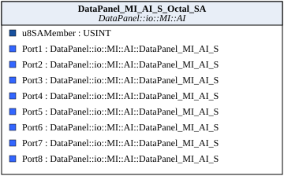

# DataPanel_MI_AI_S_Octal_SA

* * * * * * * * * *

## Einleitung

Beschreibung aus dem Kommentar des Typs: DataPanel Modules with medium IO density AI Struct + Source Address

Paket: `DataPanel::io::MI::AI`

## Schnittstellenstruktur

### **Felder**

-   **u8SAMember** (Typ: `USINT`): Node SA 224..239 (Vorgabewert: `MI_00`)
-   **Port1** (Typ: `DataPanel::io::MI::AI::DataPanel_MI_AI_S`): Identify the Port 1A..8B (Vorgabewert: `Invalid`)
-   **Port2** (Typ: `DataPanel::io::MI::AI::DataPanel_MI_AI_S`): Identify the Port 1A..8B (Vorgabewert: `Invalid`)
-   **Port3** (Typ: `DataPanel::io::MI::AI::DataPanel_MI_AI_S`): Identify the Port 1A..8B (Vorgabewert: `Invalid`)
-   **Port4** (Typ: `DataPanel::io::MI::AI::DataPanel_MI_AI_S`): Identify the Port 1A..8B (Vorgabewert: `Invalid`)
-   **Port5** (Typ: `DataPanel::io::MI::AI::DataPanel_MI_AI_S`): Identify the Port 1A..8B (Vorgabewert: `Invalid`)
-   **Port6** (Typ: `DataPanel::io::MI::AI::DataPanel_MI_AI_S`): Identify the Port 1A..8B (Vorgabewert: `Invalid`)
-   **Port7** (Typ: `DataPanel::io::MI::AI::DataPanel_MI_AI_S`): Identify the Port 1A..8B (Vorgabewert: `Invalid`)
-   **Port8** (Typ: `DataPanel::io::MI::AI::DataPanel_MI_AI_S`): Identify the Port 1A..8B (Vorgabewert: `Invalid`)

Hinweis: Diese Seite wurde aus der Typdefinition (`DataPanel_MI_AI_S_Octal_SA.dtp`) erzeugt und gibt nur die Schnittstelle wieder. Eine ausführliche Beschreibung des Verhaltens fehlt noch.
