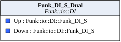

# Funk_DI_S_Dual

* * * * * * * * * *

## Einleitung

Beschreibung aus dem Kommentar des Typs: Funk DI Struct Dual

Paket: `Funk::io::DI`

## Schnittstellenstruktur

### **Felder**

-   **Up** (Typ: `Funk::io::DI::Funk_DI_S`): forward, up, right, clockwise (Vorgabewert: `(Pin := 127)`)
-   **Down** (Typ: `Funk::io::DI::Funk_DI_S`): backward, down, left, counter-clockwise (Vorgabewert: `(Pin := 127)`)

Hinweis: Diese Seite wurde aus der Typdefinition (`Funk_DI_S_Dual.dtp`) erzeugt und gibt nur die Schnittstelle wieder. Eine ausführliche Beschreibung des Verhaltens fehlt noch.
