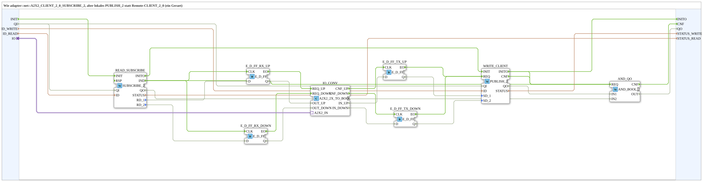

# A2X2_PUBLISH_2_SUBSCRIBE_2

* * * * * * * * * *

## Einleitung

`A2X2_PUBLISH_2_SUBSCRIBE_2` ist die lokale Variante von `adapter::net::A2X2_CLIENT_2_0_SUBSCRIBE_2`: statt eines Remote-`CLIENT_2_0` schreibt ein lokales `PUBLISH_2` (ein Gerät). Der Baustein abonniert mit `SUBSCRIBE_2` zwei BOOL-Werte (UP/DOWN) und schreibt mit `PUBLISH_2` zwei BOOL-Werte (UP/DOWN); beides hängt hinter einem einzigen bidirektionalen `A2X2`-Adapter (Socket `IO`). Intern sitzt der Adapter-Konverter `A2X2_2X_TO_BOOL`, weil eine SubApp die Pins eines Schnittstellen-Adapters nicht direkt verwenden kann. Der Baustein ist als SubAppType angelegt, damit FORTE den Typ nicht kennen muss (kein ELF für MyLib_AX).

## Schnittstellenstruktur

### **Ereignis-Eingänge**

- `INIT` (EInit): Initialisierung

### **Ereignis-Ausgänge**

- `INITO` (EInit): Initialisierungsbestätigung
- `CNF` (Event): `QO`/`STATUS` aktualisiert

### **Daten-Eingänge**

| Variable | Typ | Kommentar |
|----------|-----|-----------|
| `QI` | BOOL | Qualifier für alle internen Netzbausteine |
| `ID_WRITE` | WSTRING | Zieladresse (`ACTION=WRITE`) für beide BOOLs (Quellkommentar: „Remote-Zieladresse“) |
| `ID_READ` | WSTRING | Lokal überwachter Zustandsknoten (`ACTION=READ`) für beide BOOLs |

### **Daten-Ausgänge**

| Variable | Typ | Kommentar |
|----------|-----|-----------|
| `QO` | BOOL | TRUE nur, wenn `WRITE_CLIENT` und `READ_SUBSCRIBE` aktuell beide `QO = TRUE` melden |
| `STATUS_WRITE` | WSTRING | `STATUS` von `WRITE_CLIENT` |
| `STATUS_READ` | WSTRING | `STATUS` von `READ_SUBSCRIBE` |

### **Adapter**

| Adapter | Typ | Richtung | Kommentar |
|---------|-----|----------|-----------|
| `IO` | `adapter::types::bidirectional::A2X2` | Socket | UP/DOWN-BOOLs zum Senden (aus), UP/DOWN-BOOLs empfangen (ein) |

## Verwendete Funktionsbausteine (FBs)

- **WRITE_CLIENT** (`iec61499::net::PUBLISH_2`): schreibt die beiden BOOLs (`SD_1`, `SD_2`)
- **READ_SUBSCRIBE** (`iec61499::net::SUBSCRIBE_2`): liefert die beiden empfangenen BOOLs (`RD_1`, `RD_2`)
- **IO_CONV** (`adapter::conversion::bidirectional::A2X2_2X_TO_BOOL`): Adapter-Konverter zwischen `A2X2`-Adapter und den einzelnen BOOL-/Ereignis-Pins; siehe [A2X2_2X_TO_BOOL](../../adapter/conversion/bidirectional/BOOL/A2X2_2X_TO_BOOL.md)
- **E_D_FF_RX_UP**, **E_D_FF_RX_DOWN** (`iec61499::events::E_D_FF`): puffern `RD_1` bzw. `RD_2` bei `IND` (Empfangsseite)
- **E_D_FF_TX_UP**, **E_D_FF_TX_DOWN** (`iec61499::events::E_D_FF`): puffern `IO_CONV.IN_UP` bzw. `IN_DOWN` bei `CNF_UP`/`CNF_DOWN` (Sendeseite)
- **AND_QO** (`iec61131::booleanOperators::AND_BOOL_2`): verundet die `QO`-Werte von `WRITE_CLIENT` und `READ_SUBSCRIBE`

## Programmablauf und Verbindungen

1. `INIT` -> `READ_SUBSCRIBE.INIT`; `READ_SUBSCRIBE.INITO` -> `WRITE_CLIENT.INIT`; `WRITE_CLIENT.INITO` -> `INITO` (sequentielle Initialisierung).
2. `QI` -> `READ_SUBSCRIBE.QI` und `WRITE_CLIENT.QI`; `ID_READ` -> `READ_SUBSCRIBE.ID`; `ID_WRITE` -> `WRITE_CLIENT.ID`.
3. `READ_SUBSCRIBE.IND` -> `E_D_FF_RX_UP.CLK` und `E_D_FF_RX_DOWN.CLK`; `READ_SUBSCRIBE.RD_1` -> `E_D_FF_RX_UP.D`; `READ_SUBSCRIBE.RD_2` -> `E_D_FF_RX_DOWN.D`.
4. `E_D_FF_RX_UP.EO` -> `IO_CONV.REQ_UP`; `E_D_FF_RX_DOWN.EO` -> `IO_CONV.REQ_DOWN`; `E_D_FF_RX_UP.Q` -> `IO_CONV.OUT_UP`; `E_D_FF_RX_DOWN.Q` -> `IO_CONV.OUT_DOWN`.
5. `IO_CONV.CNF_UP` -> `E_D_FF_TX_UP.CLK`; `IO_CONV.CNF_DOWN` -> `E_D_FF_TX_DOWN.CLK`; `IO_CONV.IN_UP` -> `E_D_FF_TX_UP.D`; `IO_CONV.IN_DOWN` -> `E_D_FF_TX_DOWN.D`.
6. `E_D_FF_TX_UP.EO` und `E_D_FF_TX_DOWN.EO` -> `WRITE_CLIENT.REQ`; `E_D_FF_TX_UP.Q` -> `WRITE_CLIENT.SD_1`; `E_D_FF_TX_DOWN.Q` -> `WRITE_CLIENT.SD_2`.
7. `WRITE_CLIENT.INITO`, `WRITE_CLIENT.CNF` und `READ_SUBSCRIBE.IND` -> `AND_QO.REQ`; `WRITE_CLIENT.QO` -> `AND_QO.IN1`; `READ_SUBSCRIBE.QO` -> `AND_QO.IN2`; `AND_QO.CNF` -> `CNF`; `AND_QO.OUT` -> `QO`.
8. `WRITE_CLIENT.STATUS` -> `STATUS_WRITE`; `READ_SUBSCRIBE.STATUS` -> `STATUS_READ`.
9. `IO` (Socket) -> `IO_CONV.A2X2_IN`.

## Technische Besonderheiten

- Der Adapter-Konverter ist nötig, weil eine SubApp die Pins eines Schnittstellen-Adapters nicht direkt nutzen kann; er setzt die Adapterpins in einzelne BOOL- und Ereignis-Pins um.
- Die vier `E_D_FF` puffern jeweils einen BOOL-Wert, damit er zum zugehörigen Ereignis stabil vorliegt.
- `QO` ist nur TRUE, wenn Schreib- und Lesezweig beide `QO = TRUE` melden; jedes dieser Ereignisse löst zusätzlich `CNF` aus.
- Lokale Variante: `PUBLISH_2` statt Remote-`CLIENT_2_0` (ein Gerät).

## Anwendungsszenarien

- Kopplung zweier BOOL-Signale (UP/DOWN) über OPC-UA auf einem einzigen Gerät, z. B. in lokalen Übungsaufbauten, die sonst zwei Geräte benötigen.
- Austausch gegen die gleichnamige `adapter::net`-Variante mit Remote-`CLIENT_2_0`, wenn zwei Geräte beteiligt sind.

## Zugehörige Übungen

- [Uebung_OPC_L12_AX](https://meisterschulen-am-ostbahnhof-munchen-docs.readthedocs.io/projects/4diac-exercises-docs/de/latest/Uebungen/test_AX/Meins/OPC_UA_Lokal/Uebung_OPC_L12_AX/)

## Zusammenfassung

`A2X2_PUBLISH_2_SUBSCRIBE_2` bündelt `SUBSCRIBE_2` und `PUBLISH_2` hinter einem `A2X2`-Adapter (Socket) und nutzt dazu den Adapter-Konverter `A2X2_2X_TO_BOOL`. Er ist die lokale Variante des `adapter::net`-Bausteins mit Remote-`CLIENT_2_0`.

---

### 🌐 Passende Themen-Unterseiten auf ms-muc-docs.de

- [🌐 Eclipse 4diac IDE & Farb-Referenz auf ms-muc-docs.de](https://www.ms-muc-docs.de/iec-61499/eclipse-4diac/)
