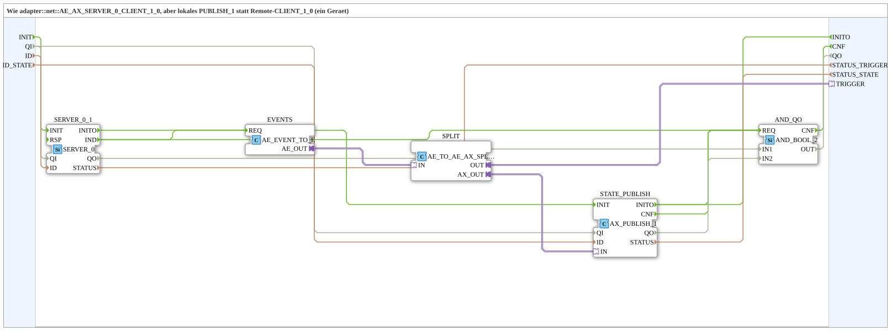

# AE_AX_SERVER_0_PUBLISH_1

* * * * * * * * * *

## Einleitung

`AE_AX_SERVER_0_PUBLISH_1` ist die lokale Variante von [`adapter::net::AE_AX_SERVER_0_CLIENT_1_0`](../../adapter/net/AE_AX_SERVER_0_CLIENT_1_0.md): statt eines Remote-`CLIENT_1_0` schreibt ein lokales `AX_PUBLISH_1` (ein Gerät). Der Baustein empfängt einen OPC-UA-Methodenaufruf über `SERVER_0` und veröffentlicht den resultierenden Zustand lokal; beides liegt hinter einem einzigen bidirektionalen `AE_AX`-Adapter-Plug `TRIGGER`. Intern sitzen Adapter-Konverter (`AE_EVENT_TO_E`, `AE_TO_AE_AX_SPLIT`) und `AX_PUBLISH_1`, weil eine SubApp die Pins eines Schnittstellen-Adapters nicht direkt nutzen kann. Der Baustein ist als SubAppType angelegt, damit FORTE den Typ nicht kennen muss (kein ELF für MyLib_AX).

## Schnittstellenstruktur

### **Ereignis-Eingänge**

- `INIT` (EInit): Initialisierung

### **Ereignis-Ausgänge**

- `INITO` (EInit): Initialisierungsbestätigung
- `CNF` (Event): `QO`/`STATUS` aktualisiert

### **Daten-Eingänge**

| Variable | Typ | Kommentar |
|----------|-----|-----------|
| `QI` | BOOL | Qualifier für alle internen Netzbausteine |
| `ID` | WSTRING | Lokale Methodenadresse (`ACTION=CREATE_METHOD`) für den Trigger-Methodenaufruf (`SERVER_0_1`) |
| `ID_STATE` | WSTRING | Lokale Adresse (`ACTION=WRITE`) für den Zustand (`STATE_PUBLISH`) |

### **Daten-Ausgänge**

| Variable | Typ | Kommentar |
|----------|-----|-----------|
| `QO` | BOOL | TRUE nur, wenn `SERVER_0_1` und `STATE_PUBLISH` aktuell alle `QO = TRUE` melden |
| `STATUS_TRIGGER` | WSTRING | `STATUS` von `SERVER_0_1` |
| `STATUS_STATE` | WSTRING | `STATUS` von `STATE_PUBLISH` |

### **Adapter**

| Adapter | Typ | Richtung | Kommentar |
|---------|-----|----------|-----------|
| `TRIGGER` | `adapter::types::bidirectional::AE_AX` | Plug | Trigger (ein), Zustand (aus) |

## Verwendete Funktionsbausteine (FBs)

- **SERVER_0_1** (`iec61499::net::SERVER_0`): empfängt den Trigger-Methodenaufruf (`IND`)
- **EVENTS** (`adapter::conversion::unidirectional::AE_EVENT_TO_E`): Adapter-Konverter, setzt die `IND`-Ereignisse auf den Adapter; siehe [AE_EVENT_TO_E](../../adapter/conversion/unidirectional/EVENT/AE_EVENT_TO_E.md)
- **SPLIT** (`adapter::events::bidirectional::AE_TO_AE_AX_SPLIT`): teilt den Adapter in `OUT` (zum Plug `TRIGGER`) und `AX_OUT` (zum Zustands-Publish); siehe [AE_TO_AE_AX_SPLIT](../../adapter/events/bidirectional/AE_TO_AE_AX_SPLIT.md)
- **STATE_PUBLISH** (`adapter::net::AX_PUBLISH_1`): veröffentlicht den Zustand lokal; siehe [AX_PUBLISH_1](../../adapter/net/AX_PUBLISH_1.md)
- **AND_QO** (`iec61131::booleanOperators::AND_BOOL_2`): verundet die `QO`-Werte aller Netzbausteine

## Programmablauf und Verbindungen

1. `INIT` -> `SERVER_0_1.INIT`; `SERVER_0_1.INITO` -> `STATE_PUBLISH.INIT`; `STATE_PUBLISH.INITO` -> `INITO` (sequentielle Initialisierung).
2. `SERVER_0_1.IND` -> `SERVER_0_1.RSP` (Selbstschleife direkt am Server, siehe Regel unten).
3. `SERVER_0_1.IND` -> `EVENTS.REQ`.
4. `EVENTS.AE_OUT` -> `SPLIT.IN`; `SPLIT.OUT` -> `TRIGGER`; `SPLIT.AX_OUT` -> `STATE_PUBLISH.IN`.
5. `QI` -> `SERVER_0_1.QI` und `STATE_PUBLISH.QI`.
6. `ID` -> `SERVER_0_1.ID`, `ID_STATE` -> `STATE_PUBLISH.ID`.
7. `SERVER_0_1.QO` -> `AND_QO.IN1`; `STATE_PUBLISH.QO` -> `AND_QO.IN2`; `AND_QO.OUT` -> `QO`.
8. `STATE_PUBLISH.INITO`, `SERVER_0_1.IND` und `STATE_PUBLISH.CNF` -> `AND_QO.REQ`; `AND_QO.CNF` -> `CNF`.
9. `SERVER_0_1.STATUS` -> `STATUS_TRIGGER`, `STATE_PUBLISH.STATUS` -> `STATUS_STATE`.

## Technische Besonderheiten

- Die Adapter-Konverter sind nötig, weil eine SubApp die Pins eines Schnittstellen-Adapters nicht direkt nutzen kann: Der Konverter setzt die `IND`-Ereignisse auf den Adapter, der Split trennt den Plug-Anteil vom Zustandspfad zu `AX_PUBLISH_1`.
- Lokale Variante: `AX_PUBLISH_1` statt Remote-`CLIENT_1_0` (ein Gerät).
- `QO` ist nur TRUE, wenn alle 2 Netzbausteine `QO = TRUE` melden; jede Indikation und `STATE_PUBLISH.CNF` lösen zusätzlich `CNF` aus.
- **Regel `IND` → `RSP`**: Jeder `SERVER_0` braucht `IND` → `RSP` direkt am eigenen Baustein. Ohne `RSP` wartet FORTE in `onServerMethodCall` bis zu 4 s und hält dabei die globale Service-Sperre von open62541. In dieser Zeit stocken **alle** OPC-UA-Publishes der Station, nicht nur die der Methode. Die Reaktion der Anwendung hängt als zweite, unabhängige Verbindung am selben `IND`; `RSP` wird nie verzögert. Siehe [SERVER_0](../../../StandardLibraries/net/SERVER_0.md).

## Anwendungsszenarien

- Entgegennahme von OPC-UA-Methodenaufrufen mit lokaler Zustandsveröffentlichung auf einem einzigen Gerät, z. B. in lokalen Übungsaufbauten.
- Austausch gegen die gleichnamige `adapter::net`-Variante `AE_AX_SERVER_0_CLIENT_1_0` mit Remote-`CLIENT_1_0`, wenn zwei Geräte beteiligt sind.

## Vergleich mit ähnlichen Bausteinen

- **[AE_AX_SERVER_0_CLIENT_1_0](../../adapter/net/AE_AX_SERVER_0_CLIENT_1_0.md)**: gleiche Schnittstelle, aber Remote-`CLIENT_1_0` statt lokalem `AX_PUBLISH_1`.

## Zusammenfassung

`AE_AX_SERVER_0_PUBLISH_1` empfängt einen Methodenaufruf über `SERVER_0` und veröffentlicht den Zustand lokal über `AX_PUBLISH_1`, beides hinter einem `AE_AX`-Plug. Er ist die lokale Variante von `AE_AX_SERVER_0_CLIENT_1_0`.

---

### 🌐 Passende Themen-Unterseiten auf ms-muc-docs.de

- [🌐 Eclipse 4diac IDE & Farb-Referenz auf ms-muc-docs.de](https://www.ms-muc-docs.de/iec-61499/eclipse-4diac/)
