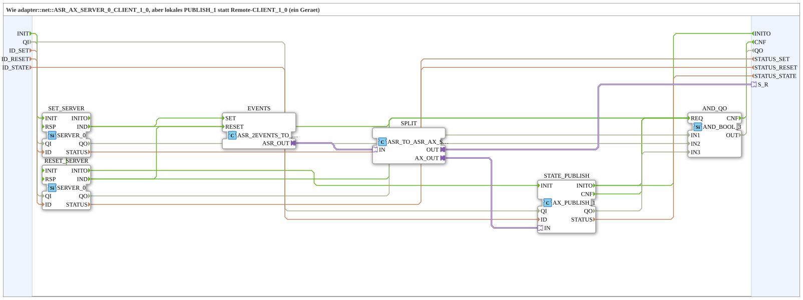

# ASR_AX_SERVER_0_PUBLISH_1

* * * * * * * * * *

## Einleitung

`ASR_AX_SERVER_0_PUBLISH_1` ist die lokale Variante von [`adapter::net::ASR_AX_SERVER_0_CLIENT_1_0`](../../adapter/net/ASR_AX_SERVER_0_CLIENT_1_0.md): statt eines Remote-`CLIENT_1_0` schreibt ein lokales `AX_PUBLISH_1` (ein Gerät). Der Baustein empfängt zwei OPC-UA-Methodenaufrufe über `SERVER_0` und veröffentlicht den resultierenden Zustand lokal; beides liegt hinter einem einzigen bidirektionalen `ASR_AX`-Adapter-Plug `S_R`. Intern sitzen Adapter-Konverter (`ASR_2EVENTS_TO_SR`, `ASR_TO_ASR_AX_SPLIT`) und `AX_PUBLISH_1`, weil eine SubApp die Pins eines Schnittstellen-Adapters nicht direkt nutzen kann. Der Baustein ist als SubAppType angelegt, damit FORTE den Typ nicht kennen muss (kein ELF für MyLib_AX).

## Schnittstellenstruktur

### **Ereignis-Eingänge**

- `INIT` (EInit): Initialisierung

### **Ereignis-Ausgänge**

- `INITO` (EInit): Initialisierungsbestätigung
- `CNF` (Event): `QO`/`STATUS` aktualisiert

### **Daten-Eingänge**

| Variable | Typ | Kommentar |
|----------|-----|-----------|
| `QI` | BOOL | Qualifier für alle internen Netzbausteine |
| `ID_SET` | WSTRING | Lokale Methodenadresse (`ACTION=CREATE_METHOD`) für den Set-Methodenaufruf (`SET_SERVER`) |
| `ID_RESET` | WSTRING | Lokale Methodenadresse (`ACTION=CREATE_METHOD`) für den Reset-Methodenaufruf (`RESET_SERVER`) |
| `ID_STATE` | WSTRING | Lokale Adresse (`ACTION=WRITE`) für den Zustand (`STATE_PUBLISH`) |

### **Daten-Ausgänge**

| Variable | Typ | Kommentar |
|----------|-----|-----------|
| `QO` | BOOL | TRUE nur, wenn `SET_SERVER`, `RESET_SERVER` und `STATE_PUBLISH` aktuell alle `QO = TRUE` melden |
| `STATUS_SET` | WSTRING | `STATUS` von `SET_SERVER` |
| `STATUS_RESET` | WSTRING | `STATUS` von `RESET_SERVER` |
| `STATUS_STATE` | WSTRING | `STATUS` von `STATE_PUBLISH` |

### **Adapter**

| Adapter | Typ | Richtung | Kommentar |
|---------|-----|----------|-----------|
| `S_R` | `adapter::types::bidirectional::ASR_AX` | Plug | Set/Reset (ein), Zustand (aus) |

## Verwendete Funktionsbausteine (FBs)

- **SET_SERVER** (`iec61499::net::SERVER_0`): empfängt den Set-Methodenaufruf (`IND`)
- **RESET_SERVER** (`iec61499::net::SERVER_0`): empfängt den Reset-Methodenaufruf (`IND`)
- **EVENTS** (`adapter::conversion::unidirectional::ASR_2EVENTS_TO_SR`): Adapter-Konverter, setzt die `IND`-Ereignisse auf den Adapter; siehe [ASR_2EVENTS_TO_SR](../../adapter/conversion/unidirectional/EVENT/ASR_2EVENTS_TO_SR.md)
- **SPLIT** (`adapter::events::bidirectional::ASR_TO_ASR_AX_SPLIT`): teilt den Adapter in `OUT` (zum Plug `S_R`) und `AX_OUT` (zum Zustands-Publish); siehe [ASR_TO_ASR_AX_SPLIT](../../adapter/events/bidirectional/ASR_TO_ASR_AX_SPLIT.md)
- **STATE_PUBLISH** (`adapter::net::AX_PUBLISH_1`): veröffentlicht den Zustand lokal; siehe [AX_PUBLISH_1](../../adapter/net/AX_PUBLISH_1.md)
- **AND_QO** (`iec61131::booleanOperators::AND_BOOL_3`): verundet die `QO`-Werte aller Netzbausteine

## Programmablauf und Verbindungen

1. `INIT` -> `SET_SERVER.INIT`; `SET_SERVER.INITO` -> `RESET_SERVER.INIT`; `RESET_SERVER.INITO` -> `STATE_PUBLISH.INIT`; `STATE_PUBLISH.INITO` -> `INITO` (sequentielle Initialisierung).
2. `SET_SERVER.IND` -> `SET_SERVER.RSP`, `RESET_SERVER.IND` -> `RESET_SERVER.RSP` (Selbstschleife direkt am Server, siehe Regel unten).
3. `SET_SERVER.IND` -> `EVENTS.SET`; `RESET_SERVER.IND` -> `EVENTS.RESET`.
4. `EVENTS.ASR_OUT` -> `SPLIT.IN`; `SPLIT.OUT` -> `S_R`; `SPLIT.AX_OUT` -> `STATE_PUBLISH.IN`.
5. `QI` -> `SET_SERVER.QI`, `RESET_SERVER.QI` und `STATE_PUBLISH.QI`.
6. `ID_SET` -> `SET_SERVER.ID`, `ID_RESET` -> `RESET_SERVER.ID`, `ID_STATE` -> `STATE_PUBLISH.ID`.
7. `SET_SERVER.QO` -> `AND_QO.IN1`; `RESET_SERVER.QO` -> `AND_QO.IN2`; `STATE_PUBLISH.QO` -> `AND_QO.IN3`; `AND_QO.OUT` -> `QO`.
8. `STATE_PUBLISH.INITO`, `SET_SERVER.IND`, `RESET_SERVER.IND` und `STATE_PUBLISH.CNF` -> `AND_QO.REQ`; `AND_QO.CNF` -> `CNF`.
9. `SET_SERVER.STATUS` -> `STATUS_SET`, `RESET_SERVER.STATUS` -> `STATUS_RESET`, `STATE_PUBLISH.STATUS` -> `STATUS_STATE`.

## Technische Besonderheiten

- Die Adapter-Konverter sind nötig, weil eine SubApp die Pins eines Schnittstellen-Adapters nicht direkt nutzen kann: Der Konverter setzt die `IND`-Ereignisse auf den Adapter, der Split trennt den Plug-Anteil vom Zustandspfad zu `AX_PUBLISH_1`.
- Lokale Variante: `AX_PUBLISH_1` statt Remote-`CLIENT_1_0` (ein Gerät).
- `QO` ist nur TRUE, wenn alle 3 Netzbausteine `QO = TRUE` melden; jede Indikation und `STATE_PUBLISH.CNF` lösen zusätzlich `CNF` aus.
- **Regel `IND` → `RSP`**: Jeder `SERVER_0` braucht `IND` → `RSP` direkt am eigenen Baustein. Ohne `RSP` wartet FORTE in `onServerMethodCall` bis zu 4 s und hält dabei die globale Service-Sperre von open62541. In dieser Zeit stocken **alle** OPC-UA-Publishes der Station, nicht nur die der Methode. Die Reaktion der Anwendung hängt als zweite, unabhängige Verbindung am selben `IND`; `RSP` wird nie verzögert. Siehe [SERVER_0](../../../StandardLibraries/net/SERVER_0.md).

## Anwendungsszenarien

- Entgegennahme von OPC-UA-Methodenaufrufen mit lokaler Zustandsveröffentlichung auf einem einzigen Gerät, z. B. in lokalen Übungsaufbauten.
- Austausch gegen die gleichnamige `adapter::net`-Variante `ASR_AX_SERVER_0_CLIENT_1_0` mit Remote-`CLIENT_1_0`, wenn zwei Geräte beteiligt sind.

## Vergleich mit ähnlichen Bausteinen

- **[ASR_AX_SERVER_0_CLIENT_1_0](../../adapter/net/ASR_AX_SERVER_0_CLIENT_1_0.md)**: gleiche Schnittstelle, aber Remote-`CLIENT_1_0` statt lokalem `AX_PUBLISH_1`.

## Zusammenfassung

`ASR_AX_SERVER_0_PUBLISH_1` empfängt zwei Methodenaufrufe über `SERVER_0` und veröffentlicht den Zustand lokal über `AX_PUBLISH_1`, beides hinter einem `ASR_AX`-Plug. Er ist die lokale Variante von `ASR_AX_SERVER_0_CLIENT_1_0`.

---

### 🌐 Passende Themen-Unterseiten auf ms-muc-docs.de

- [🌐 Eclipse 4diac IDE & Farb-Referenz auf ms-muc-docs.de](https://www.ms-muc-docs.de/iec-61499/eclipse-4diac/)
