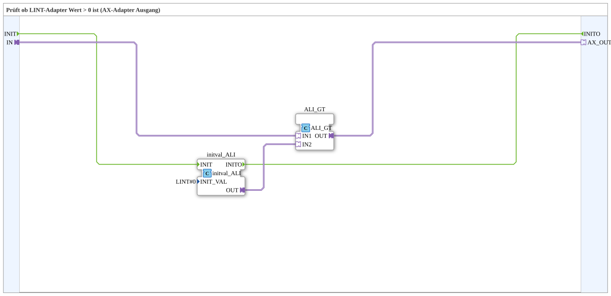

# ALI_GT_0

* * * * * * * * * *

## Einleitung

`ALI_GT_0` prüft, ob ein LINT-Adapter-Wert größer als 0 ist, und gibt das Ergebnis als boolesches AX-Adapter-Signal aus. Typischer Eingangswert ist ein vorzeichenbehafteter 64-Bit-Wert. Der Baustein ist für jeden Zahlentyp gleich aufgebaut (`AS`, `AI`, `ADI`, `ALI`, `AUS`, `AUI`, `AUDI`, `AULI`, `AR`, `ALR`).

## Schnittstelle

- **Ereignis-Eingang**: `INIT` (Initialisierung)
- **Ereignis-Ausgang**: `INITO` (Initialisierung abgeschlossen, kommt vom internen `initval_ALI`)
- **Sockel**: `IN` (`ALI`) — der Wert, der gegen 0 verglichen wird
- **Stecker**: `AX_OUT` (`AX`) — TRUE, wenn `IN > 0`

## Verwendete Funktionsbausteine (FBs)

### Sub-Bausteine: ALI_GT_0

- **Typ**: SubAppType
- **Verwendete interne FBs**:
    - **initval_ALI**: `adapter::types::unidirectional::ALI::initval::initval_ALI` — liefert die feste Vergleichskonstante `LINT#0` als Adapter-Wert (`INIT_VAL=LINT#0`). Ein Adapter-Sockel kann die Konstante nicht als Parameter bekommen, deshalb wird sie über diesen Baustein eingespeist.
    - **ALI_GT**: `adapter::iec61131::comparison::ALI_GT` — adapter-nativer Vergleich `IN1 > IN2`.
- **Funktionsweise**: `IN` → `ALI_GT.IN1`; Konstante 0 → `ALI_GT.IN2`; Ergebnis → `AX_OUT`.

## Programmablauf und Verbindungen

1. `INIT` → `initval_ALI.INIT`; `initval_ALI.INITO` → `INITO`.
2. `IN` (Adapter) → `ALI_GT.IN1`.
3. `initval_ALI.OUT` (Konstante `LINT#0`) → `ALI_GT.IN2`.
4. `ALI_GT.OUT` → `AX_OUT` (Adapter).

## Anwendungsszenarien

- Umwandlung von ein vorzeichenbehafteter 64-Bit-Wert in ein einfaches boolesches Adapter-Signal für VT-Statusanzeigen oder Freigabelogik.

## Zusammenfassung

`ALI_GT_0` ist ein kompakter Wrapper um den adapter-nativen Vergleich `ALI_GT` — wandelt „LINT > 0“ direkt in ein AX-Adapter-Signal um, ohne dass der Aufrufer die Null-Konstante selbst anlegen und verdrahten muss.

---

### 🌐 Passende Themen-Unterseiten auf ms-muc-docs.de

- [🌐 Eclipse 4diac IDE & Farb-Referenz auf ms-muc-docs.de](https://www.ms-muc-docs.de/iec-61499/eclipse-4diac/)
