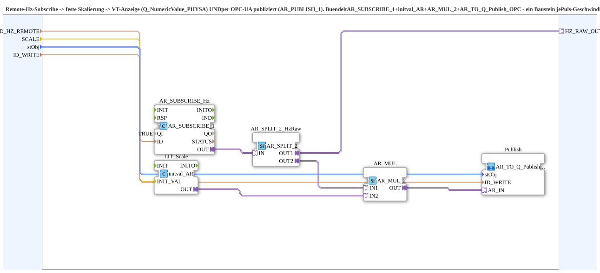

# AR_HZ_TO_Q_Publish_OPC

* * * * * * * * * *

## Einleitung

`AR_HZ_TO_Q_Publish_OPC` bündelt die Kette **Remote-Subscribe einer Frequenz (Hz) → feste Skalierung → VT-Anzeige (`Q_NumericValue_PHYSA`) und OPC-UA-Publish** zu einer wiederverwendbaren SubApp. Sie fasst `AR_SUBSCRIBE_1`, `initval_AR`, `AR_MUL_2` und `AR_TO_Q_Publish_OPC` zusammen – ein Baustein je Puls-Geschwindigkeits-/Drehzahlsensor (Aufnahme B03, Igelband1/2 B10/B11, Sägeblatt B08), nur die Parameter unterscheiden sich. Sie wurde aus `Inputs_STG1.SUB` herausgelöst, wo vier nahezu identische Ketten existierten.

## Schnittstellenstruktur

### **Ereignis-Eingänge**

*Keine direkten Ereignis-Eingänge vorhanden*

### **Ereignis-Ausgänge**

*Keine direkten Ereignis-Ausgänge vorhanden*

### **Daten-Eingänge**

- **ID_HZ_REMOTE** (`WSTRING`): Remote-Subscribe-Adresse der publizierten Frequenz (Hz), z. B. `FBs::Ventilsteuerung::Ventilsteuerung_STG1::RemoteSubStrings::AUFNAHME_GESCHWINDIGKEIT_HZ_REMOTE`
- **SCALE** (`REAL`): Skalierungsfaktor Hz → physikalische Einheit (z. B. `3.6/53` für km/h, `60.0` für U/min bei 1 Impuls/Umdrehung)
- **stObj** (`logiBUS::utils::conversion::phys::NumericObjectPool_S`): Object-Pool-Eigenschaften der VT-Zahlenvariable (`u16ObjId`, `scale`, `offset`, `decimals`), z. B. `FBs::const::DefaultPool_Numeric::NumberVariable_X_N`
- **ID_WRITE** (`WSTRING`): Lokale Publish-Adresse (REAL, physikalischer Wert) für Web-Mirror/Dashboard/Self-Subscribe

### **Daten-Ausgänge**

*Keine Daten-Ausgänge vorhanden*

### **Adapter**

- **HZ_RAW_OUT** (Plug): Unidirektionaler Adapter vom Typ `adapter::types::unidirectional::AR` – optionaler Nur-Lese-Spiegel des noch unskalierten Rohwerts (Hz) vor der `SCALE`-Multiplikation. Unverdrahtet lassen, wenn nicht gebraucht.

## Verwendete Funktionsbausteine (FBs)

- **AR_SUBSCRIBE_Hz**: [`adapter::net::AR_SUBSCRIBE_1`](../../adapter/net/AR_SUBSCRIBE_1.md) (`QI=TRUE`), abonniert die Remote-Adresse `ID_HZ_REMOTE`
- **LIT_Scale**: `adapter::types::unidirectional::AR::initval::initval_AR`, liefert `SCALE` als AR-Wert
- **AR_SPLIT_2_HzRaw**: [`adapter::events::unidirectional::AR_SPLIT_2`](../../adapter/events/unidirectional/REAL/AR_SPLIT_2.md), verzweigt den Rohwert
- **AR_MUL**: [`adapter::iec61131::arithmetic::AR_MUL_2`](../../adapter/iec61131-3/arithmetic/AR_MUL_2.md), multipliziert Rohwert mit `SCALE`
- **Publish**: SubApp `MyLib::sys::AR_TO_Q_Publish_OPC`, zeigt den Wert im VT an (`stObj`) und publiziert ihn per OPC-UA (`ID_WRITE`)

## Programmablauf und Verbindungen

1. `ID_HZ_REMOTE` → `AR_SUBSCRIBE_Hz.ID`; der Ausgang `AR_SUBSCRIBE_Hz.OUT` führt auf `AR_SPLIT_2_HzRaw.IN`.
2. `AR_SPLIT_2_HzRaw.OUT1` → Plug `HZ_RAW_OUT` (unskalierter Rohwert, optional).
3. `AR_SPLIT_2_HzRaw.OUT2` → `AR_MUL.IN1`; `SCALE` → `LIT_Scale.INIT_VAL`, `LIT_Scale.OUT` → `AR_MUL.IN2`.
4. `AR_MUL.OUT` → `Publish.AR_IN`.
5. `stObj` → `Publish.stObj`, `ID_WRITE` → `Publish.ID_WRITE`.

## Technische Besonderheiten

- **`HZ_RAW_OUT` (Version 1.1)**: Der optionale Plug spiegelt den Rohwert (Hz) für eine Diagnose-Anzeige, ohne einen zweiten eigenständigen Remote-Subscribe desselben Knotens zu benötigen (FORTE meldet bei doppeltem Self-Subscribe `Cannot add another one`).
- Reine Verdrahtung vorhandener Bausteine, keine eigene Logik.

## Anwendungsszenarien

- Anzeige und Publizieren von Geschwindigkeit bzw. Drehzahl aus einem Pulssensor-Frequenzwert (z. B. Aufnahme, Igelbänder, Sägeblatt)

## Fazit

`AR_HZ_TO_Q_Publish_OPC` ersetzt die vierfach duplizierte Kette aus Subscribe, Skalierung und Publish durch einen einzigen parametrierbaren Baustein.
