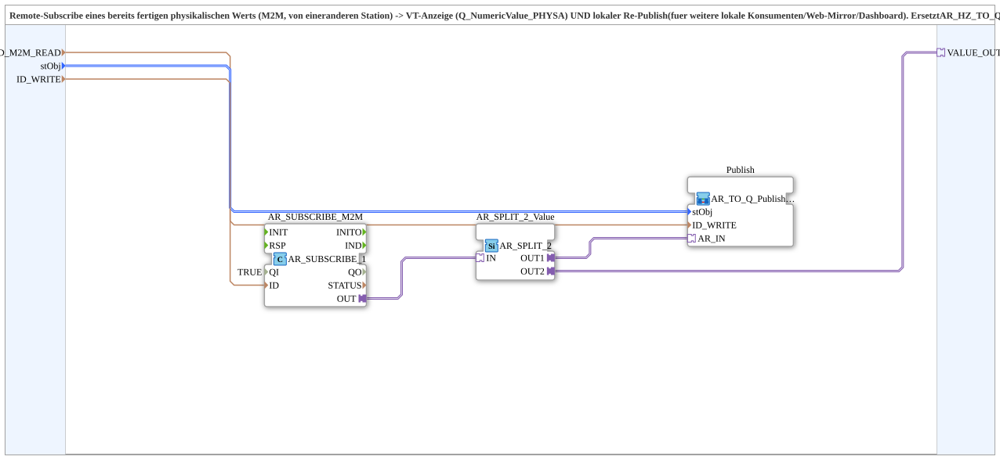

# AR_M2M_Subscribe_TO_Q_Publish_OPC

* * * * * * * * * *

## Einleitung

`AR_M2M_Subscribe_TO_Q_Publish_OPC` abonniert einen bereits fertig umgerechneten physikalischen Wert (REAL) per OPC-UA von einer anderen Station (M2M), zeigt ihn auf dem VT an (`Q_NumericValue_PHYSA`) und publiziert ihn lokal erneut, damit weitere lokale Konsumenten, Web-Mirror oder Dashboard ihn lesen können. Zusätzlich steht der Wert am Plug `VALUE_OUT` für lokale Adapter-Konsumenten bereit. Der Baustein ist die schlanke Nachfolgevariante von `AR_HZ_TO_Q_Publish_OPC` ohne eigene Skalierung, weil die Hz-zu-Einheit-Umrechnung inzwischen auf der Sensor-Station läuft (siehe [`logiBUS_PI_Speed_Publish_OPC`](logiBUS_PI_Speed_Publish_OPC.md)).

## Schnittstellenstruktur

### **Ereignis-Eingänge**

Der Funktionsblock verfügt über keine direkten Ereignis-Eingänge.

### **Ereignis-Ausgänge**

Der Funktionsblock verfügt über keine direkten Ereignis-Ausgänge.

### **Daten-Eingänge**

- **ID_M2M_READ** (WSTRING): Remote-Subscribe-Adresse des fertigen physikalischen Werts (REAL), z. B. `FBs::Ventilsteuerung::Ventilsteuerung_STG1::RemoteSubStrings::AUFNAHME_GESCHWINDIGKEIT_KMH_M2M`
- **stObj** (`logiBUS::utils::conversion::phys::NumericObjectPool_S`): Object-Pool-Eigenschaften der VT-Zahlenvariable (`u16ObjId`, Skalierung, Offset, Nachkommastellen), z. B. `FBs::const::DefaultPool_Numeric::NumberVariable_X_N`
- **ID_WRITE** (WSTRING): lokale Publish-Adresse (REAL, physikalischer Wert) für Web-Mirror, Dashboard und Self-Subscribe weiterer lokaler Konsumenten

### **Daten-Ausgänge**

Der Funktionsblock verfügt über keine direkten Daten-Ausgänge.

### **Adapter**

- **VALUE_OUT** (Plug, `adapter::types::unidirectional::AR`): Nur-Lese-Spiegel des remote abonnierten Werts für weitere lokale Konsumenten; vermeidet einen doppelten OPC-UA-Self-Subscribe desselben Remote-Knotens auf dieser Station

## Funktionsweise

Das Netzwerk besteht aus drei Teilen:

- `AR_SUBSCRIBE_M2M` (`adapter::net::AR_SUBSCRIBE_1`, Parameter `QI = TRUE`): abonniert die Adresse `ID_M2M_READ` (`ID_M2M_READ` → `AR_SUBSCRIBE_M2M.ID`) und gibt den Wert als AR-Adapter aus.
- `AR_SPLIT_2_Value` (`adapter::events::unidirectional::AR_SPLIT_2`): verteilt den abonnierten Wert auf zwei Ziele (`AR_SUBSCRIBE_M2M.OUT` → `AR_SPLIT_2_Value.IN`).
- `Publish` (`MyLib::sys::AR_TO_Q_Publish_OPC`): zeigt den Wert am VT an und publiziert ihn lokal (`AR_SPLIT_2_Value.OUT1` → `Publish.AR_IN`, `stObj` → `Publish.stObj`, `ID_WRITE` → `Publish.ID_WRITE`).

`AR_SPLIT_2_Value.OUT2` wird auf den Plug `VALUE_OUT` geführt.

## Technische Besonderheiten

- Kein `SCALE`/`AR_MUL_2` mehr: Der abonnierte Wert liegt bereits in der physikalischen Einheit vor
- Der `AR_SPLIT_2` vor `Publish.AR_IN` wurde eingefügt, statt `AR_SUBSCRIBE_M2M.OUT` direkt zu verdrahten, damit ein Adapter nie ohne Split verzweigt wird
- `VALUE_OUT` liefert den abonnierten Wert für Verbraucher wie Befüllautomatik oder Füllband-Erkennung, ohne einen zweiten Subscribe auf denselben Remote-Knoten anzulegen

## Anwendungsszenarien

- Anzeige eines von einer anderen Station gemessenen Werts (z. B. Geschwindigkeit) am VT und gleichzeitige lokale Bereitstellung für Dashboard und Web-Client
- Weitergabe des Remote-Werts an lokale Regel- oder Automatik-Bausteine über `VALUE_OUT`

## Fazit

Der Baustein bündelt Remote-Subscribe, VT-Anzeige und lokalen Re-Publish eines fertigen physikalischen Werts in einer SubApp und stellt den Wert zusätzlich als AR-Plug bereit.
