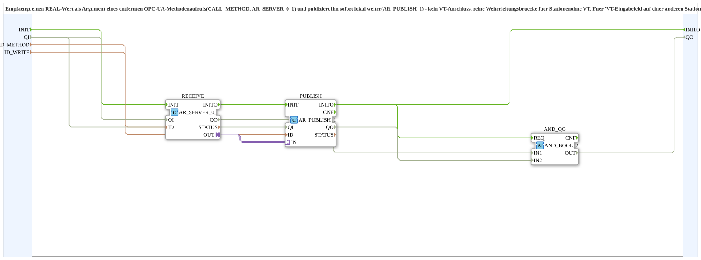

# AR_SERVER_0_1_TO_Publish_OPC

* * * * * * * * * *

## Einleitung

`AR_SERVER_0_1_TO_Publish_OPC` empfängt einen `REAL`-Wert als Argument eines entfernten OPC-UA-Methodenaufrufs (`AR_SERVER_0_1`) und publiziert ihn sofort lokal weiter (`AR_PUBLISH_1`). Der Baustein hat keinen VT-Anschluss und ist eine reine Weiterleitungsbrücke für Stationen ohne VT: Ein VT-Eingabefeld auf einer anderen Station oder ein Web-Dashboard rufen dieselbe Methode auf – und zwar nur bei echter Eingabe. Typisches Beispiel sind Druck-Referenzwerte (B20).

## Verwendete Funktionsbausteine (FBs)

### Sub-Bausteine: AR_SERVER_0_1_TO_Publish_OPC

- **Typ**: SubAppType
- **Verwendete interne FBs**:
    - **RECEIVE**: `adapter::net::AR_SERVER_0_1` (`QI` von außen) – erzeugt die OPC-UA-Methode und liefert das empfangene `REAL`-Argument am Adapter `OUT`
    - **PUBLISH**: `adapter::net::AR_PUBLISH_1` (`QI` von außen) – publiziert den Wert unter der lokalen Adresse
    - **AND_QO**: `iec61131::booleanOperators::AND_BOOL_2` – verknüpft die `QO` von `RECEIVE` und `PUBLISH`
- **Funktionsweise**: Der Wert aus dem Methodenaufruf wird ohne Zwischenlogik direkt an den Publisher weitergegeben.

## Schnittstellenstruktur

### **Ereignis-Eingänge**

- **INIT** (`EInit`): Initialisierungsanforderung; geht an `RECEIVE.INIT`

### **Ereignis-Ausgänge**

- **INITO** (`EInit`): Initialisierung abgeschlossen; kommt von `PUBLISH.INITO`

### **Daten-Eingänge**

- **QI** (`BOOL`, Vorgabe `TRUE`): Quality Input - TRUE aktiviert den Dienst; geht an `RECEIVE.QI` und `PUBLISH.QI`
- **ID_METHOD** (`WSTRING`): Lokal erzeugte OPC-UA-Methode (`ACTION=CREATE_METHOD`, 1 `REAL`-Argument) – von einer anderen Station (`AR_CLIENT_1_0`) und/oder direkt vom OPC-Dashboard aufrufbar
- **ID_WRITE** (`WSTRING`): Lokale Publish-Adresse (`REAL`, `ACTION=PUBLISH`) für den empfangenen Wert – typischerweise von einem lokalen Self-Subscribe gegengelesen

### **Daten-Ausgänge**

- **QO** (`BOOL`): Quality Output - TRUE, wenn der Dienst erfolgreich ausgeführt wurde (AND aus `RECEIVE.QO` und `PUBLISH.QO`)

## Programmablauf und Verbindungen

- `ID_METHOD` → `RECEIVE.ID`
- `ID_WRITE` → `PUBLISH.ID`
- `INIT` → `RECEIVE.INIT`
- `RECEIVE.INITO` → `PUBLISH.INIT` (Der Publisher wird initialisiert, sobald die Methode angelegt ist)
- `PUBLISH.INITO` → `INITO` und → `AND_QO.REQ`
- `QI` → `RECEIVE.QI` und `PUBLISH.QI`
- `RECEIVE.QO` → `AND_QO.IN1`, `PUBLISH.QO` → `AND_QO.IN2`, `AND_QO.OUT` → `QO`
- `RECEIVE.OUT` → `PUBLISH.IN` (Adapterverbindung des `REAL`-Wertes)

## Technische Besonderheiten

- Kein VT-Anschluss: gedacht für Sensor-Stationen ohne eigene VT (z. B. STG4), die dennoch editierbare Referenzwerte von einer anderen Station (VT) oder vom Dashboard entgegennehmen sollen
- Die Methode wird nur bei echter Eingabe aufgerufen, es gibt keinen zyklischen Abgleich
- Version 1.0 (2026-09-23): bündelt `AR_SERVER_0_1` (Empfang) und `AR_PUBLISH_1` (lokale Weiterleitung)

## Anwendungsszenarien

- Druck-Referenzwerte (B20) einer Station ohne VT, die von einer anderen Station oder vom Web-Dashboard gesetzt werden
- Allgemein: Entgegennahme eines `REAL`-Sollwerts per OPC-UA-Methodenaufruf und lokale Bereitstellung als Publish-Wert

## Zusammenfassung

`AR_SERVER_0_1_TO_Publish_OPC` kapselt `AR_SERVER_0_1` und `AR_PUBLISH_1` zu einer Weiterleitungsbrücke, die einen per OPC-UA-Methode empfangenen `REAL`-Wert lokal weiter publiziert.
