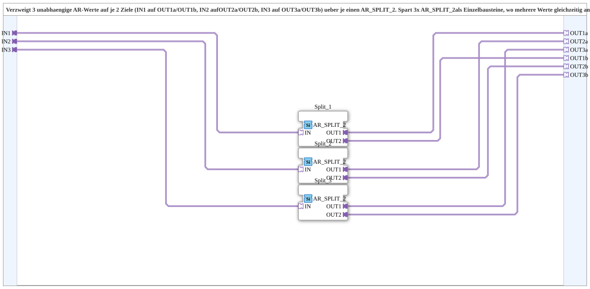

# AR_SPLIT_2_3

* * * * * * * * * *

## Einleitung

`AR_SPLIT_2_3` verzweigt **drei unabhängige AR-Werte** auf je zwei Ziele (`IN1` → `OUT1a`/`OUT1b`, `IN2` → `OUT2a`/`OUT2b`, `IN3` → `OUT3a`/`OUT3b`) über je einen [`AR_SPLIT_2`](../../adapter/events/unidirectional/REAL/AR_SPLIT_2.md). Sie spart drei einzelne `AR_SPLIT_2`-Bausteine, wenn mehrere Werte gleichzeitig an zwei unabhängige Verbraucher verteilt werden müssen (z. B. Schwelle/Totzone/Hysterese an Regel-Logik und an Positions-/Anzeige-Logik, wie in der Befüllautomatik).

## Schnittstellenstruktur

### **Ereignis-Eingänge**

*Keine direkten Ereignis-Eingänge vorhanden – Ereignisse kommen über die Adapter-Sockets/-Plugs*

### **Ereignis-Ausgänge**

*Keine direkten Ereignis-Ausgänge vorhanden*

### **Daten-Eingänge**

*Keine Daten-Eingänge vorhanden*

### **Daten-Ausgänge**

*Keine Daten-Ausgänge vorhanden*

### **Adapter**

Alle Adapter sind unidirektional vom Typ `adapter::types::unidirectional::AR`.

- **IN1** (Socket): wird auf `OUT1a` und `OUT1b` verzweigt
- **IN2** (Socket): wird auf `OUT2a` und `OUT2b` verzweigt
- **IN3** (Socket): wird auf `OUT3a` und `OUT3b` verzweigt
- **OUT1a**, **OUT2a**, **OUT3a** (Plugs): jeweils erstes Ziel von `IN1`/`IN2`/`IN3`
- **OUT1b**, **OUT2b**, **OUT3b** (Plugs): jeweils zweites Ziel von `IN1`/`IN2`/`IN3`

## Verwendete Funktionsbausteine (FBs)

- **Split_1**, **Split_2**, **Split_3**: je `adapter::events::unidirectional::AR_SPLIT_2`

## Programmablauf und Verbindungen

- `IN1` → `Split_1.IN`; `Split_1.OUT1` → `OUT1a`; `Split_1.OUT2` → `OUT1b`
- `IN2` → `Split_2.IN`; `Split_2.OUT1` → `OUT2a`; `Split_2.OUT2` → `OUT2b`
- `IN3` → `Split_3.IN`; `Split_3.OUT1` → `OUT3a`; `Split_3.OUT2` → `OUT3b`

Die drei Zweige sind vollständig voneinander unabhängig.

## Anwendungsszenarien

- Verteilung mehrerer Parameter (Schwelle, Totzone, Hysterese) an zwei unabhängige Verbraucher gleichzeitig

## Fazit

`AR_SPLIT_2_3` bündelt drei `AR_SPLIT_2` in einer SubApp und hält so das Netzwerk des aufrufenden Bausteins übersichtlich.
