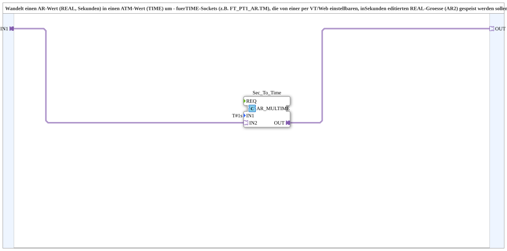

# AR_S_TO_ATM

* * * * * * * * * *

## Einleitung

`AR_S_TO_ATM` wandelt einen `AR`-Wert (REAL, Sekunden) in einen `ATM`-Wert (TIME) um. Er wird für TIME-Sockets (z. B. `FT_PT1_AR.TM`) benötigt, die von einer per VT oder Web einstellbaren, in Sekunden editierten REAL-Größe (AR2) gespeist werden sollen.

## Schnittstellenstruktur

### **Ereignis-Eingänge**

Der Funktionsblock verfügt über keine direkten Ereignis-Eingänge.

### **Ereignis-Ausgänge**

Der Funktionsblock verfügt über keine direkten Ereignis-Ausgänge.

### **Daten-Eingänge**

Der Funktionsblock verfügt über keine direkten Daten-Eingänge.

### **Daten-Ausgänge**

Der Funktionsblock verfügt über keine direkten Daten-Ausgänge.

### **Adapter**

- **IN1** (Socket, `adapter::types::unidirectional::AR`): Zeit in Sekunden (REAL)
- **OUT** (Plug, `adapter::types::unidirectional::ATM`): `IN1`, umgerechnet von Sekunden (REAL) auf TIME

## Funktionsweise

Intern arbeitet eine einzige Instanz `Sec_To_Time` des Typs `adapter::iec61131::arithmetic::AR_MULTIME` mit dem Parameter `IN1 = T#1s`. Der Socket `IN1` wird auf `Sec_To_Time.IN2` geführt, das Ergebnis `Sec_To_Time.OUT` auf den Plug `OUT`. Damit gilt `OUT = T#1s * IN1`, also echte IEC-61131-3-TIME-Arithmetik: Ein Eingang von `2.5` ergibt `T#2s500ms`.

## Technische Besonderheiten

- Frühere Variante (`AR_R_MUL` × 1000 → `AR_TO_ADI` → `ADI_TO_ATM`) wurde ersetzt, weil sie auf einer nicht existierenden Funktion `iec61131::conversion::F_DINT_TO_TIME` beruhte
- Zustandslos; Ereignisse laufen über die Adapter (`E1` von `IN1` löst die Berechnung aus)

## Anwendungsszenarien

- Einstellbare PT1-Filterzeit der Puls-Frequenz-Sensoren (siehe [`logiBUS_PI_Speed_Publish_OPC`](logiBUS_PI_Speed_Publish_OPC.md)): in Sekunden editiert, als TIME an `FT_PT1_AR.TM` geführt
- Jede Stelle, an der eine in Sekunden eingegebene Größe an einen TIME-Socket übergeben werden muss

## Fazit

`AR_S_TO_ATM` ist eine kleine Adapter-SubApp, die Sekunden-Werte per `T#1s * Sekunden` in TIME umrechnet.
