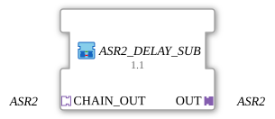

# ASR2_DELAY_SUB

* * * * * * * * * *

## Einleitung

`ASR2_DELAY_SUB` ist `ASR2_DELAY` mit fest verdrahteten Verzögerungszeiten: Die vier Zeiten (Set und Reset, jeweils vorwärts und rückwärts) werden über `initval_ATM`-Instanzen vorbelegt, sodass der Baustein ohne eigene Zeitverdrahtung als Verzögerungsglied in eine ASR2-Kette eingehängt werden kann.

## Schnittstellenstruktur

### **Ereignis-Eingänge**

Der Funktionsblock verfügt über keine direkten Ereignis-Eingänge.

### **Ereignis-Ausgänge**

Der Funktionsblock verfügt über keine direkten Ereignis-Ausgänge.

### **Daten-Eingänge**

Der Funktionsblock verfügt über keine direkten Daten-Eingänge.

### **Daten-Ausgänge**

Der Funktionsblock verfügt über keine direkten Daten-Ausgänge.

### **Adapter**

- **CHAIN_OUT** (Socket, `adapter::types::bidirectional::ASR2`): Eingang der Kette; auf `ASR2_DELAY.IN` geführt
- **OUT** (Plug, `adapter::types::bidirectional::ASR2`): verzögerte Kette; kommt von `ASR2_DELAY.OUT`

## Funktionsweise

Das Netzwerk besteht aus einer `ASR2_DELAY`-Instanz (`adapter::events::bidirectional::ASR2_DELAY`) und vier `initval_ATM`-Instanzen (`adapter::types::unidirectional::ATM::initval::initval_ATM`):

- `CHAIN_OUT` → `ASR2_DELAY.IN` und `ASR2_DELAY.OUT` → `OUT`
- `initval_PT_SET_FWD.OUT` → `ASR2_DELAY.PT_SET_FWD`
- `initval_PT_SET_BWD.OUT` → `ASR2_DELAY.PT_SET_BWD`
- `initval_PT_RESET_FWD.OUT` → `ASR2_DELAY.PT_RESET_FWD`
- `initval_PT_RESET_BWD.OUT` → `ASR2_DELAY.PT_RESET_BWD`

Alle vier `initval_ATM`-Instanzen sind mit `INIT_VAL = T#500ms` parametriert.

## Technische Besonderheiten

- Die Zeiten sind Platzhalter-Festwerte ohne funktionale Vorgabe und können bei Bedarf später parametrierbar gemacht werden; der Typkommentar nennt als Beispiel `T#2s`, die Instanzen sind aktuell auf `T#500ms` gesetzt
- Die Schnittstelle besteht nur aus dem Eingang `CHAIN_OUT` und dem Ausgang `OUT`; die `STOP_*`-Sockets von `ASR2_DELAY` bleiben in dieser SubApp unverdrahtet
- Zustandslos auf SubApp-Ebene; der Zustand (laufende Timer) liegt in `ASR2_DELAY`

## Anwendungsszenarien

- Zeitversetzte Ansteuerung von Ausgängen in einer Set/Reset-Kette (z. B. Bänder-Sequenzierung), wenn feste Verzögerungen genügen

## ⚖️ Vergleich mit ähnlichen Bausteinen

Für frei einstellbare Zeiten wird `ASR2_DELAY` direkt mit eigenen `ATM`-Quellen beschaltet; `ASR2_DELAY_SUB` kapselt dagegen die Festwerte. Für ein einzelnes Ereignis je Richtung siehe [`AE2_DELAY`](../../adapter/events/bidirectional/AE2_DELAY.md).

## Fazit

`ASR2_DELAY_SUB` ist ein Einhänge-Verzögerungsglied für ASR2-Ketten mit fest vorbelegten Zeiten.
