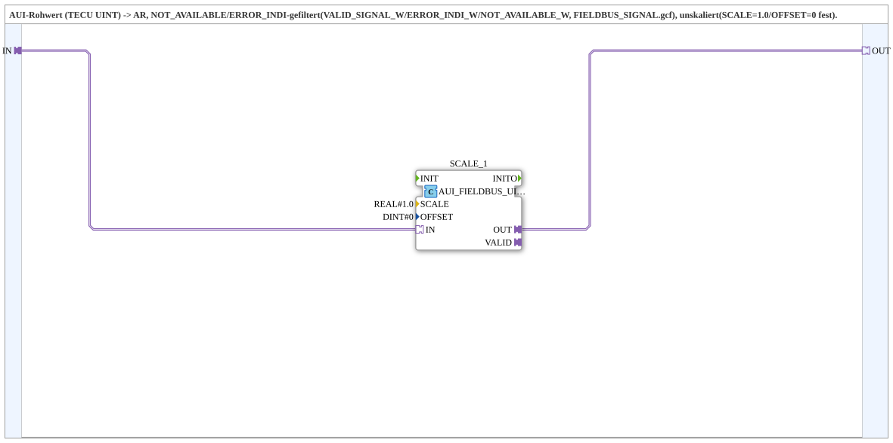

# AUI_FIELDBUS_UINT_TO_AR

* * * * * * * * * *

## Einleitung

`AUI_FIELDBUS_UINT_TO_AR` wandelt einen `AUI`-Rohwert (TECU, `UINT`) in einen `AR`-Wert um und filtert dabei die Feldbus-Sonderwerte `NOT_AVAILABLE` und `ERROR_INDI` heraus. Die Umrechnung erfolgt unskaliert (`SCALE = 1.0`, `OFFSET = 0` fest). Der Baustein wurde herausgelöst, weil dieselbe Parametrierung zuvor in `TECU_RPTO`, `TECU_FPTO`, `TECU_COGSOG`, `TECU_GBSD`, `TECU_WBSD`, `TECU_VDS`, `TECU_FHS` und `TECU_RHS` jedes Mal einzeln gesetzt wurde. Er liegt in `MyLib_AX::sys`, da er generisch und nicht TECU-spezifisch ist.

## Schnittstellenstruktur

### **Ereignis-Eingänge**

Keine.

### **Ereignis-Ausgänge**

Keine.

### **Daten-Eingänge**

Keine.

### **Daten-Ausgänge**

Keine.

### **Adapter**

- **IN** (Socket, `adapter::types::unidirectional::AUI`): TECU-Rohwert
- **OUT** (Plug, `adapter::types::unidirectional::AR`): `0.0` bei `NOT_AVAILABLE`/`ERROR_INDI`, sonst `IN` unskaliert

## Verwendete Funktionsbausteine (FBs)

- **`SCALE_1`** (`logiBUS::signalprocessing::fieldbus::AUI_FIELDBUS_UINT_TO_SIGNAL_SCALED`): Parameter `SCALE = 1.0`, `OFFSET = 0`

## Funktionsweise

`IN` → `SCALE_1.IN` und `SCALE_1.OUT` → `OUT`. Die Filterung der Feldbus-Sonderwerte (`VALID_SIGNAL_W`/`ERROR_INDI_W`/`NOT_AVAILABLE_W`, definiert in `FIELDBUS_SIGNAL.gcf`) übernimmt der interne Baustein; die SubApp legt nur Skalierung und Offset fest.

## Technische Besonderheiten

- Keine eigenen Ereignisse oder Daten-Ports, nur Adapter
- Fester Skalierungsfaktor 1.0 und Offset 0 (generische, unskalierte Variante)

## Anwendungsszenarien

- Übernahme von TECU-Rohwerten (z. B. Drehzahlen) aus dem Feldbus als `AR`-Signal ohne Skalierung

## Zusammenfassung

`AUI_FIELDBUS_UINT_TO_AR` kapselt `AUI_FIELDBUS_UINT_TO_SIGNAL_SCALED` mit `SCALE = 1.0`/`OFFSET = 0` als wiederverwendbare SubApp.

## 🛠️ Zugehörige Übungen

- [Uebung_078_AUI](https://meisterschulen-am-ostbahnhof-munchen-docs.readthedocs.io/projects/4diac-exercises-docs/de/latest/Uebungen/test_AX/Uebungen_doc/Uebung_078_AUI/)

---

### 🌐 Passende Themen-Unterseiten auf ms-muc-docs.de

- [🌐 Eclipse 4diac IDE & Farb-Referenz auf ms-muc-docs.de](https://www.ms-muc-docs.de/iec-61499/eclipse-4diac/)
