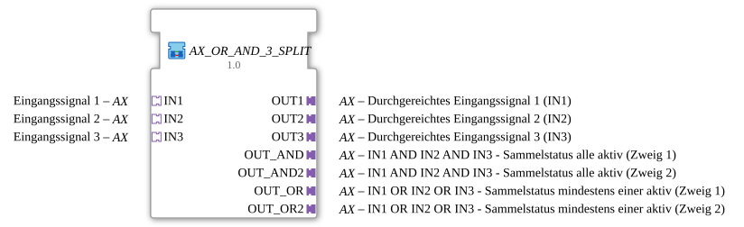

# AX_OR_AND_3_SPLIT

* * * * * * * * * *

## Einleitung

`AX_OR_AND_3_SPLIT` reicht **drei unabhängige AX-Signale** einzeln durch (`OUT1`/`OUT2`/`OUT3` = `IN1`/`IN2`/`IN3`) und verknüpft sie zusätzlich gemeinsam **UND** (`OUT_AND`/`OUT_AND2` = `IN1 AND IN2 AND IN3`) sowie **ODER** (`OUT_OR`/`OUT_OR2` = `IN1 OR IN2 OR IN3`). Die Sammelausgänge sind jeweils doppelt (Zweig 1/Zweig 2) ausgeführt.

## Schnittstellenstruktur

### **Ereignis-Eingänge**

*Keine direkten Ereignis-Eingänge vorhanden – Ereignisse kommen über die Adapter-Sockets/-Plugs*

### **Ereignis-Ausgänge**

*Keine direkten Ereignis-Ausgänge vorhanden*

### **Daten-Eingänge**

*Keine Daten-Eingänge vorhanden*

### **Daten-Ausgänge**

*Keine Daten-Ausgänge vorhanden*

### **Adapter**

Alle Adapter sind unidirektional vom Typ `adapter::types::unidirectional::AX`.

- **IN1**, **IN2**, **IN3** (Sockets): Eingangssignale 1 bis 3
- **OUT1**, **OUT2**, **OUT3** (Plugs): Durchgereichte Eingangssignale 1 bis 3
- **OUT_AND**, **OUT_AND2** (Plugs): `IN1 AND IN2 AND IN3` – Sammelstatus „alle aktiv“ (Zweig 1/Zweig 2)
- **OUT_OR**, **OUT_OR2** (Plugs): `IN1 OR IN2 OR IN3` – Sammelstatus „mindestens einer aktiv“ (Zweig 1/Zweig 2)

## Verwendete Funktionsbausteine (FBs)

- **Split1**, **Split2**, **Split3**: je `adapter::events::unidirectional::AX_SPLIT_3` (verzweigt jedes Eingangssignal auf drei Ziele)
- **AND_3**: `adapter::booleanOperators::AX_AND_3`
- **OR_3**: `adapter::booleanOperators::AX_OR_3`
- **Split_AND**, **Split_OR**: je `adapter::events::unidirectional::AX_SPLIT_2` (verdoppeln den jeweiligen Sammelausgang)

## Programmablauf und Verbindungen

- `INx` → `Splitx.IN`
- `Splitx.OUT1` → `OUTx` (Durchreichen)
- `Splitx.OUT2` → `AND_3.INx`
- `Splitx.OUT3` → `OR_3.INx`
- `AND_3.OUT` → `Split_AND.IN`; `Split_AND.OUT1` → `OUT_AND`, `Split_AND.OUT2` → `OUT_AND2`
- `OR_3.OUT` → `Split_OR.IN`; `Split_OR.OUT1` → `OUT_OR`, `Split_OR.OUT2` → `OUT_OR2`

(mit `x` = 1, 2, 3)

## Technische Besonderheiten

- Die UND- und ODER-Sammelausgänge sind aufgedoppelt (`AX_SPLIT_2`), damit je zwei Verbraucher versorgt werden können.

## Anwendungsszenarien

- Mehrere Statussignale (z. B. Bänder) einzeln weiterverwenden und zusätzlich einen gemeinsamen Status „alle aktiv“ bzw. „mindestens einer aktiv“ bilden

## Fazit

`AX_OR_AND_3_SPLIT` bündelt Durchreichen, UND- und ODER-Verknüpfung dreier AX-Signale in einer SubApp.
