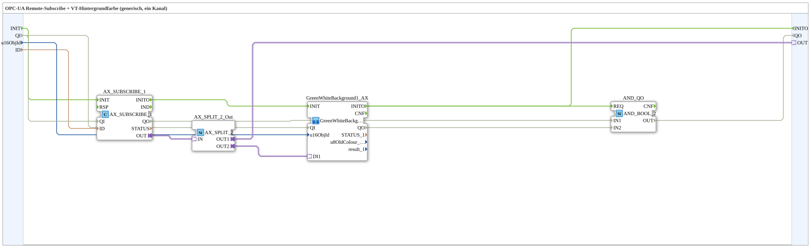

# AX_SUBSCRIBE_BG_OPC

* * * * * * * * * *

## Einleitung

Der Funktionsblock **AX_SUBSCRIBE_BG_OPC** ist eine Subapplikation, die eine OPC-UA-Remote-Subscription mit einer Hintergrundfarbsteuerung für Visualisierungselemente (VT) verbindet. Er dient dazu, über eine OPC-UA-Verbindung einen Datenwert zu empfangen und daraus die Hintergrundfarbe eines benannten Rechtecks in einer Visualisierung dynamisch anzupassen. Die Subapp ist generisch aufgebaut und unterstützt einen Kanal.

## Schnittstellenstruktur

Die Subapp besitzt den Ereigniseingang `INIT`, den Ereignisausgang `INITO`, die Dateneingänge `QI`, `u16ObjId` und `ID` sowie den Datenausgang `QO`; externe Adapter gibt es nicht. Die Verbindungen zu internen Bausteinen erfolgen über die eingebettete Netzwerkstruktur.

### **Ereignis-Eingänge**

- **INIT** (`EInit`): Initialisierungsanforderung; startet die Initialisierungskette `AX_SUBSCRIBE_1` → `GreenWhiteBackground1_AX`.

### **Ereignis-Ausgänge**

- **INITO** (`EInit`): Initialisierungsbestätigung; kommt von `GreenWhiteBackground1_AX.INITO`.

### **Daten-Eingänge**

| Name      | Typ     | Kommentar                                  |
|-----------|---------|--------------------------------------------|
| `QI`      | `BOOL`  | Quality Input, Freigabe des Dienstes (Initialwert `TRUE`) |
| `u16ObjId`| `UINT`  | Objekt-ID des Hintergrund-Rechtecks (VT)   |
| `ID`      | `WSTRING`| OPC-UA-Remote-Subscribe-Adresse            |

### **Daten-Ausgänge**

| Name | Typ    | Kommentar |
|------|--------|-----------|
| `QO` | `BOOL` | Quality Output, `AND` der `QO`-Ausgänge von `AX_SUBSCRIBE_1` und `GreenWhiteBackground1_AX` |

### **Adapter**

Extern sind keine Adapter angelegt. Innerhalb der Subapp wird ein Adapter vom Typ `adapter::net::AX_SUBSCRIBE_1` verwendet, dessen Ausgang `OUT` mit dem Eingang `DI1` der Subapp `GreenWhiteBackground1_AX` verbunden ist.

## Funktionsweise

Die Subapp kombiniert drei interne Komponenten:

1. **AX_SUBSCRIBE_1** – ein Adapter, der eine OPC-UA-Remote-Subscription abwickelt. Über den Dateneingang `ID` wird die OPC-UA-Adresse (z.B. eine Node-ID) bereitgestellt. Der Adapter empfängt fortlaufend Wertänderungen von dieser Adresse und stellt sie an seinem Ausgangs-Adapter `OUT` bereit.

2. **GreenWhiteBackground1_AX** – eine weitere Subapp, die die Hintergrundfarbe eines Visualisierungsobjekts (VT) steuert. Sie erhält über `u16ObjId` die Objekt-ID des Rechtecks und über den Adaptereingang `DI1` die empfangenen Datenwerte. Abhängig vom Wert wechselt sie zwischen einer grünen und einer weißen Hintergrundfarbe.

3. **AND_QO** – ein `iec61131::booleanOperators::AND_BOOL_2`, der die `QO`-Ausgänge von `AX_SUBSCRIBE_1` und `GreenWhiteBackground1_AX` zum SubApp-Ausgang `QO` verknüpft.

Durch die interne Verdrahtung wird der vom OPC-UA-Adapter gelieferte Wert direkt an die Hintergrundsteuerung weitergeleitet. Somit reagiert das Visualisierungselement unmittelbar auf Änderungen des OPC-UA-Datenpunkts.

**Initialisierung und Qualität:** `INIT` → `AX_SUBSCRIBE_1.INIT`, `AX_SUBSCRIBE_1.INITO` → `GreenWhiteBackground1_AX.INIT`, `GreenWhiteBackground1_AX.INITO` → `INITO` und → `AND_QO.REQ`. `QI` wird an `AX_SUBSCRIBE_1.QI` und `GreenWhiteBackground1_AX.QI` weitergereicht (kein fester `QI=TRUE` mehr im Subscribe-Baustein); `AX_SUBSCRIBE_1.QO` → `AND_QO.IN1`, `GreenWhiteBackground1_AX.QO` → `AND_QO.IN2`, `AND_QO.OUT` → `QO`.

## Technische Besonderheiten

- **OPC-UA-Integration**: Verwendet den Adapter `AX_SUBSCRIBE_1`, der für das Abonnement von OPC-UA-Variablen optimiert ist.
- **Wiederverwendbarkeit**: Die Subapp ist vollständig parametrierbar über die Eingänge `QI`, `u16ObjId` und `ID` und kann ohne Änderung der internen Logik in unterschiedlichen Visualisierungsprojekten eingesetzt werden.
- **Standardkonformität**: Basierend auf IEC 61499-2, gekennzeichnet durch das `<Identification>`-Tag.
- **Kompatibilität**: Einbettung in eine Bibliothek `MyLib::sys`; verweist auf das Const `isobus::UT::Q::const::IDs::ID_NULL` als Initialwert für `u16ObjId`.
- **INIT/INITO**: Die Initialisierung wird durch die Subapp gereicht (`INIT` → `AX_SUBSCRIBE_1` → `GreenWhiteBackground1_AX` → `INITO`); im laufenden Betrieb erfolgt die Verarbeitung rein daten- und adapterbasiert.

## Zustandsübersicht

Die Subapp selbst besitzt keinen eigenen Zustandsautomaten; ihr Verhalten wird vollständig durch die internen Bausteine bestimmt. Der Adapter `AX_SUBSCRIBE_1` verwaltet den Zustand der OPC-UA-Subscription (z.B. verbunden, verbindungslos, im Fehlerfall). Die Subapp `GreenWhiteBackground1_AX` realisiert einen einfachen Zwei-Zustands-Automat für die Hintergrundfarbe (grün/weiß), abhängig vom aktuellen Wert am Eingang.

## Anwendungsszenarien

- **Visualisierung von OPC-UA-Daten**: Anzeige von Maschinenzuständen (z.B. „Läuft" = grün, „Stopp" = weiß) in einem SCADA-System.
- **Echtzeit-Farbwechsel**: Dynamische Kennzeichnung von Prozesswerten basierend auf Schwellwerten oder booleschen Signalen.
- **Plug-and-Play-Komponente**: Einsatz in größeren Subapplikationen, bei denen eine einfache, generische OPC-UA-gesteuerte Hintergrundfärbung benötigt wird.

## Vergleich mit ähnlichen Bausteinen

Im Vergleich zu direkt verdrahteten Subscribe-Bausteinen (z.B. einem einzelnen `AX_SUBSCRIBE`-Funktionsblock) bietet diese Subapp eine höhere Abstraktion: Sie bündelt Subscription und Farbsteuerung in einer Einheit, sodass der Anwender nur noch Adresse und Objekt-ID angeben muss. Gegenüber alternativen Lösungen, die separate Blöcke für OPC-UA-Lesen und Farbwechsel vorsehen, reduziert sie den Verdrahtungsaufwand und erhöht die Wiederverwendbarkeit. Einschränkung: Sie ist auf einen einzigen Kanal ausgelegt, während andere Bausteine evtl. mehrere Kanäle unterstützen.

## Fazit

**AX_SUBSCRIBE_BG_OPC** ist eine kompakte Subapplikation, die OPC-UA-Datenabonnement und Visualisierungs-Hintergrundsteuerung nahtlos verbindet. Sie eignet sich hervorragend für Projekte, die eine schnelle und zuverlässige Farbkennzeichnung auf Basis von OPC-UA-Daten erfordern, ohne dass der Entwickler sich um die zugrunde liegende Kommunikation oder Zustandslogik kümmern muss. Durch die einfache Parametrierbarkeit und die klare Schnittstellenstruktur lässt sie sich unkompliziert in bestehende Anlagen integrieren.
