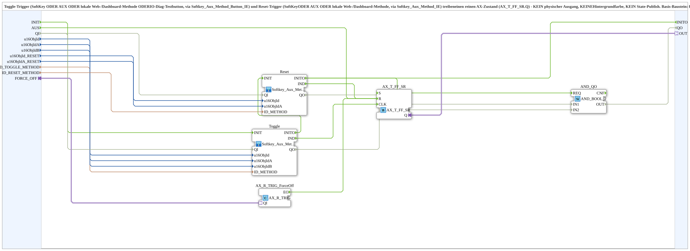

# AX_SoftkeyToggle_RS_TO_AX

* * * * * * * * * *

## Einleitung

`AX_SoftkeyToggle_RS_TO_AX` erzeugt einen reinen AX-Zustand aus einem Toggle-Trigger und einem Reset-Trigger. Der Toggle-Trigger kommt von SoftKey, AUX, einer lokalen Web-/Dashboard-Methode oder einem IO-Diag-Testbutton (über `Softkey_Aux_Method_Button_IE`), der Reset-Trigger von SoftKey, AUX oder einer lokalen Methode (über `Softkey_Aux_Method_IE`). Beide treiben ein `AX_T_FF_SR`, dessen Zustand am Plug `OUT` anliegt. Es gibt **keinen** physischen Ausgang, **keine** Hintergrundfarbe und **keinen** State-Publish; das bleibt dem Aufrufer überlassen.

## Schnittstellenstruktur

### **Ereignis-Eingänge**

- **INIT** (`EInit`): Initialisierungsanforderung
- **AUS**: setzt den Zustand hart auf AUS zurück, von außen als Ereignis (z. B. ein zentral gelesener gemeinsamer SoftKey 'Alles Aus'); zusätzlich zum eigenen Reset-Pfad über `u16ObjId_RESET`/`u16ObjIdA_RESET`/`ID_RESET_METHOD`. Unverdrahtet lassen, wenn nicht gebraucht.

### **Ereignis-Ausgänge**

- **INITO** (`EInit`): Initialisierungsbestätigung

### **Daten-Eingänge**

- **QI** (BOOL): Quality Input, TRUE gibt den Dienst frei (Default `TRUE`)
- **u16ObjId** (UINT): Object ID des SoftKeys Ein/Aus (Toggle), Default `ID_NULL`
- **u16ObjIdA** (UINT): Object ID der AuxFunction2 (Joystick) für den Toggle, gleichberechtigt zum SoftKey
- **u16ObjIdB** (UINT): Object ID des IO-Diag-Testbuttons (Ausgänge-Diagnoseseite), toggelt gleichberechtigt mit; `ID_NULL` lassen, wenn kein solcher Button beteiligt ist
- **u16ObjId_RESET** (UINT): Object ID des SoftKeys 'Alles Aus' (Reset, hart auf AUS)
- **u16ObjIdA_RESET** (UINT): Object ID der AuxFunction2 (Joystick) für den Reset, gleichberechtigt zum SoftKey 'Alles Aus'
- **ID_TOGGLE_METHOD** (WSTRING): lokale Methodenadresse (`ACTION=CREATE_METHOD`) für den argumentlosen Toggle-Trigger; wird vom Web-Client (vt-ui-mirror) und direkt vom OPC-Dashboard aufgerufen
- **ID_RESET_METHOD** (WSTRING): lokale Methodenadresse (`ACTION=CREATE_METHOD`) für den argumentlosen Reset-Trigger (hart auf AUS); wird vom Web-Client und vom OPC-Dashboard aufgerufen

### **Daten-Ausgänge**

- **QO** (BOOL): Quality Output, UND aus `Toggle.QO` und `Reset.QO`

### **Adapter**

- **OUT** (Plug, `adapter::types::unidirectional::AX`): Toggle-Zustand (`AX_T_FF_SR.Q`); Weiterverarbeitung (Ausgang, Hintergrund, Verzögerung) bleibt dem Aufrufer überlassen
- **FORCE_OFF** (Socket, `adapter::types::unidirectional::AX`): optional; eine steigende Flanke setzt hart auf AUS zurück (z. B. Sicherheitsabschaltung). Unverdrahtet bzw. auf festes FALSE lassen, wenn nicht gebraucht

## Funktionsweise

Das Netzwerk enthält fünf Teile:

- `Toggle` (`MyLib::sys::Softkey_Aux_Method_Button_IE`): liest `u16ObjId`, `u16ObjIdA`, `u16ObjIdB` und `ID_TOGGLE_METHOD` (an `Toggle.ID_METHOD`); sein `IND` führt auf `AX_T_FF_SR.CLK` und schaltet den Zustand um.
- `Reset` (`MyLib::sys::Softkey_Aux_Method_IE`): liest `u16ObjId_RESET` (an `Reset.u16ObjId`), `u16ObjIdA_RESET` (an `Reset.u16ObjIdA`) und `ID_RESET_METHOD`; sein `IND` führt auf `AX_T_FF_SR.R`.
- `AX_T_FF_SR` (`adapter::events::unidirectional::AX_T_FF_SR`): Toggle-Flipflop mit Set/Reset; `AX_T_FF_SR.Q` → `OUT`.
- `AX_R_TRIG_ForceOff` (`adapter::events::unidirectional::AX_R_TRIG`): erkennt die steigende Flanke an `FORCE_OFF` (`FORCE_OFF` → `AX_R_TRIG_ForceOff.QI`); sein `EO` führt ebenfalls auf `AX_T_FF_SR.R`.
- `AND_QO` (`iec61131::booleanOperators::AND_BOOL_2`): verknüpft `Toggle.QO` (`IN1`) und `Reset.QO` (`IN2`) zum `QO` der SubApp.

Das Ereignis `AUS` ist ein dritter, additiver Weg auf `AX_T_FF_SR.R`.

Initialisierung und Qualität: `INIT` → `Toggle.INIT`; `Toggle.INITO` → `Reset.INIT`; `Reset.INITO` → `INITO` (und → `AND_QO.REQ`). `QI` wird an `Toggle.QI` und `Reset.QI` verteilt.

## Technische Besonderheiten

- Basis-Baustein: Für **einen** Ausgang gibt es `MyLib::sys::AX_SoftkeyToggle_RS_TO_QXA_BG`, das diesen Baustein kapselt. Für mehrere zeitversetzte Ausgänge (z. B. Bänder-Sequenzierung) wird dieser Baustein direkt verwendet und der `OUT`-Zustand pro Kanal mit `AX_TON`/`AX_TOF` weiterverarbeitet
- Drei gleichberechtigte Reset-Wege (VT/AUX/Methode, Ereignis `AUS`, Flanke an `FORCE_OFF`) laufen alle auf `AX_T_FF_SR.R`
- Der Reset-Eingang heißt `AUS`, passend zum zentralen 'Alles Aus'-Softkey, den mehrere Toggle-Instanzen gemeinsam verteilen

## Anwendungsszenarien

- Ein-/Ausschalter für Antriebe, der gleichermaßen per SoftKey, Joystick-Zuweisung, Web/Dashboard und Diagnose-Button bedient wird
- Zentrales 'Alles Aus' für mehrere Toggle-Instanzen über das Ereignis `AUS`
- Sicherheitsabschaltung über `FORCE_OFF` (z. B. Zapfwellen-Überwachung)

## Fazit

`AX_SoftkeyToggle_RS_TO_AX` liefert den reinen Toggle-Zustand mit mehreren gleichberechtigten Bedien- und Reset-Wegen und überlässt Ausgang, Hintergrundfarbe und Publish dem Aufrufer.
