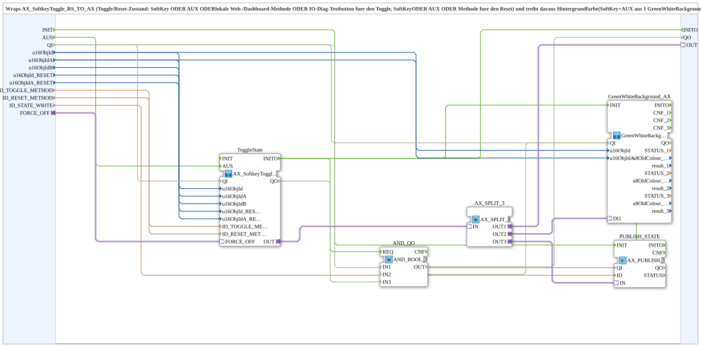

# AX_SoftkeyToggle_RS_TO_AX_BG_PUBLISH

* * * * * * * * * *

## Einleitung

`AX_SoftkeyToggle_RS_TO_AX_BG_PUBLISH` kapselt [`AX_SoftkeyToggle_RS_TO_AX`](./AX_SoftkeyToggle_RS_TO_AX.md) (Toggle-/Reset-Zustand) und treibt daraus die Hintergrundfarbe sowie einen lokalen State-Publish, **ohne** physischen Ausgang. Der Toggle wird ausgelöst durch SoftKey, AUX, lokale Web-/Dashboard-Methode oder IO-Diag-Testbutton; der Reset durch SoftKey, AUX oder Methode. Die Hintergrundfarbe (SoftKey und AUX) kommt aus einer gemeinsamen `GreenWhiteBackground3_AX`. Der Baustein ist das Gegenstück zu `AX_SoftkeyToggle_RS_TO_QXA_BG`, das zusätzlich noch einen `logiBUS_QXA` treibt. Er ist für Fälle gedacht, in denen der Aufrufer den Toggle-Zustand weiterverarbeitet, bevor er auf einen oder mehrere physische Ausgänge geht (z. B. Bänder-Sequenzierung: Taste 5 toggelt, danach erst `AX_TON`/`AX_TOF` je Kanal). Der Toggle-Zustand bleibt zusätzlich als Plug `OUT` verfügbar.

## Schnittstellenstruktur

### **Ereignis-Eingänge**

- **AUS**: Reset hart auf AUS, von außen als Event (z. B. ein zentral gelesener gemeinsamer SoftKey). Durchreiche an `ToggleState.AUS`. Unverdrahtet lassen, wenn nicht gebraucht.

### **Ereignis-Ausgänge**

Keine.

### **Daten-Eingänge**

- **u16ObjId** (`UINT`): Object ID Softkey Ein/Aus (Toggle), trägt auch die Hintergrundfarbe (Default `ID_NULL`)
- **u16ObjIdA** (`UINT`): Object ID AuxFunction2 (Joystick) für den Toggle, gleichberechtigt zum SoftKey, zeigt die Hintergrundfarbe am Aux-Handle mit (Default `ID_NULL`)
- **u16ObjIdB** (`UINT`): Object ID IO-Diag-Testbutton (Ausgänge-Diagnoseseite), toggelt gleichberechtigt mit; keine eigene Hintergrundfarbe, da `GreenWhiteBackground3_AX` nur SoftKey und AUX kennt (Default `ID_NULL`)
- **u16ObjId_RESET** (`UINT`): Object ID Softkey "Alles Aus" (Reset, hart auf AUS), z. B. `SoftKey_AUS` (Default `ID_NULL`)
- **u16ObjIdA_RESET** (`UINT`): Object ID AuxFunction2 (Joystick) für den Reset, gleichberechtigt zum Softkey "Alles Aus" (Default `ID_NULL`)
- **ID_TOGGLE_METHOD** (`WSTRING`): lokale Methodenadresse (`ACTION=CREATE_METHOD`) für den argumentlosen Toggle-Trigger, wird vom Web-Client (vt-ui-mirror) und direkt vom OPC-Dashboard aufgerufen
- **ID_RESET_METHOD** (`WSTRING`): lokale Methodenadresse (`ACTION=CREATE_METHOD`) für den argumentlosen Reset-Trigger (hart auf AUS), wird von Web-Client und OPC-Dashboard aufgerufen
- **ID_STATE_WRITE** (`WSTRING`): lokale Publish-Adresse (`ACTION=WRITE`) für den tatsächlichen Toggle-Zustand (`AX_T_FF_SR.Q`), wird von Web-Client/Dashboard remote abonniert

### **Daten-Ausgänge**

Keine.

### **Adapter**

- **FORCE_OFF** (Socket, `adapter::types::unidirectional::AX`): optional; eine steigende Flanke resettet hart auf AUS (z. B. Sicherheitsabschaltung). Reiner Durchreich-Socket an `ToggleState.FORCE_OFF`. Unverdrahtet lassen (fester FALSE-Literal), wenn nicht gebraucht.
- **OUT** (Plug, `adapter::types::unidirectional::AX`): Toggle-Zustand (`AX_T_FF_SR.Q`) zur Weiterverarbeitung beim Aufrufer; Hintergrund und Publish sind hier bereits erledigt

## Verwendete Funktionsbausteine (FBs)

- **`ToggleState`** (SubApp `MyLib::sys::AX_SoftkeyToggle_RS_TO_AX`): erzeugt den Toggle-/Reset-Zustand
- **`AX_SPLIT_3`** (`adapter::events::unidirectional::AX_SPLIT_3`): verteilt den Zustand auf drei Ziele
- **`GreenWhiteBackground_AX`** (SubApp `MyLib::sys::GreenWhiteBackground3_AX`): Hintergrundfarbe grün/weiß
- **`PUBLISH_STATE`** (`adapter::net::AX_PUBLISH_1`, `QI = TRUE`): publiziert den Zustand

## Funktionsweise

- `AUS` → `ToggleState.AUS`; `FORCE_OFF` → `ToggleState.FORCE_OFF`
- `u16ObjId`, `u16ObjIdA`, `u16ObjIdB`, `u16ObjId_RESET`, `u16ObjIdA_RESET`, `ID_TOGGLE_METHOD`, `ID_RESET_METHOD` → gleichnamige Eingänge von `ToggleState`
- `ToggleState.OUT` → `AX_SPLIT_3.IN`
- `AX_SPLIT_3.OUT1` → `OUT`
- `AX_SPLIT_3.OUT2` → `GreenWhiteBackground_AX.DI1`; `u16ObjId`, `u16ObjIdA` → `GreenWhiteBackground_AX`
- `AX_SPLIT_3.OUT3` → `PUBLISH_STATE.IN`; `ID_STATE_WRITE` → `PUBLISH_STATE.ID`

## Technische Besonderheiten

- Herausgelöst aus `Baender_EinAus` (ToggleState/`AX_SPLIT_3`-Anteil für Hintergrund und Publish, `GreenWhiteBackground_AX`, `PUBLISH_STATE`). Die zeitversetzten Ausgänge (`TOF_IgelElevator`/`TON_Querband`-Staffelung) bleiben beim Aufrufer.
- Versionsverlauf: `FORCE_OFF` (v1.1, für übergeordnete Sicherheitsabschaltung), Durchreiche `RESET` (v1.2), Umbenennung des Eingangs `RESET` in `AUS` (v1.3).
- Importiert `isobus::UT::Q::const::IDs::ID_NULL` als Default der Objekt-IDs.

## Anwendungsszenarien

- Ein-/Aus-Toggle mit Farbanzeige und Web-Publish, dessen Zustand vor dem physischen Ausgang weiterverarbeitet wird (z. B. gestaffelte Bänder)

## Zusammenfassung

`AX_SoftkeyToggle_RS_TO_AX_BG_PUBLISH` liefert einen Toggle-/Reset-Zustand mit Hintergrundfarbe und State-Publish und gibt den Zustand als `AX`-Plug zur Weiterverarbeitung aus.

---

### 🌐 Passende Themen-Unterseiten auf ms-muc-docs.de

- [🌐 Eclipse 4diac IDE & Farb-Referenz auf ms-muc-docs.de](https://www.ms-muc-docs.de/iec-61499/eclipse-4diac/)
