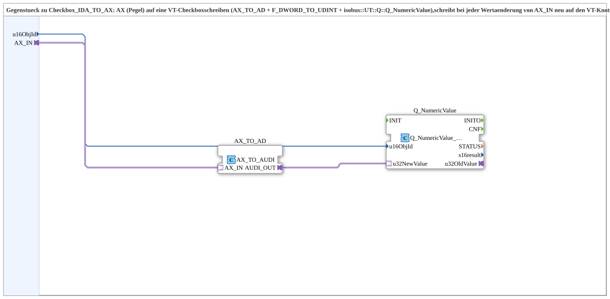

# AX_TO_Checkbox

* * * * * * * * * *

## Einleitung

`AX_TO_Checkbox` ist das Gegenstück zu [`Checkbox_IDA_TO_AX`](./Checkbox_IDA_TO_AX.md): Es schreibt einen Pegel (`AX_IN`, 0/1) auf eine VT-Checkbox (ECU → VT statt VT → ECU). Intern wandelt `AX_TO_AD` (`adapter::conversion::unidirectional::AX_TO_AUDI`) den Pegel in einen UDINT-Wert, den `Q_NumericValue` (`isobus::UT::Q::Q_NumericValue_AUDI`) über `u32NewValue` zum VT sendet.

## Schnittstelle

### Ereignisanschlüsse

- **Eingang `INIT`** (`EInit`): Initialisierungsanforderung – an `Q_NumericValue.INIT`.
- **Ausgang `INITO`** (`EInit`): Initialisierungsbestätigung – von `Q_NumericValue.INITO`.

### Eingangsvariablen

- `QI` (BOOL, Default `TRUE`): Quality Input – TRUE, um den Dienst freizugeben (an `Q_NumericValue.QI`).
- `u16ObjId` (UINT, Default `ID_NULL`): ObjectID der VT-NumberVariable hinter der Checkbox.

### Ausgangsvariablen

- `QO` (BOOL): Quality Output – TRUE, wenn der Dienst erfolgreich ausgeführt wurde (von `Q_NumericValue.QO`).

### Adapter

- **Socket `AX_IN`** (`adapter::types::unidirectional::AX`): zu schreibender Pegel (0/1).

Außer `INIT`/`INITO` besitzt der Baustein keine eigenen Ereignisanschlüsse; das Schreiben wird durch den Adapter `AX_IN` ausgelöst.

## Funktionsweise

1. `AX_IN` wird über `AX_TO_AD` in einen UDINT-Wert gewandelt.
2. `Q_NumericValue` schreibt diesen Wert unter `u16ObjId` auf den VT-Knoten. Laut Quellcode-Kommentar wird bei jeder Wertänderung von `AX_IN` neu geschrieben.
3. `INIT` → `Q_NumericValue.INIT`, `Q_NumericValue.INITO` → `INITO`, `QI` → `Q_NumericValue.QI`, `Q_NumericValue.QO` → `QO`.

## Technische Besonderheiten

- `u16ObjId` ist die ObjectID der **CNumberVariable**, die die Checkbox als Wertspeicher referenziert - **nicht** die ObjectID der Checkbox (`CInputBoolean`) selbst. Das VT erwartet Wertänderungen unter der NumberVariable-ID (analog `Checkbox_IDA_TO_AX`).
- Instanz-Eindeutigkeit: `Q_NumericValue` erlaubt nur eine Instanz je Ziel-ObjectID im gesamten Projekt.

## Zusammenfassung

Schreibt einen AX-Pegel auf eine VT-Checkbox über die zugehörige NumberVariable.

## 🛠️ Zugehörige Übungen

- [Uebung_094b5_AX](https://meisterschulen-am-ostbahnhof-munchen-docs.readthedocs.io/projects/4diac-exercises-docs/de/latest/Uebungen/test_AX/Uebungen_doc/Uebung_094b5_AX/)

---

### 🌐 Passende Themen-Unterseiten auf ms-muc-docs.de

- [🌐 Eclipse 4diac IDE & Farb-Referenz auf ms-muc-docs.de](https://www.ms-muc-docs.de/iec-61499/eclipse-4diac/)
