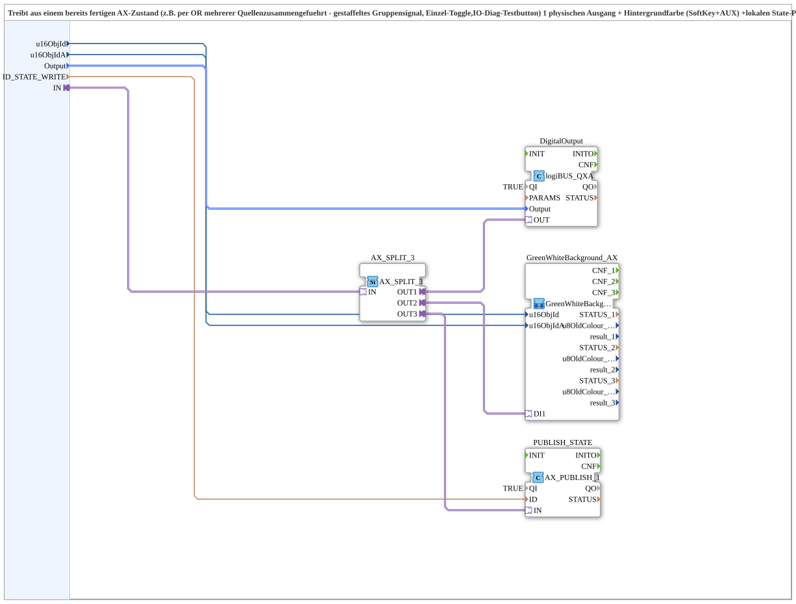

# AX_TO_QXA_BG_PUBLISH

* * * * * * * * * *

## Einleitung

`AX_TO_QXA_BG_PUBLISH` treibt aus einem bereits fertigen AX-Zustand (z. B. per ODER mehrerer Quellen zusammengeführt, etwa gestaffeltes Gruppensignal, Einzel-Toggle oder IO-Diag-Testbutton) **einen** physischen Ausgang, die Hintergrundfarbe (SoftKey und AUX) und einen lokalen State-Publish für Web-Client und OPC-Dashboard. Er ist das Gegenstück zu `MyLib::sys::AX_SoftkeyToggle_RS_TO_QXA_BG`, das den Toggle/Reset noch selbst erzeugt; hier liegt der AX-Zustand bereits fertig vor.

## Schnittstellenstruktur

### **Ereignis-Eingänge**

Der Funktionsblock verfügt über keine direkten Ereignis-Eingänge.

### **Ereignis-Ausgänge**

Der Funktionsblock verfügt über keine direkten Ereignis-Ausgänge.

### **Daten-Eingänge**

- **u16ObjId** (UINT): Object ID des SoftKeys, trägt die Hintergrundfarbe (Default `ID_NULL`)
- **u16ObjIdA** (UINT): Object ID der AuxFunction2 (Joystick), zeigt die Hintergrundfarbe am Aux-Handle mit (Default `ID_NULL`)
- **Output** (`logiBUS::io::DQ::logiBUS_DO_S`): Auswahl des Ausgangs `Output_Q1`..`Output_Q12` (Default `logiBUS_DO::Invalid`)
- **ID_STATE_WRITE** (WSTRING): lokale Publish-Adresse (`ACTION=WRITE`) für den tatsächlichen Zustand; wird vom Web-Client/Dashboard remote abonniert

### **Daten-Ausgänge**

Der Funktionsblock verfügt über keine direkten Daten-Ausgänge.

### **Adapter**

- **IN** (Socket, `adapter::types::unidirectional::AX`): fertiger, bereits zusammengeführter AX-Zustand; wird auf Ausgang, Hintergrund und Publish verteilt

## Funktionsweise

`IN` wird auf einen `AX_SPLIT_3` (`adapter::events::unidirectional::AX_SPLIT_3`) geführt, der den Zustand auf drei Ziele verteilt:

- `AX_SPLIT_3.OUT1` → `DigitalOutput.OUT`: `DigitalOutput` (`logiBUS::io::DQ::logiBUS_QXA`, `QI = TRUE`) schaltet den physischen Ausgang; `Output` → `DigitalOutput.Output`.
- `AX_SPLIT_3.OUT2` → `GreenWhiteBackground_AX.DI1`: `GreenWhiteBackground_AX` ([`MyLib::sys::GreenWhiteBackground3_AX`](GreenWhiteBackground3_AX.md)) färbt den Hintergrund grün (TRUE) bzw. weiß (FALSE); `u16ObjId` und `u16ObjIdA` gehen an dessen gleichnamige Eingänge.
- `AX_SPLIT_3.OUT3` → `PUBLISH_STATE.IN`: `PUBLISH_STATE` (`adapter::net::AX_PUBLISH_1`, `QI = TRUE`) publiziert den Zustand an die Adresse `ID_STATE_WRITE` (`ID_STATE_WRITE` → `PUBLISH_STATE.ID`).

## Technische Besonderheiten

- Herausgelöst aus `Baender_EinAus` (dort dreimal identisch für Igel, Elevator und Querband verdrahtet)
- `ID_STATE_WRITE` ist neu hinzugekommen, weil der Web-Mirror für die Einzel-Bänder-Softkeys einen eigenen State-Publish benötigt
- Es gibt keine eigenen Ereignis- oder Datenports für den Zustand; alles läuft über den AX-Adapter `IN`

## Anwendungsszenarien

- Gruppensignal oder ODER-verknüpfter Zustand, der einen Ausgang schalten, die Softkey-Farbe anzeigen und für das Web veröffentlicht werden soll
- Mehrere zeitversetzte Kanäle, die jeweils einen eigenen Zustand liefern

## Fazit

`AX_TO_QXA_BG_PUBLISH` verteilt einen fertigen AX-Zustand auf physischen Ausgang, Hintergrundfarbe und State-Publish.
