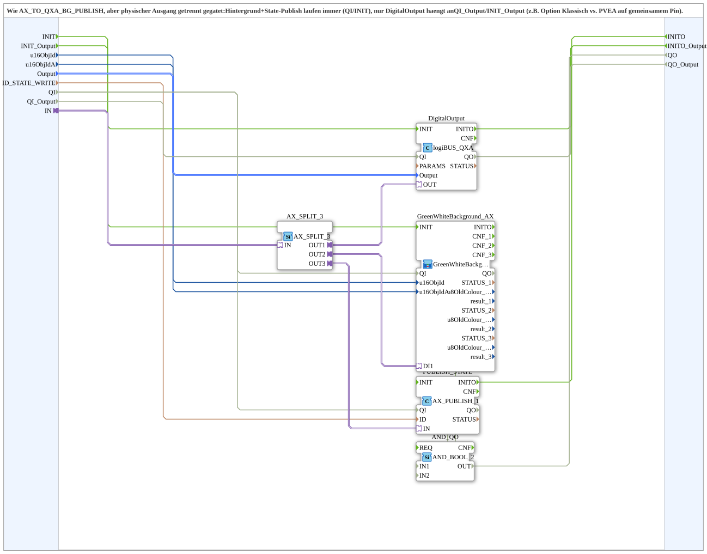

# AX_TO_QXA_BG_PUBLISH_OPT

* * * * * * * * * *

## Einleitung

`AX_TO_QXA_BG_PUBLISH_OPT` entspricht [`AX_TO_QXA_BG_PUBLISH`](./AX_TO_QXA_BG_PUBLISH.md), schaltet den physischen Ausgang aber getrennt: Hintergrund und State-Publish laufen immer über `QI`/`INIT`, nur der `DigitalOutput` hängt an `QI_Output`/`INIT_Output` (z. B. Option „Klassisch“ gegenüber „PVEA“ auf einem gemeinsamen Pin). Der Baustein ist eine Kopie von `AX_TO_QXA_BG_PUBLISH` v1.2; Grund war, dass bei der Variante PVEA mit dem Ausgang auch SoftKey-Hintergrund und State-Publish inaktiv blieben.

## Schnittstellenstruktur

### **Ereignis-Eingänge**

- **INIT** (`EInit`): Initialisierung Hintergrund und Publish (Anzeige); typisch sofort beim Boot
- **INIT_Output** (`EInit`): Initialisierung des physischen Ausgangs; typisch von der Option getrieben

### **Ereignis-Ausgänge**

- **INITO** (`EInit`): Anzeige initialisiert; echtes Confirm von `PUBLISH_STATE.INITO`
- **INITO_Output** (`EInit`): Ausgang initialisiert; echtes Confirm von `DigitalOutput.INITO`

### **Daten-Eingänge**

| Variable | Typ | Vorgabe | Kommentar |
|----------|-----|---------|-----------|
| `u16ObjId` | UINT | `ID_NULL` | Object ID SoftKey; trägt die Hintergrundfarbe. |
| `u16ObjIdA` | UINT | `ID_NULL` | Object ID AuxFunction2 (Joystick); zeigt die Hintergrundfarbe am Aux-Handle mit. |
| `Output` | `logiBUS::io::DQ::logiBUS_DO_S` | `logiBUS_DO::Invalid` | Auswahl des Ausgangs `Output_Q1`..`Output_Q12`. |
| `ID_STATE_WRITE` | WSTRING |  | Lokale Publish-Adresse (`ACTION=WRITE`) für den Zustand; wird von Web-Client/Dashboard remote abonniert. |
| `QI` | BOOL | TRUE | Qualifier für Hintergrund und Publish (Anzeige). |
| `QI_Output` | BOOL | TRUE | Qualifier nur für den physischen Ausgang; FALSE gibt den Pin frei. |

### **Daten-Ausgänge**

| Variable | Typ | Vorgabe | Kommentar |
|----------|-----|---------|-----------|
| `QO` | BOOL |  | Quality Output Anzeige (UND aus `GreenWhiteBackground_AX.QO` und `PUBLISH_STATE.QO`). |
| `QO_Output` | BOOL |  | Quality Output physischer Ausgang (`DigitalOutput.QO`). |

### **Adapter**

| Adapter | Typ | Richtung | Kommentar |
|---------|-----|----------|-----------|
| `IN` | `adapter::types::unidirectional::AX` | Socket | Fertiger AX-Zustand; wird auf Ausgang, Hintergrund und Publish verteilt. |

## Verwendete Funktionsbausteine (FBs)

- **AX_SPLIT_3** (`adapter::events::unidirectional::AX_SPLIT_3`): Adapter-Fanout (strikt 1:1)
- **DigitalOutput** (`logiBUS::io::DQ::logiBUS_QXA`): physischer Ausgang
- **GreenWhiteBackground_AX** (SubApp `MyLib::sys::GreenWhiteBackground3_AX`): Hintergrundfarbe von SoftKey und Aux; siehe [`GreenWhiteBackground3_AX`](./GreenWhiteBackground3_AX.md)
- **PUBLISH_STATE** (`adapter::net::AX_PUBLISH_1`): lokaler State-Publish
- **AND_QO** (`iec61131::booleanOperators::AND_BOOL_2`): verknüpft die `QO` der Anzeige

## Programmablauf und Verbindungen

1. AX-Zustand: `IN` -> `AX_SPLIT_3.IN`; `OUT1` -> `DigitalOutput.OUT`; `OUT2` -> `GreenWhiteBackground_AX.DI1`; `OUT3` -> `PUBLISH_STATE.IN`.
2. Initialisierung Ausgang: `INIT_Output` -> `DigitalOutput.INIT`; `DigitalOutput.INITO` -> `INITO_Output`.
3. Initialisierung Anzeige: `INIT` -> `GreenWhiteBackground_AX.INIT`; `GreenWhiteBackground_AX.INITO` -> `PUBLISH_STATE.INIT`; `PUBLISH_STATE.INITO` -> `INITO` und -> `AND_QO.REQ`.
4. Qualifier: `QI` -> `GreenWhiteBackground_AX.QI` und `PUBLISH_STATE.QI`; `QI_Output` -> `DigitalOutput.QI`.
5. Qualität: `GreenWhiteBackground_AX.QO` -> `AND_QO.IN1`; `PUBLISH_STATE.QO` -> `AND_QO.IN2`; `AND_QO.OUT` -> `QO`; `DigitalOutput.QO` -> `QO_Output`.
6. Daten: `u16ObjId`, `u16ObjIdA` -> `GreenWhiteBackground_AX`; `Output` -> `DigitalOutput.Output`; `ID_STATE_WRITE` -> `PUBLISH_STATE.ID`.

## Technische Besonderheiten

- `QI`/`INIT` gelten nur noch für Hintergrund und Publish; `QI_Output`/`INIT_Output`/`INITO_Output`/`QO_Output` gehören ausschließlich zum `DigitalOutput`.
- Der `AX_SPLIT_3` ist nötig, weil der Adapter-Fanout strikt 1:1 ist.

## Anwendungsszenarien

- Kanäle, bei denen sich der physische Ausgang per Option (z. B. Klassisch gegenüber PVEA auf gemeinsamem Pin) abschalten lässt, SoftKey-Hintergrund und State-Publish aber immer laufen sollen.

## Zusammenfassung

`AX_TO_QXA_BG_PUBLISH_OPT` verteilt einen fertigen AX-Zustand auf Ausgang, Hintergrund und Publish, wobei der physische Ausgang getrennt freigegeben und initialisiert wird.

---

### 🌐 Passende Themen-Unterseiten auf ms-muc-docs.de

- [🌐 Eclipse 4diac IDE & Farb-Referenz auf ms-muc-docs.de](https://www.ms-muc-docs.de/iec-61499/eclipse-4diac/)
