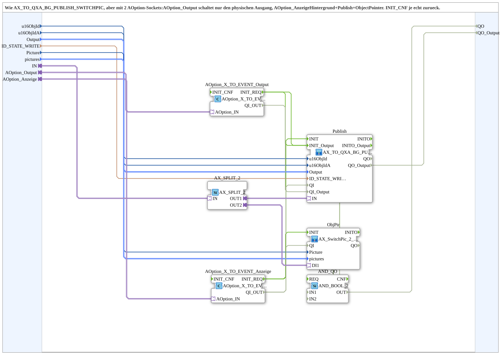

# AX_TO_QXA_BG_PUBLISH_SWITCHPIC_OPT

* * * * * * * * * *

## Einleitung

`AX_TO_QXA_BG_PUBLISH_SWITCHPIC_OPT` entspricht [`AX_TO_QXA_BG_PUBLISH_SWITCHPIC`](./AX_TO_QXA_BG_PUBLISH_SWITCHPIC.md), hat aber statt `QI`/`INIT` zwei `AOption`-Sockets: `AOption_Output` schaltet nur den physischen Ausgang, `AOption_Anzeige` schaltet Hintergrund, Publish und ObjectPointer. Das `INIT_CNF` kommt jeweils echt zurück. Der Baustein ist eine Kopie von `AX_TO_QXA_BG_PUBLISH_SWITCHPIC` v1.2; Grund war, dass bei der Variante PVEA SoftKey-Hintergrund, ObjectPointer und State-Publish inaktiv blieben. Der Ausgangs-Teil gibt es auch einzeln als [`AX_TO_QXA_Option`](./AX_TO_QXA_Option.md), der Anzeige-Teil als [`AX_TO_BG_PUBLISH_SWITCHPIC_Option`](./AX_TO_BG_PUBLISH_SWITCHPIC_Option.md).

## Schnittstellenstruktur

### **Ereignis-Eingänge**

Keine vorhanden.

### **Ereignis-Ausgänge**

Keine vorhanden.

### **Daten-Eingänge**

| Variable | Typ | Vorgabe | Kommentar |
|----------|-----|---------|-----------|
| `u16ObjId` | UINT | `ID_NULL` | Object ID SoftKey; trägt die Hintergrundfarbe. |
| `u16ObjIdA` | UINT | `ID_NULL` | Object ID AuxFunction2 (Joystick); zeigt die Hintergrundfarbe am Aux-Handle mit. |
| `Output` | `logiBUS::io::DQ::logiBUS_DO_S` | `logiBUS_DO::Invalid` | Auswahl des Ausgangs `Output_Q1`..`Output_Q12`. |
| `ID_STATE_WRITE` | WSTRING |  | Lokale Publish-Adresse (`ACTION=WRITE`) für den Zustand; wird von Web-Client/Dashboard remote abonniert. |
| `Picture` | UINT |  | Object ID des ObjectPointers, der den Status-Kästchen-Inhalt trägt. |
| `pictures` | `isobus::UT::Q::types::s2x1ObjectIDs` | `(up := (u16ObjId := ID_NULL), down := (u16ObjId := ID_NULL))` | Die beiden Ziel-Object-IDs (`up` = aus, `down` = an). |

### **Daten-Ausgänge**

| Variable | Typ | Vorgabe | Kommentar |
|----------|-----|---------|-----------|
| `QO` | BOOL |  | Quality Output Anzeige (UND aus `Publish.QO` und `ObjPtr.QO`). |
| `QO_Output` | BOOL |  | Quality Output physischer Ausgang (`Publish.QO_Output`). |

### **Adapter**

| Adapter | Typ | Richtung | Kommentar |
|---------|-----|----------|-----------|
| `IN` | `adapter::types::unidirectional::AX` | Socket | Fertiger AX-Zustand; wird auf Ausgang, Hintergrund, Publish und ObjectPointer-Statusanzeige verteilt. |
| `AOption_Output` | `Option::AOption` | Socket | Aktiviert nur den physischen Ausgang (z. B. DEMUX-Zweig Klassisch). |
| `AOption_Anzeige` | `Option::AOption` | Socket | Aktiviert Hintergrund, Publish und ObjectPointer (z. B. `AOption_OR_2` aus Klassisch und PVEA). |

## Verwendete Funktionsbausteine (FBs)

- **AX_SPLIT_2** (`adapter::events::unidirectional::AX_SPLIT_2`): Adapter-Fanout (strikt 1:1)
- **AOption_X_TO_EVENT_Output** (`Option::conversion::AOption_X_TO_EVENT`): Option für den physischen Ausgang
- **AOption_X_TO_EVENT_Anzeige** (`Option::conversion::AOption_X_TO_EVENT`): Option für die Anzeige
- **Publish** (SubApp `MyLib::sys::AX_TO_QXA_BG_PUBLISH_OPT`): Ausgang, Hintergrund und State-Publish; siehe [`AX_TO_QXA_BG_PUBLISH_OPT`](./AX_TO_QXA_BG_PUBLISH_OPT.md)
- **ObjPtr** (SubApp `MyLib::sys::AX_SwitchPic_2_1`): ObjectPointer-Statusanzeige; siehe [`AX_SwitchPic_2_1`](./AX_SwitchPic_2_1.md)
- **AND_QO** (`iec61131::booleanOperators::AND_BOOL_2`): verknüpft die `QO` der Anzeige

## Programmablauf und Verbindungen

1. AX-Zustand: `IN` -> `AX_SPLIT_2.IN`; `OUT1` -> `Publish.IN`; `OUT2` -> `ObjPtr.DI1`.
2. Optionen: `AOption_Output` -> `AOption_X_TO_EVENT_Output.AOption_IN`; `AOption_Anzeige` -> `AOption_X_TO_EVENT_Anzeige.AOption_IN`.
3. Initialisierung Anzeige: `AOption_X_TO_EVENT_Anzeige.INIT_REQ` -> `Publish.INIT`; `Publish.INITO` -> `ObjPtr.INIT`; `ObjPtr.INITO` -> `AOption_X_TO_EVENT_Anzeige.INIT_CNF` und -> `AND_QO.REQ`.
4. Initialisierung Ausgang: `AOption_X_TO_EVENT_Output.INIT_REQ` -> `Publish.INIT_Output`; `Publish.INITO_Output` -> `AOption_X_TO_EVENT_Output.INIT_CNF`.
5. Qualifier: `AOption_X_TO_EVENT_Anzeige.QI_OUT` -> `Publish.QI` und `ObjPtr.QI`; `AOption_X_TO_EVENT_Output.QI_OUT` -> `Publish.QI_Output`.
6. Qualität: `Publish.QO` -> `AND_QO.IN1`; `ObjPtr.QO` -> `AND_QO.IN2`; `AND_QO.OUT` -> `QO`; `Publish.QO_Output` -> `QO_Output`.
7. Daten: `u16ObjId`, `u16ObjIdA`, `Output`, `ID_STATE_WRITE` -> gleichnamige Eingänge von `Publish` (`ID_STATE_WRITE` -> `Publish.ID_STATE_WRITE`); `Picture` -> `ObjPtr.Picture`; `pictures` -> `ObjPtr.pictures`.

## Technische Besonderheiten

- Der Baustein hat keine eigenen Ereigniseingänge/-ausgänge; die Initialisierung läuft über die beiden `AOption`-Sockets.
- Ausgang und Anzeige lassen sich unabhängig voneinander aktivieren.
- Der `AX_SPLIT_2` ist nötig, weil der Adapter-Fanout strikt 1:1 ist.

## Anwendungsszenarien

- Mehrere gleich aufgebaute Kanäle (z. B. Förderbänder) mit Ausgang, SoftKey-Farbe, Publish und Status-Bild, bei denen der Ausgang nur für eine Option (z. B. Klassisch) aktiv sein soll, die Anzeige aber für mehrere Optionen (z. B. Klassisch und PVEA).

## Zusammenfassung

`AX_TO_QXA_BG_PUBLISH_SWITCHPIC_OPT` verteilt einen fertigen AX-Zustand auf Ausgang, Hintergrund, Publish und ObjectPointer-Statusanzeige und aktiviert Ausgang und Anzeige über zwei getrennte `AOption`-Sockets.

---

### 🌐 Passende Themen-Unterseiten auf ms-muc-docs.de

- [🌐 Eclipse 4diac IDE & Farb-Referenz auf ms-muc-docs.de](https://www.ms-muc-docs.de/iec-61499/eclipse-4diac/)
