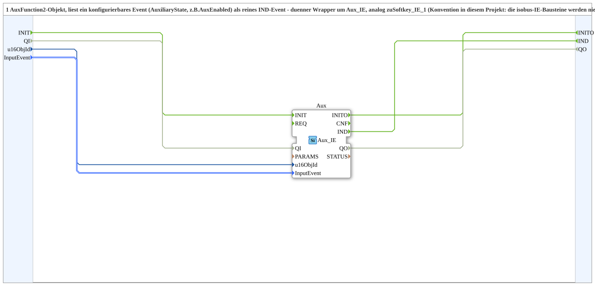

# Aux_IE_1

* * * * * * * * * *

## Einleitung

`Aux_IE_1` liest ein AuxFunction2-Objekt und gibt ein konfigurierbares Ereignis (`AuxiliaryState`, z. B. `AuxEnabled`) als reines `IND`-Ereignis aus. Der Baustein ist ein dünner Wrapper um `isobus::UT::io::Auxiliary::IN::Aux_IE`, analog zu [`Softkey_IE_1`](Softkey_IE_1.md) und [`Button_IE_1`](Button_IE_1.md). Konvention in diesem Projekt: Die isobus-IE-Bausteine werden nie roh inline verwendet, sondern immer gewrappt.

## Schnittstellenstruktur

### **Ereignis-Eingänge**

Der Funktionsblock verfügt über keine direkten Ereignis-Eingänge.

### **Ereignis-Ausgänge**

- **IND**: feuert, wenn das konfigurierte `InputEvent` auftritt

### **Daten-Eingänge**

- **u16ObjId** (UINT): Object ID der AuxFunction2 (Default `ID_NULL`)
- **InputEvent** (`isobus::UT::io::Auxiliary::IN::AuxiliaryState_S`): z. B. `AuxEnabled`, `AuxDisabled` (Default `Invalid`)

### **Daten-Ausgänge**

Der Funktionsblock verfügt über keine direkten Daten-Ausgänge.

### **Adapter**

Es werden keine Adapter verwendet.

## Funktionsweise

Das Netzwerk enthält genau eine Instanz `Aux` des Typs `isobus::UT::io::Auxiliary::IN::Aux_IE` mit dem Parameter `QI = TRUE`. `u16ObjId` und `InputEvent` werden unverändert auf die gleichnamigen Eingänge der Instanz geführt, und deren Ereignis `IND` wird direkt als `IND` der SubApp ausgegeben.

## Technische Besonderheiten

- Reine Durchreichung ohne eigene Logik oder Zustand
- `QI` ist fest auf TRUE verdrahtet; der Baustein ist also immer aktiv
- Weil `InputEvent` ein Parameter ist, kann dieselbe SubApp für unterschiedliche Ereignisarten (z. B. Drücken oder Loslassen) verwendet werden

## Anwendungsszenarien

- Einlesen einer einzelnen VT-Bedienung als Ereignis, ohne den rohen IE-Baustein direkt im Netzwerk zu verwenden

## ⚖️ Vergleich mit ähnlichen Bausteinen

Gleichartige Wrapper sind [`Button_IE_1`](Button_IE_1.md) und [`Softkey_IE_1`](Softkey_IE_1.md); sie unterscheiden sich nur im VT-Objekttyp und im Aufzählungstyp des `InputEvent`.

## Fazit

`Aux_IE_1` ist ein minimaler Wrapper, der ein konfigurierbares AuxFunction2-Ereignis als `IND` bereitstellt.
