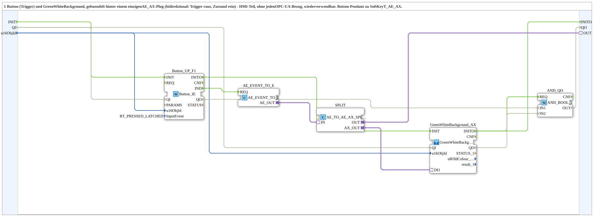

# ButtonT_AE_AX

* * * * * * * * * *

## Einleitung

`ButtonT_AE_AX` bündelt **einen Button (Trigger)** und eine `GreenWhiteBackground` hinter einem einzigen bidirektionalen `AE_AX`-Plug (Trigger raus, Zustand rein). Es ist der reine HMI-Teil ohne jeden OPC-UA-Bezug und wiederverwendbar. Der Baustein ist das Button-Pendant zu [`SoftKeyT_AE_AX`](./SoftKeyT_AE_AX.md): `Softkey_IE` wurde durch `Button_IE` ersetzt, `SK_RELEASED` durch `BT_PRESSED_LATCHED`.

## Schnittstellenstruktur

### **Ereignis-Eingänge**

Keine.

### **Ereignis-Ausgänge**

Keine.

### **Daten-Eingänge**

- **u16ObjId** (`UINT`): Object ID Button/Background (Default `ID_NULL`)

### **Daten-Ausgänge**

Keine.

### **Adapter**

- **OUT** (Plug, `adapter::types::bidirectional::AE_AX`): Trigger (raus), Zustand (rein)

## Verwendete Funktionsbausteine (FBs)

- **`Button_UP_F1`** (`isobus::UT::io::Button::Button_IE`): Parameter `QI = TRUE`, `InputEvent = BT_PRESSED_LATCHED`
- **`AE_EVENT_TO_E`** (`adapter::conversion::unidirectional::AE_EVENT_TO_E`): wandelt das Button-Ereignis in einen `AE`-Adapter
- **`SPLIT`** (`adapter::events::bidirectional::AE_TO_AE_AX_SPLIT`): trennt den bidirektionalen `AE_AX`-Plug in Trigger-Richtung und Zustands-Richtung
- **`GreenWhiteBackground_AX`** (SubApp `MyLib::sys::GreenWhiteBackground1_AX`): Hintergrundfarbe grün/weiß

## Funktionsweise

- `Button_UP_F1.IND` → `AE_EVENT_TO_E.REQ`
- `AE_EVENT_TO_E.AE_OUT` → `SPLIT.IN`
- `SPLIT.OUT` → `OUT` (Trigger nach außen, Zustand von außen)
- `SPLIT.AX_OUT` → `GreenWhiteBackground_AX.DI1` (Zustand färbt den Hintergrund)
- `u16ObjId` → `Button_UP_F1.u16ObjId` und `GreenWhiteBackground_AX.u16ObjId`

## Technische Besonderheiten

- Dieselbe Objekt-ID dient dem Button und der Hintergrundfarbe
- `BT_PRESSED_LATCHED` statt `SK_RELEASED` des Softkey-Pendants
- Kein OPC-UA-Bezug, damit in beliebigen Szenarien wiederverwendbar

## Anwendungsszenarien

- Button im VT als Trigger, dessen Zustand (z. B. von einem Toggle) als Hintergrundfarbe zurückgemeldet wird, über einen einzigen `AE_AX`-Anschluss

## Zusammenfassung

`ButtonT_AE_AX` bündelt Button-Trigger und Zustandsfarbe hinter einem `AE_AX`-Plug.

---

### 🌐 Passende Themen-Unterseiten auf ms-muc-docs.de

- [🌐 Eclipse 4diac IDE & Farb-Referenz auf ms-muc-docs.de](https://www.ms-muc-docs.de/iec-61499/eclipse-4diac/)
