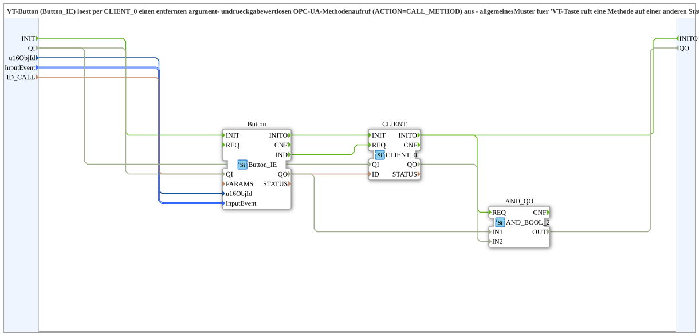

# Button_CLIENT_Method_IE

* * * * * * * * * *

## Einleitung

`Button_CLIENT_Method_IE` löst per VT-Button (`Button_IE`) über `CLIENT_0` einen entfernten, argument- und rückgabewertlosen **OPC-UA-Methodenaufruf** (`ACTION=CALL_METHOD`) aus. Es ist das allgemeine Muster „VT-Taste ruft eine Methode auf einer anderen Station auf“ und wurde aus `logiBUS_AI_Calibrated_Subscribe_VT_OPC` herausgelöst, wo es zweimal identisch vorkam. Im Gegensatz zu `Button_Method_IE` (Button ODER lokale Methode → gemeinsames `IND`) ist dies der umgekehrte „Caller“-Fall: Button → entfernte Methode.

## Schnittstellenstruktur

### **Ereignis-Eingänge**

*Keine direkten Ereignis-Eingänge vorhanden*

### **Ereignis-Ausgänge**

*Keine direkten Ereignis-Ausgänge vorhanden*

### **Daten-Eingänge**

- **u16ObjId** (`UINT`): Object-ID des Buttons
- **InputEvent** (`isobus::UT::io::Button::ButtonActivationCode_S`): Welche Button-Aktivierung den Methodenaufruf auslöst (z. B. `BT_PRESSED_LATCHED`, `BT_RELEASED_UNLATCHED`)
- **ID_CALL** (`WSTRING`): Remote-Methodenadresse (`ACTION=CALL_METHOD`); ruft die entsprechende `ID_..._METHOD`-Adresse (`ACTION=CREATE_METHOD`) auf der Zielstation auf

### **Daten-Ausgänge**

*Keine Daten-Ausgänge vorhanden*

### **Adapter**

Dieser Funktionsblock verwendet keine Adapter.

## Verwendete Funktionsbausteine (FBs)

- **Button**: [`isobus::UT::io::Button::Button_IE`](../../isobus/UT/io/Button/Button_IE.md) (`QI=TRUE`)
- **CLIENT**: [`iec61499::net::CLIENT_0`](../../../StandardLibraries/net/CLIENT_0.md) (`QI=TRUE`)

## Programmablauf und Verbindungen

- `u16ObjId` → `Button.u16ObjId`; `InputEvent` → `Button.InputEvent`
- `Button.IND` → `CLIENT.REQ`
- `ID_CALL` → `CLIENT.ID`

Bei jeder Button-Aktivierung gemäß `InputEvent` wird somit der Methodenaufruf `CLIENT_0` angestoßen.

## Technische Besonderheiten

- `InputEvent` ist ein Parameter und nicht auf `BT_PRESSED_LATCHED` festgelegt, damit auch andere Aktivierungsarten (z. B. Loslassen) wiederverwendbar sind.
- Die Rückmeldung (`CNF`) von `CLIENT_0` wird nicht nach außen geführt.

## Anwendungsszenarien

- VT-Taste, die eine Methode auf einer anderen Station aufruft (z. B. Kalibrierung per OPC-UA)

## Fazit

`Button_CLIENT_Method_IE` ist ein kleines, generisches Muster für den Aufruf einer entfernten OPC-UA-Methode per VT-Taste.
