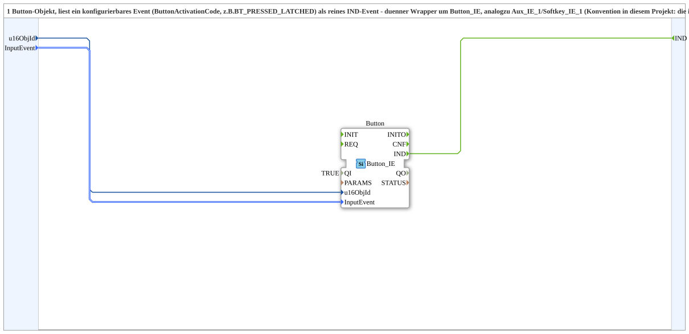

# Button_IE_1

* * * * * * * * * *

## Einleitung

`Button_IE_1` liest ein Button-Objekt und gibt ein konfigurierbares Ereignis (`ButtonActivationCode`, z. B. `BT_PRESSED_LATCHED`) als reines `IND`-Ereignis aus. Der Baustein ist ein dünner Wrapper um `isobus::UT::io::Button::Button_IE`, analog zu [`Aux_IE_1`](Aux_IE_1.md) und [`Softkey_IE_1`](Softkey_IE_1.md). Konvention in diesem Projekt: Die isobus-IE-Bausteine werden nie roh inline verwendet, sondern immer gewrappt.

## Schnittstellenstruktur

### **Ereignis-Eingänge**

- **INIT** (`EInit`): Initialization Request

### **Ereignis-Ausgänge**

- **INITO** (`EInit`): Initialization Confirm
- **IND**: feuert, wenn das konfigurierte `InputEvent` auftritt

### **Daten-Eingänge**

- **QI** (`BOOL`, Default `TRUE`): Quality Input - TRUE, um den Dienst freizugeben
- **u16ObjId** (UINT): Object ID des Buttons (Default `ID_NULL`)
- **InputEvent** (`isobus::UT::io::Button::ButtonActivationCode_S`): z. B. `BT_PRESSED_LATCHED`, `BT_RELEASED_UNLATCHED` (Default `Invalid`)

### **Daten-Ausgänge**

- **QO** (`BOOL`): Quality Output - TRUE, wenn der Dienst erfolgreich ausgeführt wurde (durchgereicht von `Button.QO`)

### **Adapter**

Es werden keine Adapter verwendet.

## Funktionsweise

Das Netzwerk enthält genau eine Instanz `Button` des Typs `isobus::UT::io::Button::Button_IE`. `u16ObjId`, `InputEvent` und `QI` werden unverändert auf die gleichnamigen Eingänge der Instanz geführt, `INIT` → `Button.INIT`; deren Ereignisse `IND` und `INITO` sowie der Ausgang `QO` werden direkt als `IND`, `INITO` und `QO` der SubApp ausgegeben.

## Technische Besonderheiten

- Reine Durchreichung ohne eigene Logik oder Zustand
- `QI` wird von außen an den inneren Baustein durchgereicht (Vorgabe `TRUE`)
- Weil `InputEvent` ein Parameter ist, kann dieselbe SubApp für unterschiedliche Ereignisarten (z. B. Drücken oder Loslassen) verwendet werden

## Anwendungsszenarien

- Einlesen einer einzelnen VT-Bedienung als Ereignis, ohne den rohen IE-Baustein direkt im Netzwerk zu verwenden

## ⚖️ Vergleich mit ähnlichen Bausteinen

Gleichartige Wrapper sind [`Aux_IE_1`](Aux_IE_1.md) und [`Softkey_IE_1`](Softkey_IE_1.md); sie unterscheiden sich nur im VT-Objekttyp und im Aufzählungstyp des `InputEvent`.

## Fazit

`Button_IE_1` ist ein minimaler Wrapper, der ein konfigurierbares Button-Ereignis als `IND` bereitstellt.
