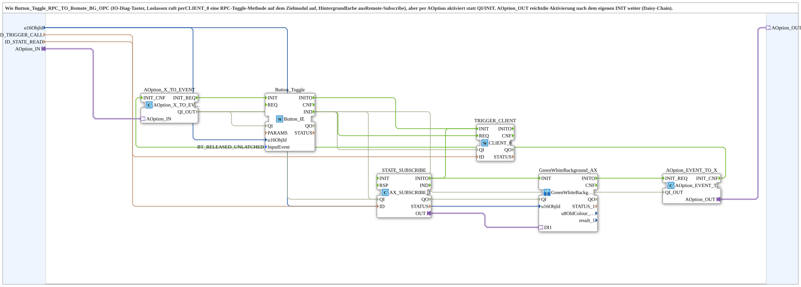

# Button_Toggle_RPC_TO_Remote_BG_Option_OPC

* * * * * * * * * *

## Einleitung

`Button_Toggle_RPC_TO_Remote_BG_Option_OPC` ist ein IO-Diag-Taster: Beim Loslassen ruft er per `CLIENT_0` eine RPC-Toggle-Methode auf dem Zielmodul auf, die Hintergrundfarbe kommt aus einem Remote-Subscribe. Der Baustein entspricht [`Button_Toggle_RPC_TO_Remote_BG_OPC`](./Button_Toggle_RPC_TO_Remote_BG_OPC.md), wird aber per `AOption` aktiviert statt über `QI`/`INIT`. `AOption_OUT` reicht die Aktivierung nach dem eigenen `INIT` weiter (Daisy-Chain wie `OptionalGroup_001a`). Er ist eine Kopie von `Button_Toggle_RPC_TO_Remote_BG_OPC`, bei der `INIT`/`INITO`/`QI`/`QO` durch `AOption_IN` und `AOption_OUT` ersetzt wurden.

## Schnittstellenstruktur

### **Ereignis-Eingänge**

Keine vorhanden.

### **Ereignis-Ausgänge**

Keine vorhanden.

### **Daten-Eingänge**

| Variable | Typ | Vorgabe | Kommentar |
|----------|-----|---------|-----------|
| `u16ObjId` | UINT | `ID_NULL` | Object ID Button/Hintergrund. |
| `ID_TRIGGER_CALL` | WSTRING |  | Remote-Methodenadresse (`ACTION=CALL_METHOD`) für den argumentlosen Trigger-Methodenaufruf auf dem Zielmodul. |
| `ID_STATE_READ` | WSTRING |  | Lokal überwachte Adresse (`BOOL`, `ACTION=READ`) für den Flipflop-Zustand; wird vom Zielmodul remote beschrieben. |

### **Daten-Ausgänge**

Keine vorhanden.

### **Adapter**

| Adapter | Typ | Richtung | Kommentar |
|---------|-----|----------|-----------|
| `AOption_IN` | `Option::AOption` | Socket | Treibt `INIT`/`QI`; anschließen an `AOption_AUI_DEMUX_N.OUTx` oder `AOption_OUT` einer vorgeschalteten Instanz. |
| `AOption_OUT` | `Option::AOption` | Plug | Reicht die Aktivierung nach dem eigenen INIT an das nächste Glied weiter (Daisy-Chain); muss verbunden sein, Kettenende z. B. `DummyGroup`. |

## Verwendete Funktionsbausteine (FBs)

- **AOption_X_TO_EVENT** (`Option::conversion::AOption_X_TO_EVENT`): wandelt die Option in `INIT_REQ`/`QI_OUT` und nimmt `INIT_CNF` entgegen
- **Button_Toggle** (`isobus::UT::io::Button::Button_IE`, `InputEvent = BT_RELEASED_UNLATCHED`): VT-Button, Ereignis beim Loslassen
- **TRIGGER_CLIENT** (`iec61499::net::CLIENT_0`): ruft die Methode auf dem Zielmodul auf
- **STATE_SUBSCRIBE** (`adapter::net::AX_SUBSCRIBE_1`): Remote-Subscribe des Zustands
- **GreenWhiteBackground_AX** (SubApp `MyLib::sys::GreenWhiteBackground1_AX`): Hintergrundfarbe; siehe [`GreenWhiteBackground1_AX`](./GreenWhiteBackground1_AX.md)
- **AOption_EVENT_TO_X** (`Option::conversion::AOption_EVENT_TO_X`): gibt die Aktivierung an `AOption_OUT` weiter

## Programmablauf und Verbindungen

1. Initialisierungskette: `AOption_X_TO_EVENT.INIT_REQ` -> `Button_Toggle.INIT`; `Button_Toggle.INITO` -> `TRIGGER_CLIENT.INIT`; `TRIGGER_CLIENT.INITO` -> `STATE_SUBSCRIBE.INIT`; `STATE_SUBSCRIBE.INITO` -> `GreenWhiteBackground_AX.INIT`; `GreenWhiteBackground_AX.INITO` -> `AOption_EVENT_TO_X.INIT_REQ`; `AOption_EVENT_TO_X.INIT_CNF` -> `AOption_X_TO_EVENT.INIT_CNF`.
2. Methodenaufruf: `Button_Toggle.IND` -> `TRIGGER_CLIENT.REQ`.
3. Qualifier: `AOption_X_TO_EVENT.QI_OUT` -> `Button_Toggle.QI`, `TRIGGER_CLIENT.QI`, `STATE_SUBSCRIBE.QI`, `GreenWhiteBackground_AX.QI` und `AOption_EVENT_TO_X.QI_OUT`.
4. Option: `AOption_IN` -> `AOption_X_TO_EVENT.AOption_IN`; `AOption_EVENT_TO_X.AOption_OUT` -> `AOption_OUT`.
5. Status: `STATE_SUBSCRIBE.OUT` -> `GreenWhiteBackground_AX.DI1`.
6. Daten: `u16ObjId` -> `Button_Toggle.u16ObjId` und `GreenWhiteBackground_AX.u16ObjId`; `ID_TRIGGER_CALL` -> `TRIGGER_CLIENT.ID`; `ID_STATE_READ` -> `STATE_SUBSCRIBE.ID`.

## Technische Besonderheiten

- Der Baustein hat keine eigenen Ereignis- und `QI`/`QO`-Anschlüsse; Aktivierung und Bestätigung laufen ausschließlich über `AOption_IN`/`AOption_OUT`.
- `AOption_OUT` muss weiterverbunden sein (z. B. `DummyGroup` als Kettenende), sonst kommt kein `INIT_CNF` zurück.
- Der Zustand wird nicht hier berechnet, sondern vom Zielmodul remote geliefert.

## Anwendungsszenarien

- Optionaler Diagnose-Taster, der ein Ausgangs-Toggle auf einem entfernten Modul auslöst und dessen Zustand farbig anzeigt, aktiv nur bei ausgewählter Option.
- Mehrere Instanzen, die dieselbe Option teilen und per `AOption_OUT` verkettet werden.

## Zusammenfassung

`Button_Toggle_RPC_TO_Remote_BG_Option_OPC` löst beim Loslassen einen Remote-Methodenaufruf aus, zeigt den remote gelieferten Zustand als Hintergrundfarbe und wird per `AOption` aktiviert und verkettet.

---

### 🌐 Passende Themen-Unterseiten auf ms-muc-docs.de

- [🌐 Eclipse 4diac IDE & Farb-Referenz auf ms-muc-docs.de](https://www.ms-muc-docs.de/iec-61499/eclipse-4diac/)
