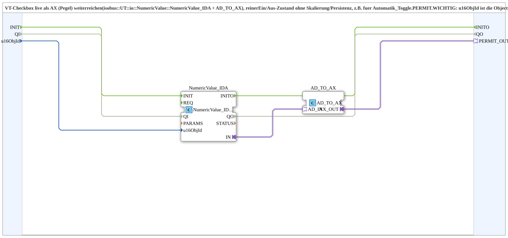

# Checkbox_IDA_TO_AX

* * * * * * * * * *

## Einleitung

`Checkbox_IDA_TO_AX` reicht den Zustand einer **VT-Checkbox live als AX-Pegel** weiter (`isobus::UT::io::NumericValue::NumericValue_IDA` + `AD_TO_AX`). Es ist ein reiner Ein/Aus-Zustand ohne Skalierung und Persistenz, z. B. für `Automatik_Toggle.PERMIT`.

**Wichtig:** `u16ObjId` ist die Object ID der **`CNumberVariable`**, die die Checkbox als Wertspeicher referenziert (z. B. `NumberVariable_Bunker_Fuellstand_Hoehe_Automatik`) – **nicht** die Object ID der Checkbox (`CInputBoolean`) selbst. Die VT meldet Wertänderungen unter der NumberVariable-ID (live verifiziert).

## Schnittstellenstruktur

### **Ereignis-Eingänge**

Keine.

### **Ereignis-Ausgänge**

Keine.

### **Daten-Eingänge**

- **u16ObjId** (`UINT`): Object ID der Zahlenvariable, die die VT-Checkbox (InputBoolean) als Wertspeicher nutzt (Default `ID_NULL`)

### **Daten-Ausgänge**

Keine.

### **Adapter**

- **PERMIT_OUT** (Plug, `adapter::types::unidirectional::AX`): roher Checkbox-Zustand (0/1) als Pegel

## Verwendete Funktionsbausteine (FBs)

- **`NumericValue_IDA`** (`isobus::UT::io::NumericValue::NumericValue_IDA`): Parameter `QI = TRUE`, liefert den Wert der Zahlenvariable als `AD`-Adapter
- **`AD_TO_AX`** (`adapter::conversion::unidirectional::AD_TO_AX`): wandelt den Wert in einen `AX`-Pegel

## Funktionsweise

- `u16ObjId` → `NumericValue_IDA.u16ObjId`
- `NumericValue_IDA.IN` → `AD_TO_AX.AD_IN`
- `AD_TO_AX.AX_OUT` → `PERMIT_OUT`

## Technische Besonderheiten

- Rein als Pegel; keine Skalierung, keine Persistenz
- Variante mit Initialisierung: [Checkbox_IDA_TO_AX_INIT_Force1](./Checkbox_IDA_TO_AX_INIT_Force1.md)

## Anwendungsszenarien

- Freigabe (`PERMIT`) einer Automatik per Checkbox im VT, z. B. für `Automatik_Toggle`

## Zusammenfassung

`Checkbox_IDA_TO_AX` macht aus einer VT-Checkbox einen `AX`-Pegel für die weitere Logik.

---

### 🌐 Passende Themen-Unterseiten auf ms-muc-docs.de

- [🌐 Eclipse 4diac IDE & Farb-Referenz auf ms-muc-docs.de](https://www.ms-muc-docs.de/iec-61499/eclipse-4diac/)
