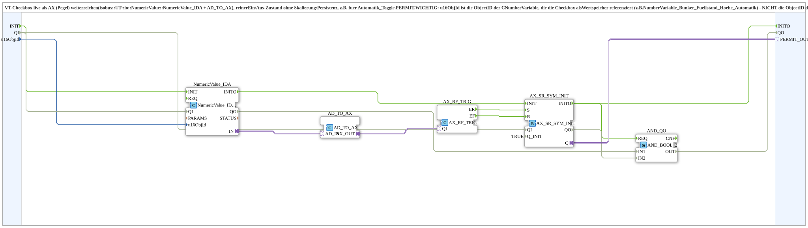

# Checkbox_IDA_TO_AX_INIT

* * * * * * * * * *

## Einleitung

`Checkbox_IDA_TO_AX_INIT` reicht den Zustand einer VT-Checkbox live als `AX`-Pegel weiter (`isobus::UT::io::NumericValue::NumericValue_IDA` + `AD_TO_AX`). Es ist ein reiner Ein/Aus-Zustand ohne Skalierung oder Persistenz, z. B. für `Automatik_Toggle.PERMIT`. Der Zustand wird über einen Flankenwächter und ein SR-Flipflop mit definiertem Initialwert gehalten (`_INIT`).

**Wichtig:** `u16ObjId` ist die ObjectID der `CNumberVariable`, die die Checkbox als Wertspeicher referenziert (z. B. `NumberVariable_Bunker_Fuellstand_Hoehe_Automatik`) – **nicht** die ObjectID der Checkbox (`CInputBoolean`) selbst. Die VT meldet Wertänderungen unter der NumberVariable-ID (live verifiziert).

## Verwendete Funktionsbausteine (FBs)

### Sub-Bausteine: Checkbox_IDA_TO_AX_INIT

- **Typ**: SubAppType
- **Verwendete interne FBs**:
    - **NumericValue_IDA**: `isobus::UT::io::NumericValue::NumericValue_IDA` – liest den Rohwert per ObjectID
    - **AD_TO_AX**: `adapter::conversion::unidirectional::AD_TO_AX` – wandelt den `DWORD`-Wert in ein `AX`-Signal (Wert `<> 0`)
    - **AX_RF_TRIG**: `adapter::events::unidirectional::AX_RF_TRIG` – erkennt steigende (`ER`) und fallende (`EF`) Flanke
    - **AX_SR_SYM_INIT**: `adapter::events::unidirectional::AX_SR_SYM_INIT` (`Q_INIT=TRUE`) – Flipflop mit definiertem Initialwert
    - **AND_QO**: `iec61131::booleanOperators::AND_BOOL_2` – verknüpft `NumericValue_IDA.QO` und `AX_SR_SYM_INIT.QO` zum `QO`
- **Import**: `isobus::UT::Q::const::IDs::ID_NULL` (Initialwert von `u16ObjId`)

## Schnittstellenstruktur

### **Ereignis-Eingänge**

- **INIT** (`EInit`): Initialisierungsanforderung

### **Ereignis-Ausgänge**

- **INITO** (`EInit`): Initialisierungsbestätigung

Die Nutzereignisse laufen weiterhin über die Adapter.

### **Daten-Eingänge**

- **QI** (`BOOL`, Vorgabe `TRUE`): Quality Input – TRUE gibt den Dienst frei
- **u16ObjId** (`UINT`, Initialwert `ID_NULL`): Objekt-ID der VT-Checkbox bzw. der von ihr referenzierten NumberVariable

### **Daten-Ausgänge**

- **QO** (`BOOL`): Quality Output – UND aus `NumericValue_IDA.QO` und `AX_SR_SYM_INIT.QO`

### **Adapter**

- **PERMIT_OUT** (Plug): `adapter::types::unidirectional::AX` – roher Checkbox-Zustand (0/1) als Pegel

## Programmablauf und Verbindungen

- `u16ObjId` → `NumericValue_IDA.u16ObjId`
- `NumericValue_IDA.IN` → `AD_TO_AX.AD_IN`
- `AD_TO_AX.AX_OUT` → `AX_RF_TRIG.QI`
- `AX_RF_TRIG.ER` → `AX_SR_SYM_INIT.S` (Checkbox gesetzt)
- `AX_RF_TRIG.EF` → `AX_SR_SYM_INIT.R` (Checkbox gelöscht)
- `AX_SR_SYM_INIT.Q` → `PERMIT_OUT`
- `INIT` → `NumericValue_IDA.INIT`; `NumericValue_IDA.INITO` → `AX_SR_SYM_INIT.INIT`; `AX_SR_SYM_INIT.INITO` → `INITO` (und → `AND_QO.REQ`)
- `QI` → `NumericValue_IDA.QI` und `QI` → `AX_SR_SYM_INIT.QI`
- `NumericValue_IDA.QO` → `AND_QO.IN1`; `AX_SR_SYM_INIT.QO` → `AND_QO.IN2`; `AND_QO.OUT` → `QO`

## Technische Besonderheiten

- Initialwert: `AX_SR_SYM_INIT` ist mit `Q_INIT=TRUE` parametriert
- Die Checkbox wird roh per ObjectID gelesen; es gibt keine Skalierung und keine Persistenz
- Version 1.0 (2026-09-27): wirkt wie ein `AX_PERMIT`, um das gesamte An/Aus der Befüllautomatik zu gaten

## Anwendungsszenarien

- Freigabe (`PERMIT`) einer Automatik über eine VT-Checkbox, z. B. `Automatik_Toggle.PERMIT`

## Zusammenfassung

`Checkbox_IDA_TO_AX_INIT` liest eine VT-Checkbox über ihre NumberVariable und stellt den Zustand als `AX`-Pegel mit definiertem Initialwert bereit.
