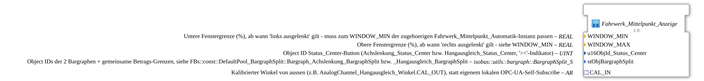

# Fahrwerk_Mittelpunkt_Anzeige

* * * * * * * * * *

## Einleitung

`Fahrwerk_Mittelpunkt_Anzeige` ist die **reine Anzeige-Hälfte** von `Fahrwerk_Mittelpunkt_Automatik`: zwei Bargraphen plus Status-Center-Hintergrundfarbe für einen Winkelsensor mit Mittelstellung (Achslenkung/Hangausgleich). Gespeist wird sie von einem lokal bereits verfügbaren `AR`-Plug (`CAL_IN`) statt von einem eigenen OPC-UA-Self-Subscribe.

Sie ist für Fälle gedacht, in denen die eigentliche Automatik (`AUTO_LINKS`/`AUTO_RECHTS`-Regelung) auf einer anderen Station läuft als die VT (z. B. Hangausgleich seit dem Umzug nach STG4), dort aber trotzdem eine Anzeige gebraucht wird. Ein zusätzliches Forwarding ist nicht nötig: Der Kalibrierkanal-Konsument (`logiBUS_AI_Calibrated_Subscribe_VT_(3P_)OPC`) hat den Wert bereits lokal als `CAL_OUT`-Plug, der hier direkt weiterverdrahtet wird.

## Verwendete Funktionsbausteine (FBs)

### Sub-Bausteine: Fahrwerk_Mittelpunkt_Anzeige

- **Typ**: SubAppType
- **Verwendete interne Bausteine**:
    - **SPLIT_Y**: `adapter::events::unidirectional::AR_SPLIT_2` – verteilt den Winkel auf zwei Verbraucher
    - **CENTER_CMP**: [`adapter::Engineering::measurements::AR_DEADBAND_COMPARE`](../../adapter/Engineering/measurements/AR_DEADBAND_COMPARE.md) – Fenstervergleich
    - **LIT_WINDOW_MIN**, **LIT_WINDOW_MAX**: `adapter::types::unidirectional::AR::initval::initval_AR` – wandeln die Parameter `WINDOW_MIN`/`WINDOW_MAX` in `AR`-Signale
    - **SplitBar**: `isobus::UT::Q::BargraphSplitFS_AR` – zwei Bargraphen (links/rechts der Mitte)
    - **STATUS_CENTER_BG**: SubApp [`MyLib::sys::GreenWhiteBackground1_AX`](./GreenWhiteBackground1_AX.md) – Hintergrundfarbe des `Status_Center`-Buttons

## Schnittstellenstruktur

### **Ereignis-Eingänge / Ereignis-Ausgänge**

- **INIT** (`EInit`, Eingang): Initialisierungsanforderung; wird an `STATUS_CENTER_BG.INIT` durchgereicht
- **INITO** (`EInit`, Ausgang): Initialisierungsbestätigung; kommt von `STATUS_CENTER_BG.INITO`

Die Laufzeit-Ereignisse laufen weiterhin über den Adapter.

### **Daten-Eingänge**

- **QI** (`BOOL`, Vorgabe `TRUE`): Quality Input, Freigabe des Dienstes; wird an `STATUS_CENTER_BG.QI` durchgereicht
- **WINDOW_MIN** (`REAL`, Vorgabe `-2.0`): Untere Fenstergrenze (%), ab wann „links ausgelenkt" gilt – muss zum `WINDOW_MIN` der zugehörigen `Fahrwerk_Mittelpunkt_Automatik`-Instanz passen
- **WINDOW_MAX** (`REAL`, Vorgabe `2.0`): Obere Fenstergrenze (%), ab wann „rechts ausgelenkt" gilt – siehe `WINDOW_MIN`
- **u16ObjId_Status_Center** (`UINT`): Object-ID des `Status_Center`-Buttons (`Achslenkung_Status_Center` bzw. `Hangausgleich_Status_Center`, „><"-Indikator)
- **stObjBargraphSplit** (`isobus::utils::bargraph::BargraphSplit_S`): Object-IDs der zwei Bargraphen plus gemeinsame Betrags-Grenzen (siehe `FBs::const::DefaultPool_BargraphSplit::Bargraph_Achslenkung_BargraphSplit` bzw. `_Hangausgleich_BargraphSplit`)

### **Daten-Ausgänge**

- **QO** (`BOOL`): Quality Output, kommt von `STATUS_CENTER_BG.QO`

### **Adapter**

- **CAL_IN** (Socket, `adapter::types::unidirectional::AR`): Kalibrierter Winkel von außen (z. B. `AnalogChannel_Hangausgleich_Winkel.CAL_OUT`)

## Programmablauf und Verbindungen

- `CAL_IN` → `SPLIT_Y.IN`
- `SPLIT_Y.OUT1` → `CENTER_CMP.Y`; `SPLIT_Y.OUT2` → `SplitBar.rPhys`
- `WINDOW_MIN` → `LIT_WINDOW_MIN.INIT_VAL`; `LIT_WINDOW_MIN.OUT` → `CENTER_CMP.WINDOW_MIN`
- `WINDOW_MAX` → `LIT_WINDOW_MAX.INIT_VAL`; `LIT_WINDOW_MAX.OUT` → `CENTER_CMP.WINDOW_MAX`
- `CENTER_CMP.CENTERED` → `STATUS_CENTER_BG.DI1`
- `u16ObjId_Status_Center` → `STATUS_CENTER_BG.u16ObjId`
- `stObjBargraphSplit` → `SplitBar.stObj`
- Initialisierung: `INIT` → `STATUS_CENTER_BG.INIT`; `STATUS_CENTER_BG.INITO` → `INITO`
- Qualität: `QI` → `STATUS_CENTER_BG.QI`; `STATUS_CENTER_BG.QO` → `QO`

## Technische Besonderheiten

- Herausgelöst aus `Fahrwerk_Mittelpunkt_Automatik` (dort kamen `SUBSCRIBE_Y`, `SPLIT_Y`, `CENTER_CMP`, `SplitBar` und `STATUS_CENTER_BG` bereits genauso vor)
- Die Automatik selbst läuft seit v3.0 des Hangausgleichs auf STG4 (ohne VT; dort sind `u16ObjId_Status_Center` und `stObjBargraphSplit` bewusst `ID_NULL`); diese SubApp läuft stattdessen auf STG1, gespeist vom ohnehin lokal vorhandenen `CAL_OUT`-Plug – kein zusätzlicher Remote-Round-Trip
- Version 1.0 (2026-09-26)

## Anwendungsszenarien

- Anzeige von Achslenkung oder Hangausgleich (zwei Bargraphen plus Mitte-Indikator) auf einer Station, deren Regelung auf einer anderen Station läuft

## Zusammenfassung

`Fahrwerk_Mittelpunkt_Anzeige` zeigt einen kalibrierten Winkel als zwei Bargraphen und als Status-Center-Hintergrundfarbe an, ohne eigene Regelung und ohne OPC-UA-Subscribe.
