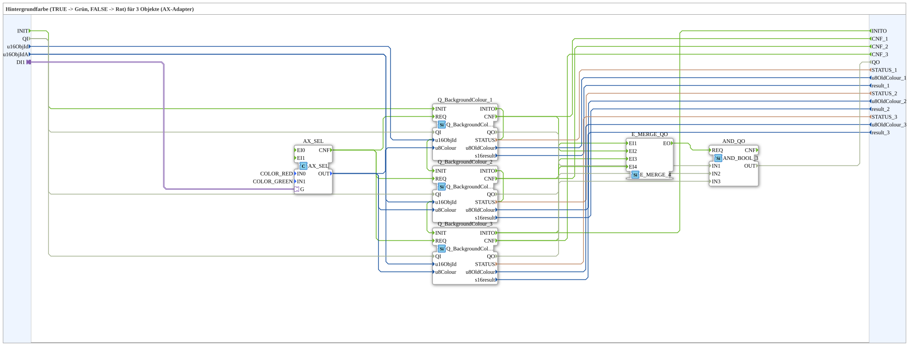

# GreenRedBackground3_AX

* * * * * * * * * *

## Einleitung

`GreenRedBackground3_AX` schaltet die VT-Hintergrundfarbe von 3 Objekten anhand eines booleschen Selector-Signals: `TRUE` → **Grün**, `FALSE` → **Rot**. Das Selector-Signal kommt über einen `AX`-Adapter-Socket (`DI1`). Die Objekt-ID wird über die Eingänge `u16ObjId, u16ObjIdA` übergeben.

| Position | Objekt-ID-Quelle | Baustein                                            |
| -------- | ---------------- | --------------------------------------------------- |
| 1        | `u16ObjId`       | `Q_BackgroundColour` (normales Objekt)              |
| 2        | `u16ObjIdA`      | `Q_BackgroundColour` (normales Objekt)              |
| 3        | `u16ObjIdA`      | `Q_BackgroundColourAux` (Auxiliary-Function-Objekt) |

Allgemeines Muster (Selector → `AX_SEL`/`F_SEL` → `Q_BackgroundColour`) siehe [Background-Farbbausteine (gemeinsames Muster)](./Background-Farbbausteine.md).

Zusätzlich besitzt der Baustein die Schnittstelle für Initialisierung und Qualität: Ereigniseingang `INIT`, Ereignisausgang `INITO`, Dateneingang `QI` (`BOOL`, Initialwert `TRUE`) und Datenausgang `QO` (`BOOL`, AND aller Instanzen). `INIT` → `Q_BackgroundColour_1.INIT`, `Q_BackgroundColour_1.INITO` → `Q_BackgroundColour_2.INIT`, `Q_BackgroundColour_2.INITO` → `Q_BackgroundColour_3.INIT`, `Q_BackgroundColour_3.INITO` → `INITO` (die drei Instanzen werden also nacheinander initialisiert). `QI` geht an `QI` aller drei Instanzen. `QO` ist der Ausgang der Instanz `AND_QO` (`iec61131::booleanOperators::AND_BOOL_3`), die `Q_BackgroundColour_1.QO`, `Q_BackgroundColour_2.QO` und `Q_BackgroundColour_3.QO` verknüpft; ihr `REQ` wird von `E_MERGE_QO` (`iec61499::events::E_MERGE_4`) ausgelöst, das `Q_BackgroundColour_3.INITO` und die `CNF`-Ereignisse der drei Instanzen zusammenführt.

## Zusammenfassung

Eine von vielen Varianten der Background-Farbbausteine-Familie: Farbpaar Grün/Rot, 3 Objekte, Adapter-Selector.

---

### 🌐 Passende Themen-Unterseiten auf ms-muc-docs.de

* [🌐 Eclipse 4diac IDE & Farb-Referenz auf ms-muc-docs.de](https://www.ms-muc-docs.de/iec-61499/eclipse-4diac/)
