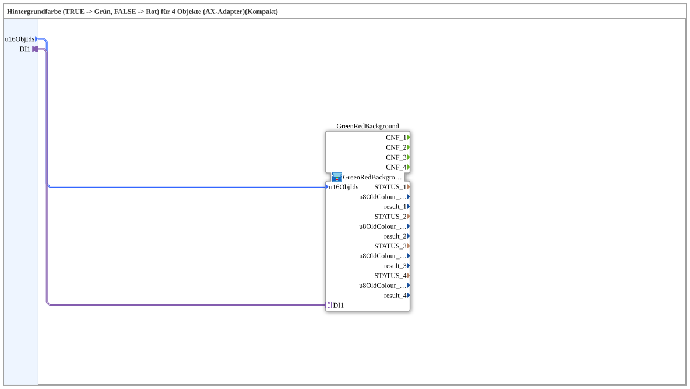

# GreenRedBackground4_AXSC

* * * * * * * * * *

## Einleitung

`GreenRedBackground4_AXSC` ist ein **Kompakt-Wrapper** um [`GreenRedBackground4_AXS`](GreenRedBackground4_AXS.md) — reicht `u16ObjId`s und den Selector durch, ohne die `CNF`-Ereignisausgänge und Diagnosewerte (`STATUS_n`, `u8OldColour_n`, `result_n`) nach außen zu führen.

Details zum gemeinsamen Muster siehe [Background-Farbbausteine (gemeinsames Muster)](./Background-Farbbausteine.md).

## Zusammenfassung

Reine Weiterleitung an `GreenRedBackground4_AXS` für den Regelfall, in dem die Diagnosewerte nicht gebraucht werden.

---

### 🌐 Passende Themen-Unterseiten auf ms-muc-docs.de

* [🌐 Eclipse 4diac IDE & Farb-Referenz auf ms-muc-docs.de](https://www.ms-muc-docs.de/iec-61499/eclipse-4diac/)
