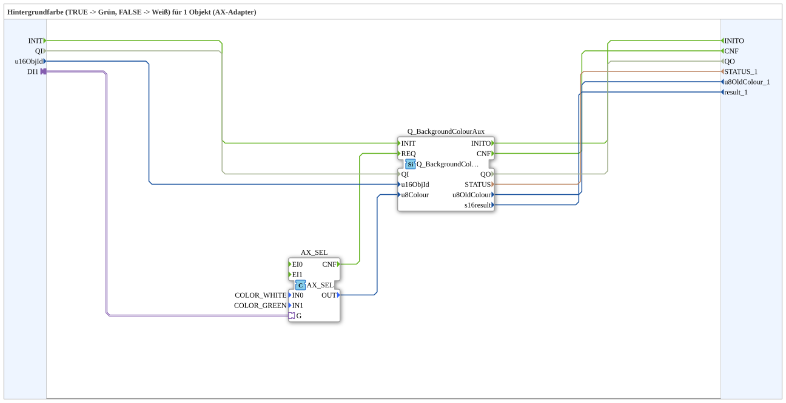

# GreenWhiteBackground1_aux_AX

* * * * * * * * * *

## Einleitung

`GreenWhiteBackground1_aux_AX` schaltet die VT-Hintergrundfarbe eines Objekts anhand eines booleschen Selector-Signals: `TRUE` → **Grün**, `FALSE` → **Weiß**. Das Selector-Signal kommt über einen `AX`-Adapter-Socket (`DI1`). Die Objekt-ID wird über den Eingang `u16ObjId` übergeben.

Allgemeines Muster (Selector → `AX_SEL`/`F_SEL` → `Q_BackgroundColour`) siehe [Background-Farbbausteine (gemeinsames Muster)](./Background-Farbbausteine.md).

Quality-Muster: Die SubApp besitzt den Ereigniseingang `INIT`, den Ereignisausgang `INITO`, den Dateneingang `QI` (`BOOL`, Vorgabe `TRUE`, „Quality Input – TRUE to enable service“) und den Datenausgang `QO` (`BOOL`, „Quality Output – TRUE if service executed successfully“). Sie werden direkt an `Q_BackgroundColourAux` durchgereicht: `INIT` → `Q_BackgroundColourAux.INIT`, `Q_BackgroundColourAux.INITO` → `INITO`, `QI` → `Q_BackgroundColourAux.QI`, `Q_BackgroundColourAux.QO` → `QO`.

## Zusammenfassung

Eine von vielen Varianten der Background-Farbbausteine-Familie: Farbpaar Grün/Weiß, 1 Objekt, Adapter-Selector.

---

### 🌐 Passende Themen-Unterseiten auf ms-muc-docs.de

* [🌐 Eclipse 4diac IDE & Farb-Referenz auf ms-muc-docs.de](https://www.ms-muc-docs.de/iec-61499/eclipse-4diac/)
