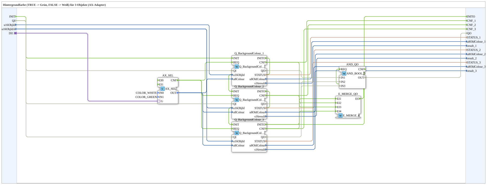
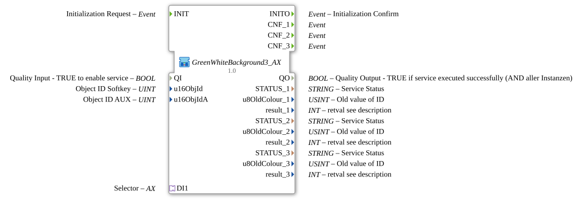

# GreenWhiteBackground3_AX

* * * * * * * * * *

## Einleitung

`GreenWhiteBackground3_AX` schaltet die VT-Hintergrundfarbe von 3 Objekten anhand eines booleschen Selector-Signals: `TRUE` → **Grün**, `FALSE` → **Weiß**. Das Selector-Signal kommt über einen `AX`-Adapter-Socket (`DI1`). Die Objekt-ID wird über die Eingänge `u16ObjId, u16ObjIdA` übergeben.

| Position | Objekt-ID-Quelle | Baustein                                            |
| -------- | ---------------- | --------------------------------------------------- |
| 1        | `u16ObjId`       | `Q_BackgroundColour` (normales Objekt)              |
| 2        | `u16ObjIdA`      | `Q_BackgroundColour` (normales Objekt)              |
| 3        | `u16ObjIdA`      | `Q_BackgroundColourAux` (Auxiliary-Function-Objekt) |

Allgemeines Muster (Selector → `AX_SEL`/`F_SEL` → `Q_BackgroundColour`) siehe [Background-Farbbausteine (gemeinsames Muster)](./Background-Farbbausteine.md).

## Initialisierung und Qualität

- **Ereignis-Eingang `INIT`** (`EInit`) und **Ereignis-Ausgang `INITO`** (`EInit`): die Initialisierung wird durch die `Q_BackgroundColour`-Instanzen gekettet: `INIT` → `Q_BackgroundColour_1.INIT`; `Q_BackgroundColour_1.INITO` → `Q_BackgroundColour_2.INIT`; `Q_BackgroundColour_2.INITO` → `Q_BackgroundColour_3.INIT`; `Q_BackgroundColour_3.INITO` → `INITO`.
- **Dateneingang `QI`** (`BOOL`, Vorgabe `TRUE`) wird an `.QI` aller Instanzen verteilt (`Q_BackgroundColour_1`, `Q_BackgroundColour_2`, `Q_BackgroundColour_3`).
- **Datenausgang `QO`** (`BOOL`): UND aller Instanzen über `AND_QO` (`iec61131::booleanOperators::AND_BOOL_3`): `Q_BackgroundColour_1.QO` → `AND_QO.IN1`, `Q_BackgroundColour_2.QO` → `AND_QO.IN2`, `Q_BackgroundColour_3.QO` → `AND_QO.IN3`; `AND_QO.OUT` → `QO`.
- `E_MERGE_QO` (`iec61499::events::E_MERGE_4`) vereint `Q_BackgroundColour_3.INITO` und die `CNF`-Ereignisse aller drei Instanzen (`Q_BackgroundColour_1.CNF`, `Q_BackgroundColour_2.CNF`, `Q_BackgroundColour_3.CNF`) und löst damit `AND_QO.REQ` aus.

## Zusammenfassung

Eine von vielen Varianten der Background-Farbbausteine-Familie: Farbpaar Grün/Weiß, 3 Objekte, Adapter-Selector.

---

### 🌐 Passende Themen-Unterseiten auf ms-muc-docs.de

- [🌐 Eclipse 4diac IDE & Farb-Referenz auf ms-muc-docs.de](https://www.ms-muc-docs.de/iec-61499/eclipse-4diac/)
