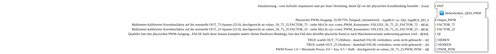

# HebenSenken_QDA_PWM

* * * * * * * * * *

## Einleitung

`HebenSenken_QDA_PWM` wählt über zwei AX-Booleans (`HEBEN`/`SENKEN`) zwischen drei ratiometrischen PWM-Stufen (Danfoss PVEA: 25 % = Senken, 50 % = Neutral, 75 % = Heben, Lastteiler-korrigiert) und gibt die gewählte Stufe auf einen physischen PWM-Ausgang aus. Er ist der reine Mux-, Skalierungs- und Ausgabe-Teil von `HebenSenken_ILOCK_QDA_PWM_OPC`, ohne Remote-Subscribe, ILOCK und Publish. Er eignet sich für Aufrufer, die `HEBEN`/`SENKEN` bereits anderweitig liefern (z. B. schon gegatet/exklusiv oder mit nur einer genutzten Richtung).

## Schnittstellenstruktur

### **Ereignis-Eingänge**

- **INIT** (`EInit`): Initialisierung; vom Aufrufer sequenziert statt per Auto-Verteilung, damit `QI` vor der physischen Kanalbindung feststeht; wird an `DigitalOutput_PWM.INIT` durchgereicht

### **Ereignis-Ausgänge**

Der Funktionsblock verfügt über keine direkten Ereignis-Ausgänge.

### **Daten-Eingänge**

- **Output_PWM** (`logiBUS::io::DQ::logiBUS_DO_S`): physischer PWM-Ausgang (25/50/75 % Tastgrad, ratiometrisch), Default `logiBUS_DO::Invalid`
- **FACTOR_75** (REAL): Multimeter-kalibrierter Korrekturfaktor auf die nominelle `OUT_75`-Spanne (25.0), durchgereicht an `values_50_75_25.FACTOR_75` (Default `REAL#1.0`)
- **FACTOR_25** (REAL): Multimeter-kalibrierter Korrekturfaktor auf die nominelle `OUT_25`-Spanne (25.0), durchgereicht an `values_50_75_25.FACTOR_25` (Default `REAL#1.0`)
- **QI** (BOOL): Qualifier für den physischen PWM-Ausgang (Default TRUE); FALSE hält die Instanz komplett inaktiv (keine Hardware-Bindung), falls derselbe physische Kanal je nach Maschinenvariante anderweitig genutzt wird

### **Daten-Ausgänge**

Der Funktionsblock verfügt über keine direkten Daten-Ausgänge.

### **Adapter**

- **HEBEN** (Socket, `AX`): TRUE wählt `OUT_75` (Heben); dauerhaft FALSE verdrahten, wenn nicht gebraucht
- **SENKEN** (Socket, `AX`): TRUE wählt `OUT_25` (Senken); dauerhaft FALSE verdrahten, wenn nicht gebraucht
- **PWM_POW** (Socket, `AR`): PWM-Power, 1.0 = maximale Power, 0.0 = Aus, 0.5 = halb; durchgereicht an `values_50_75_25.PWM_POW`

## Funktionsweise

Die Kette im Netzwerk:

1. `HEBEN` → `ASSEMBLE_AB_FROM_AX.BIT_00` und `SENKEN` → `ASSEMBLE_AB_FROM_AX.BIT_01`: beide Booleans werden zu einem Byte zusammengesetzt (`HEBEN` ist das niederwertigste Bit).
2. `AB_TO_AUI` wandelt das Byte in einen `AUI`-Wert, der als Auswahl `K` an `AR_AUI_MUX_3` geht: `K = 0` (beide FALSE) wählt `IN1` = `OUT_50` (Neutral), `K = 1` (`HEBEN`) wählt `IN2` = `OUT_75`, `K = 2` (`SENKEN`) wählt `IN3` = `OUT_25`.
3. `values_50_75_25` liefert aus `PWM_POW` sowie `FACTOR_75`/`FACTOR_25` die drei Sollwerte `OUT_50`, `OUT_75`, `OUT_25`.
4. `AR_AUI_MUX_3.OUT` → `AR_R_MUL_Korrektur` (Faktor `PWM_LASTTEILER_KORREKTUR`) → `AR_R_MUL_PWM13BIT` (Faktor `PWM_13BIT_SKALIERUNG`) → `AR_TO_AD_NUM` → `DigitalOutput_PWM.OUT`.
5. `DigitalOutput_PWM` (`logiBUS::io::DQ::logiBUS_QDA_PWM`) gibt den Wert am Ausgang `Output_PWM` aus; `QI` wird direkt an `DigitalOutput_PWM.QI` und das Ereignis `INIT` an `DigitalOutput_PWM.INIT` geführt.

## Technische Besonderheiten

- Es gibt **keine** Verriegelung: Der Aufrufer muss sicherstellen, dass `HEBEN` und `SENKEN` nie gleichzeitig TRUE sind, sonst liefert `AR_AUI_MUX_3` für `K = 3` ein undefiniertes Verhalten
- Die Plug-/Variablennamen `_75`/`_25` sind historisch; die tatsächlich kalibrierten Werte liegen bei `PWM_POW = 1.0` bei 90.0 bzw. 15.0 (siehe [`values_50_75_25`](values_50_75_25.md))
- Der Eingang `QI` (Version 1.1) erlaubt, die Instanz komplett inaktiv zu halten, wenn der Kanal anderweitig genutzt wird
- Der Ereigniseingang `INIT` (Version 1.2) ersetzt die Auto-Verteilung der Initialisierung: der Aufrufer löst sie selbst aus („Init wie bei Tecu“), sodass `QI` vor der physischen Kanalbindung feststeht
- Erster Aufrufer: `Bunkerboden_PWM.SUB`, die nur `SENKEN` (Vollgas) nutzt und `HEBEN` dauerhaft auf FALSE legt

## Anwendungsszenarien

- Ansteuerung eines Proportionalventils (Danfoss PVEA) mit 25/50/75 % PWM für Senken/Neutral/Heben
- Anwendungen mit bereits gegateten oder nur einseitig genutzten Richtungssignalen

## Fazit

`HebenSenken_QDA_PWM` setzt zwei Richtungs-Booleans ohne Verriegelung in eine der drei ratiometrischen PWM-Stufen um und gibt sie skaliert am physischen PWM-Ausgang aus.
