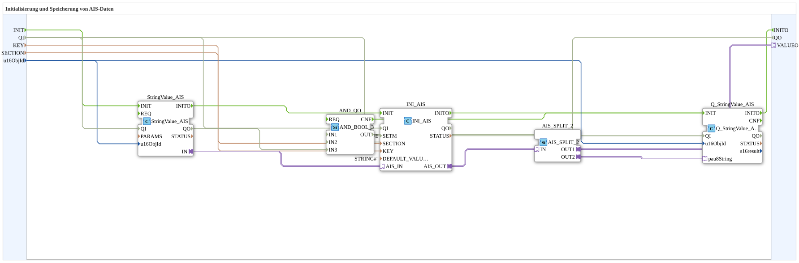

# INI_IN_AND_STORE_AIS

* * * * * * * * * *

## Einleitung

`INI_IN_AND_STORE_AIS` speichert einen über VT eingegebenen String-Wert (AIS-Adapter) persistent in einer INI-Datei und lädt ihn beim Deployment automatisch wieder.

Allgemeines Muster siehe [INI_IN_AND_STORE / NVS_IN_AND_STORE (gemeinsames Muster)](./INI-NVS-Speicherbausteine.md).

Schnittstelle (Quality-Muster): Dateneingang `QI` (`BOOL`, Vorgabe `TRUE`, „Quality Input – TRUE to enable service“) und Datenausgang `QO` (`BOOL`, „Quality Output – TRUE if service executed successfully“) sind mit allen drei internen Dienst-Bausteinen (`StringValue_AIS`, `INI_AIS`, `Q_StringValue_AIS`) verbunden: `QI` → `Q_StringValue_AIS.QI`, `INI_AIS.QI` und `StringValue_AIS.QI`; `QO` ist das UND (`AND_QO`, `iec61131::booleanOperators::AND_BOOL_3`) aus `Q_StringValue_AIS.QO`, `INI_AIS.QO` und `StringValue_AIS.QO`.

Zusätzlich besitzt der Baustein die Ereignisse `INIT` (Eingang, `EInit`) und `INITO` (Ausgang, `EInit`); die Initialisierung wird gekettet: `INIT` → `StringValue_AIS.INIT`; `StringValue_AIS.INITO` → `INI_AIS.INIT`; `INI_AIS.INITO` → `Q_StringValue_AIS.INIT`; `Q_StringValue_AIS.INITO` → `INITO` (und → `AND_QO.REQ`).

## Zusammenfassung

AIS-Variante (String) der INI-Speicherfamilie.

---

### 🌐 Passende Themen-Unterseiten auf ms-muc-docs.de

* [🌐 Eclipse 4diac IDE & Farb-Referenz auf ms-muc-docs.de](https://www.ms-muc-docs.de/iec-61499/eclipse-4diac/)
