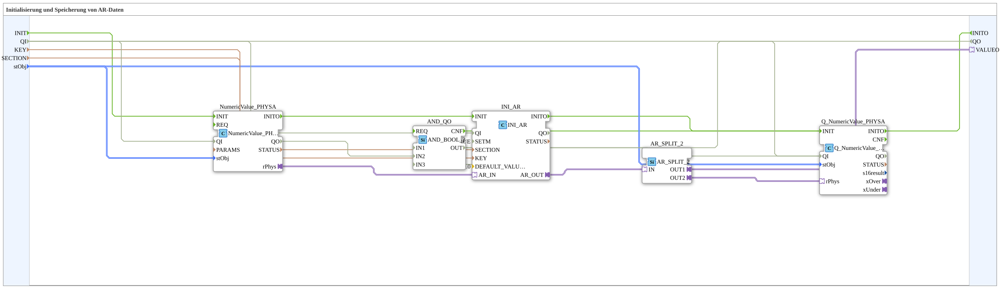

# INI_IN_AND_STORE_AR

* * * * * * * * * *

## Einleitung

`INI_IN_AND_STORE_AR` speichert einen über VT eingegebenen physikalisch skalierten REAL-Wert (AR-Adapter, `NumericValue_PHYSA`/`Q_NumericValue_PHYSA` mit `NumericObjectPool_S`-Skalierung: `r32Scale`, `i32Offset`, `u8Decimals`) persistent in einer INI-Datei.

Allgemeines Muster siehe [INI_IN_AND_STORE / NVS_IN_AND_STORE (gemeinsames Muster)](./INI-NVS-Speicherbausteine.md).

Schnittstelle (Quality-Muster): Dateneingang `QI` (`BOOL`, Vorgabe `TRUE`, „Quality Input – TRUE to enable service“) und Datenausgang `QO` (`BOOL`, „Quality Output – TRUE if service executed successfully“) sind direkt mit dem VT-Schreibbaustein verbunden: `QI` → `Q_NumericValue_PHYSA.QI`, `Q_NumericValue_PHYSA.QO` → `QO`.

## Zusammenfassung

AR-Variante (physikalisch skaliertes REAL) der INI-Speicherfamilie.

---

### 🌐 Passende Themen-Unterseiten auf ms-muc-docs.de

* [🌐 Eclipse 4diac IDE & Farb-Referenz auf ms-muc-docs.de](https://www.ms-muc-docs.de/iec-61499/eclipse-4diac/)
