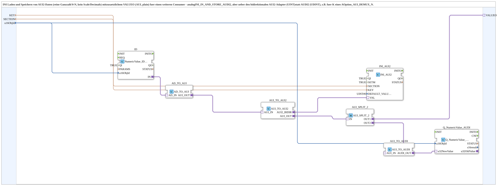

# INI_IN_AND_STORE_AUI2

* * * * * * * * * *

## Einleitung

`INI_IN_AND_STORE_AUI2` lädt und speichert AUI2-Daten (reine Ganzzahl 0-N, kein Scale/Decimals) in einer INI-Datei und stellt zusätzlich `VALUEO` (AUI, plain) für einen weiteren Consumer bereit. Er entspricht [`INI_IN_AND_STORE_AUDI2`](./INI_IN_AND_STORE_AUDI2.md), nutzt aber den bidirektionalen AUI2-Adapter (UINT) statt AUDI2 (UDINT) - z. B. für `K` eines `AOption_AUI_DEMUX_N`.

Allgemeines Muster siehe [INI_IN_AND_STORE / NVS_IN_AND_STORE (gemeinsames Muster)](./INI-NVS-Speicherbausteine.md).

## Schnittstelle

### Eingangsvariablen

- `QI` (BOOL, Vorgabe `TRUE`): Quality Input - TRUE aktiviert den Dienst.
- `KEY` (STRING): Schlüsselname in der INI-Datei.
- `SECTION` (STRING): Abschnittsname in der INI-Datei.
- `u16ObjId` (UINT, Default `ID_NULL`): ObjectID des VT-Eingabefelds.

### Ausgangsvariablen

- `QO` (BOOL): Quality Output - TRUE, wenn der Dienst erfolgreich ausgeführt wurde (UND von `Q_NumericValue_AUDI.QO`, `ID.QO` und `INI_AUI2.QO`).

### Adapter

- **Plug `VALUEO`** (`adapter::types::unidirectional::AUI`): Wert für einen weiteren Consumer.

### Ereignisse

- Eingang `INIT` (`EInit`): Initialization Request
- Ausgang `INITO` (`EInit`): Initialization Confirm

## Funktionsweise

1. `ID` (`NumericValue_IDA`) liest das VT-Eingabefeld; `AD_TO_AUI` wandelt in AUI.
2. `AUI_TO_AUI2` wandelt in den bidirektionalen AUI2-Adapter für `INI_AUI2` (`eclipse4diac::storage::INI_AUI2`; `SETM`=TRUE, `DEFAULT_VALUE`=`UINT#0`).
3. `AUI_TO_AUI2.AUI_OUT` wird per `AUI_SPLIT_2` verdoppelt: `OUT1` an `VALUEO`, `OUT2` über `AUI_TO_AUDI` an `Q_NumericValue_AUDI` (`u32NewValue`, VT-Anzeige).

`QI` wird an `ID.QI`, `INI_AUI2.QI` und `Q_NumericValue_AUDI.QI` durchgereicht. Die Initialisierungskette lautet `INIT` → `ID.INIT`, `ID.INITO` → `INI_AUI2.INIT`, `INI_AUI2.INITO` → `Q_NumericValue_AUDI.INIT`, `Q_NumericValue_AUDI.INITO` → `INITO` (und zusätzlich → `AND_QO.REQ`). `QO` ist die UND-Verknüpfung (`AND_QO`, Typ `iec61131::booleanOperators::AND_BOOL_3`) von `Q_NumericValue_AUDI.QO`, `ID.QO` und `INI_AUI2.QO`.

## Technische Besonderheiten

- Strukturell identisch zu `INI_IN_AND_STORE_AUDI2`, nur mit AUI2 statt AUDI2.
- `SETM`=TRUE: Der Boot-Wert lädt automatisch (INIT → INITO → GET → GETO); `SETM`=TRUE sorgt zusätzlich dafür, dass auch eine Live-Änderung sofort bestätigt/zurückgemeldet wird (z. B. für die Weiterverwendung über `VALUEO`).

## Zusammenfassung

AUI2-Variante der INI-Speicherfamilie für reine Ganzzahlen mit zusätzlichem `VALUEO`-Ausgang.

## 🛠️ Zugehörige Übungen

- [Uebung_094b4_AX](https://meisterschulen-am-ostbahnhof-munchen-docs.readthedocs.io/projects/4diac-exercises-docs/de/latest/Uebungen/test_AX/Uebungen_doc/Uebung_094b4_AX/)

---

### 🌐 Passende Themen-Unterseiten auf ms-muc-docs.de

- [🌐 Eclipse 4diac IDE & Farb-Referenz auf ms-muc-docs.de](https://www.ms-muc-docs.de/iec-61499/eclipse-4diac/)
