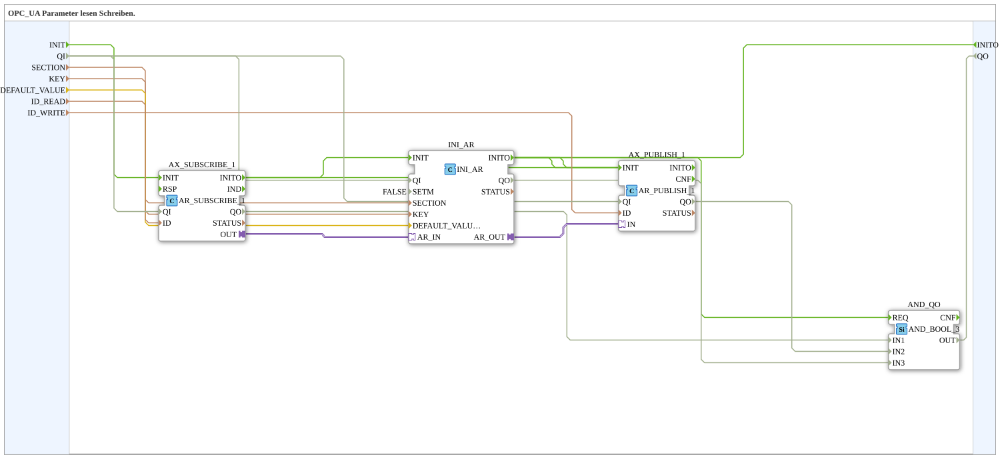

# INI_OPC_PARAM

* * * * * * * * * *

## Einleitung

`INI_OPC_PARAM` liest und schreibt einen REAL-Parameter per OPC-UA und speichert ihn remanent in der INI-Datei (`settings.ini`). Ein Client kann über `ID_READ` einen neuen Wert setzen; der aktuell gespeicherte Wert wird über `ID_WRITE` veröffentlicht. Nach einem Neustart wird der zuletzt gespeicherte Wert (oder `DEFAULT_VALUE`, falls noch keiner vorhanden ist) automatisch geladen und wieder publiziert.

## Verwendete Funktionsbausteine (FBs)

### Sub-Bausteine: INI_OPC_PARAM

- **Typ**: SubAppType
- **Verwendete interne FBs**:
    - **AX_SUBSCRIBE_1**: `adapter::net::AR_SUBSCRIBE_1` — abonniert neue Werte vom OPC-UA-Client (`ID_READ`).
    - **INI_AR**: `eclipse4diac::storage::INI_AR` (`SETM=FALSE`) — speichert den Wert remanent in der INI-Datei unter `SECTION`/`KEY`, mit `DEFAULT_VALUE` als Startwert.
    - **AX_PUBLISH_1**: `adapter::net::AR_PUBLISH_1` — veröffentlicht den aktuellen Wert per OPC-UA (`ID_WRITE`).
    - **AND_QO**: `iec61131::booleanOperators::AND_BOOL_3` — verknüpft die `QO`-Ausgänge von `AX_SUBSCRIBE_1`, `AX_PUBLISH_1` und `INI_AR` zum SubApp-Ausgang `QO`.
- **Schnittstelle**: Ereigniseingang `INIT`, Ereignisausgang `INITO`, Dateneingang `QI` (Initialwert `TRUE`, an alle drei FBs durchgereicht) und Datenausgang `QO` (`AND` der drei `QO`-Ausgänge).
- **Funktionsweise**: Ein per OPC-UA empfangener Wert wird an `INI_AR` weitergereicht, dort gespeichert, und der (neu empfangene oder beim Start geladene) Wert wird per `AX_PUBLISH_1` erneut veröffentlicht.

## Programmablauf und Verbindungen

1. **Initialisierungskette**: `INIT` → `AX_SUBSCRIBE_1.INIT`; `AX_SUBSCRIBE_1.INITO` → `INI_AR.INIT` → `INI_AR.INITO` → `AX_PUBLISH_1.INIT`. Zusätzlich sind im Quelltext `AX_SUBSCRIBE_1.INITO` → `AX_PUBLISH_1.INIT` und `AX_PUBLISH_1.INITO` → `INI_AR.INIT` verdrahtet; `INI_AR.INITO` → `INITO` und → `AND_QO.REQ`.
2. **Qualität**: `QI` → `AX_SUBSCRIBE_1.QI`, `AX_PUBLISH_1.QI` und `INI_AR.QI`; `AX_SUBSCRIBE_1.QO` → `AND_QO.IN1`, `AX_PUBLISH_1.QO` → `AND_QO.IN2`, `INI_AR.QO` → `AND_QO.IN3`; `AND_QO.OUT` → `QO`.
3. **Parameter**: `SECTION` → `INI_AR.SECTION`; `KEY` → `INI_AR.KEY`; `DEFAULT_VALUE` → `INI_AR.DEFAULT_VALUE`; `ID_READ` → `AX_SUBSCRIBE_1.ID`; `ID_WRITE` → `AX_PUBLISH_1.ID`.
4. **Adapterkette**: `AX_SUBSCRIBE_1.OUT` → `INI_AR.AR_IN` (neuer Wert vom Client) → `INI_AR.AR_OUT` → `AX_PUBLISH_1.IN` (gespeicherter/aktueller Wert zurück an den Client).

## Technische Besonderheiten

- **`SETM=FALSE`**: `INI_AR` speichert nur bei explizitem Schreibereignis über `AR_IN`, nicht bei jedem Zyklus.
- **Sequentielle Initialisierung**: `AX_SUBSCRIBE_1.INITO` → `INI_AR.INIT` → `INI_AR.INITO` → `AX_PUBLISH_1.INIT` stellt sicher, dass der gespeicherte Wert erst geladen wird, bevor er veröffentlicht wird.
- **Kein eigener Adapter-Ausgang**: Im Gegensatz zu `INI_OPC_PARAM_AR` stellt dieser Baustein den gespeicherten Wert nicht als Plug für andere Bausteine im aufrufenden Netzwerk bereit — er dient ausschließlich der OPC-UA-Anbindung.

## Anwendungsszenarien

- Ein per OPC-UA/Web-Client editierbarer Zahlenparameter (z. B. Sollwert), der über Neustarts hinweg erhalten bleiben muss, aber im lokalen Netzwerk nicht weiterverwendet wird.

## Vergleich mit ähnlichen Bausteinen

`INI_OPC_PARAM_AR` erweitert diesen Baustein um einen zusätzlichen `AR`-Plug (`OUT`) für die lokale Weiterverwendung des gespeicherten Werts. `INI_OPC_PARAM_ATM` liefert zusätzlich eine `TIME`-Umrechnung, `INI_OPC_PARAM_AX` ist die BOOL-Variante mit `AX`-Ausgang.

## Zusammenfassung

`INI_OPC_PARAM` verbindet OPC-UA-Lese-/Schreibzugriff mit remanenter INI-Speicherung eines REAL-Parameters, ohne den Wert lokal als Adapter bereitzustellen.

---

### 🌐 Passende Themen-Unterseiten auf ms-muc-docs.de

- [🌐 Eclipse 4diac IDE & Farb-Referenz auf ms-muc-docs.de](https://www.ms-muc-docs.de/iec-61499/eclipse-4diac/)
