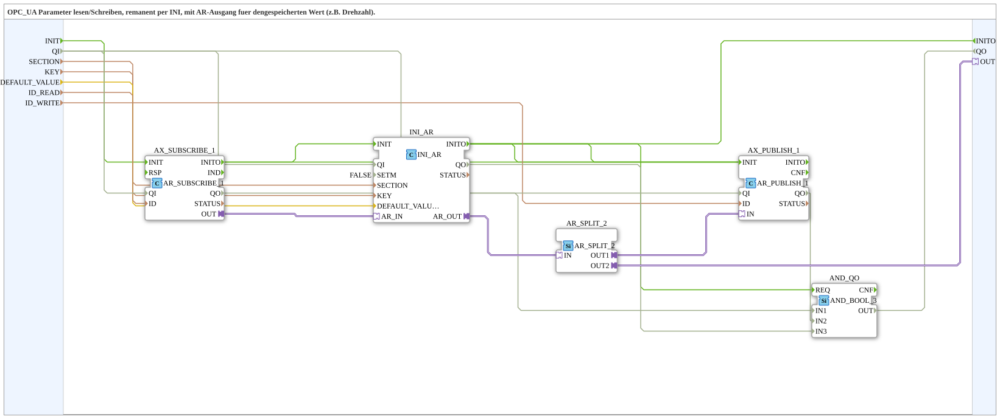

# INI_OPC_PARAM_AR

* * * * * * * * * *

## Einleitung

`INI_OPC_PARAM_AR` erweitert [`INI_OPC_PARAM`](./INI_OPC_PARAM.md) um einen zusätzlichen `AR`-Adapter-Ausgang (`OUT`), der den aktuell gespeicherten/geladenen Wert direkt für die Weiterverwendung im aufrufenden Netzwerk bereitstellt — z. B. für eine lokal einzustellende Drehzahl, die sowohl per OPC-UA editierbar sein als auch direkt in derselben Applikation verwendet werden soll.

## Verwendete Funktionsbausteine (FBs)

### Sub-Bausteine: INI_OPC_PARAM_AR

- **Typ**: SubAppType
- **Verwendete interne FBs**:
    - **AX_SUBSCRIBE_1**: `adapter::net::AR_SUBSCRIBE_1` (`QI` kommt vom Eingang `QI`) — abonniert neue Werte vom OPC-UA-Client (`ID_READ`).
    - **INI_AR**: `eclipse4diac::storage::INI_AR` (`QI` kommt vom Eingang `QI`, `SETM=FALSE`) — speichert den Wert remanent in der INI-Datei unter `SECTION`/`KEY`, mit `DEFAULT_VALUE` als Startwert.
    - **AX_PUBLISH_1**: `adapter::net::AR_PUBLISH_1` (`QI` kommt vom Eingang `QI`) — veröffentlicht den aktuellen Wert per OPC-UA (`ID_WRITE`).
    - **AND_QO**: `iec61131::booleanOperators::AND_BOOL_3` — verknüpft die `QO`-Ausgänge der drei FBs zum Ausgang `QO`.
- **Funktionsweise**: Identisch zu `INI_OPC_PARAM`, zusätzlich wird `INI_AR.AR_OUT` direkt auf den Plug `OUT` geführt. Die SubApp-Schnittstelle hat außerdem die Ereignisse `INIT`/`INITO` und die Daten `QI` (BOOL, Initialwert `TRUE`) und `QO` (BOOL).

## Programmablauf und Verbindungen

1. **Initialisierungskette**: `INIT` → `AX_SUBSCRIBE_1.INIT`; `AX_SUBSCRIBE_1.INITO` → `INI_AR.INIT` und → `AX_PUBLISH_1.INIT`; `AX_PUBLISH_1.INITO` → `INI_AR.INIT`; `INI_AR.INITO` → `AX_PUBLISH_1.INIT`, → `INITO` und → `AND_QO.REQ`.
2. **Parameter**: `SECTION` → `INI_AR.SECTION`; `KEY` → `INI_AR.KEY`; `DEFAULT_VALUE` → `INI_AR.DEFAULT_VALUE`; `ID_READ` → `AX_SUBSCRIBE_1.ID`; `ID_WRITE` → `AX_PUBLISH_1.ID`.
3. **Adapterkette**: `AX_SUBSCRIBE_1.OUT` → `INI_AR.AR_IN` → `INI_AR.AR_OUT` → `AX_PUBLISH_1.IN` **und** → `OUT` (Plug an die SubApp-Schnittstelle).
4. **Qualität**: `QI` → `AX_SUBSCRIBE_1.QI`, `AX_PUBLISH_1.QI` und `INI_AR.QI`; `AX_SUBSCRIBE_1.QO` → `AND_QO.IN1`, `AX_PUBLISH_1.QO` → `AND_QO.IN2`, `INI_AR.QO` → `AND_QO.IN3`; `AND_QO.OUT` → `QO`.

## Technische Besonderheiten

- **Ein Ausgang, zwei Ziele**: `INI_AR.AR_OUT` speist gleichzeitig den OPC-UA-Publish-Adapter und den externen `OUT`-Plug — beide erhalten denselben Wert ohne zusätzlichen Split, da es sich um zwei getrennte Adapterverbindungen von derselben Quelle handelt.
- Ansonsten identisch zu [`INI_OPC_PARAM`](./INI_OPC_PARAM.md) (siehe dort für Details zu `SETM`/Initialisierungsreihenfolge).

## Anwendungsszenarien

- Ein per OPC-UA/Web-Client editierbarer und remanent gespeicherter REAL-Parameter (z. B. Drehzahl-Sollwert), der zusätzlich direkt an andere Bausteine im selben Netzwerk weitergegeben werden muss.

## Vergleich mit ähnlichen Bausteinen

Gegenüber [`INI_OPC_PARAM`](./INI_OPC_PARAM.md) kommt nur der zusätzliche `AR`-Plug `OUT` hinzu. [`INI_OPC_PARAM_ATM`](./INI_OPC_PARAM_ATM.md) rechnet den Wert zusätzlich in `TIME` um, [`INI_OPC_PARAM_AX`](./INI_OPC_PARAM_AX.md) ist die BOOL-Variante.

## Zusammenfassung

`INI_OPC_PARAM_AR` ist `INI_OPC_PARAM` mit zusätzlichem `AR`-Ausgang für die lokale Weiterverwendung des remanent gespeicherten Parameters.

---

### 🌐 Passende Themen-Unterseiten auf ms-muc-docs.de

- [🌐 Eclipse 4diac IDE & Farb-Referenz auf ms-muc-docs.de](https://www.ms-muc-docs.de/iec-61499/eclipse-4diac/)
