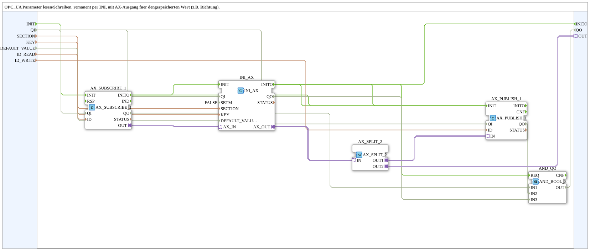

# INI_OPC_PARAM_AX

* * * * * * * * * *

## Einleitung

`INI_OPC_PARAM_AX` ist die BOOL-Variante von [`INI_OPC_PARAM_AR`](./INI_OPC_PARAM_AR.md): Statt eines REAL-Werts wird ein BOOL-Parameter (z. B. eine Richtung oder ein Betriebsmodus-Schalter) per OPC-UA gelesen/geschrieben, remanent in der INI-Datei gespeichert und als `AX`-Adapter für die lokale Weiterverwendung bereitgestellt.

## Verwendete Funktionsbausteine (FBs)

### Sub-Bausteine: INI_OPC_PARAM_AX

- **Typ**: SubAppType
- **Verwendete interne FBs**:
    - **AX_SUBSCRIBE_1**: `adapter::net::AX_SUBSCRIBE_1` — abonniert neue BOOL-Werte vom OPC-UA-Client (`ID_READ`).
    - **INI_AX**: `eclipse4diac::storage::INI_AX` (`SETM=FALSE`) — speichert den BOOL-Wert remanent in der INI-Datei unter `SECTION`/`KEY`, mit `DEFAULT_VALUE` als Startwert.
    - **AX_PUBLISH_1**: `adapter::net::AX_PUBLISH_1` — veröffentlicht den aktuellen Wert per OPC-UA (`ID_WRITE`).
    - **AX_SPLIT_2**: `adapter::events::unidirectional::AX_SPLIT_2` — verzweigt den Ausgang von `INI_AX` auf `AX_PUBLISH_1` und `OUT`.
    - **AND_QO**: `iec61131::booleanOperators::AND_BOOL_3` — verknüpft die `QO`-Ausgänge von `AX_SUBSCRIBE_1`, `AX_PUBLISH_1` und `INI_AX` zum `QO` der SubApp.
- **Funktionsweise**: Strukturell identisch zu `INI_OPC_PARAM_AR`, jedoch mit `AX`-Adaptern (`AX_SUBSCRIBE_1`/`INI_AX`/`AX_PUBLISH_1`) statt `AR`-Adaptern, passend zum BOOL-Datentyp von `DEFAULT_VALUE`.

## Programmablauf und Verbindungen

1. **Initialisierungskette**: `INIT` → `AX_SUBSCRIBE_1.INIT`; `AX_SUBSCRIBE_1.INITO` → `AX_PUBLISH_1.INIT`; `AX_PUBLISH_1.INITO` → `INI_AX.INIT`; `INI_AX.INITO` → `INITO` (und → `AND_QO.REQ`). Zusätzlich enthält das Netzwerk weiterhin die älteren Verbindungen `AX_SUBSCRIBE_1.INITO` → `INI_AX.INIT` und `INI_AX.INITO` → `AX_PUBLISH_1.INIT`.
2. **Parameter**: `SECTION` → `INI_AX.SECTION`; `KEY` → `INI_AX.KEY`; `DEFAULT_VALUE` (BOOL) → `INI_AX.DEFAULT_VALUE`; `ID_READ` → `AX_SUBSCRIBE_1.ID`; `ID_WRITE` → `AX_PUBLISH_1.ID`.
3. **Qualität**: `QI` → `.QI` von `AX_SUBSCRIBE_1`, `AX_PUBLISH_1` und `INI_AX` (nicht mehr fest `QI=TRUE`); `AX_SUBSCRIBE_1.QO` → `AND_QO.IN1`, `AX_PUBLISH_1.QO` → `AND_QO.IN2`, `INI_AX.QO` → `AND_QO.IN3`; `AND_QO.OUT` → `QO`.
4. **Adapterkette**: `AX_SUBSCRIBE_1.OUT` → `INI_AX.AX_IN` → `INI_AX.AX_OUT` → `AX_SPLIT_2.IN`; `AX_SPLIT_2.OUT1` → `AX_PUBLISH_1.IN` **und** `AX_SPLIT_2.OUT2` → `OUT` (Plug an die SubApp-Schnittstelle).

## Technische Besonderheiten

- **BOOL statt REAL**: Einziger fachlicher Unterschied zu `INI_OPC_PARAM_AR` ist der Datentyp (`DEFAULT_VALUE` ist hier `BOOL`) und die entsprechenden `AX`-Adapter-Typen anstelle von `AR`.
- Ansonsten identisch zu [`INI_OPC_PARAM_AR`](./INI_OPC_PARAM_AR.md) (Initialisierungsreihenfolge, `SETM=FALSE`, ein Ausgang mit zwei Zielen).

## Anwendungsszenarien

- Remanent gespeicherte BOOL-Parameter (z. B. Drehrichtung, Betriebsmodus-Schalter), die per OPC-UA/Web-Client editierbar sein und zusätzlich lokal als `AX`-Adapter weiterverwendet werden sollen.

## Vergleich mit ähnlichen Bausteinen

`INI_OPC_PARAM_AX` verhält sich zu [`INI_OPC_PARAM_AR`](./INI_OPC_PARAM_AR.md) wie `AX` zu `AR`: gleiche Struktur, anderer Datentyp. [`INI_OPC_PARAM`](./INI_OPC_PARAM.md) und [`INI_OPC_PARAM_ATM`](./INI_OPC_PARAM_ATM.md) sind die REAL-basierten Varianten (ohne bzw. mit zusätzlicher `TIME`-Umrechnung).

## Zusammenfassung

`INI_OPC_PARAM_AX` ist die BOOL-Variante der `INI_OPC_PARAM`-Familie: OPC-UA-Lese-/Schreibzugriff, remanente INI-Speicherung und ein lokaler `AX`-Ausgang für einen booleschen Parameter.

---

### 🌐 Passende Themen-Unterseiten auf ms-muc-docs.de

- [🌐 Eclipse 4diac IDE & Farb-Referenz auf ms-muc-docs.de](https://www.ms-muc-docs.de/iec-61499/eclipse-4diac/)
