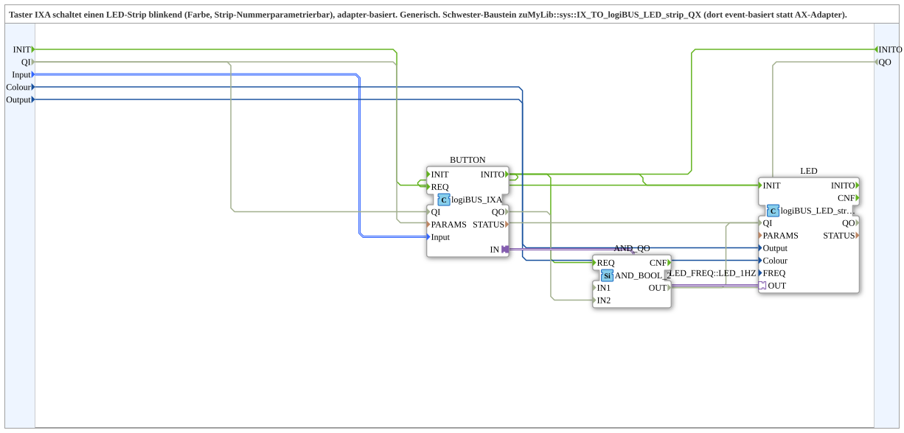

# IXA_TO_logiBUS_LED_strip_QXA

* * * * * * * * * *

## Einleitung

Der Baustein `IXA_TO_logiBUS_LED_strip_QXA` ist eine generische, adapterbasierte Subapp aus `MyLib::sys`. Sie verbindet einen Taster-Baustein `logiBUS_IXA` mit einem LED-Strip-Baustein `logiBUS_LED_strip_QXA`. Über die Daten-Eingänge lassen sich der Tastereingang, die Farbe und die Strip-Nummer parametrieren. Der Baustein ist die adapterbasierte Schwester-Variante des eventbasierten Bausteins `MyLib::sys::IX_TO_logiBUS_LED_strip_QX`.

## Schnittstellenstruktur

Die Subapp besitzt die Initialisierungs-Ereignisse `INIT`/`INITO`, die Status-Anschlüsse `QI`/`QO` und Daten-Eingänge. Es gibt keine externen Adapter.

### **Ereignis-Eingänge**

| Name | Typ | Beschreibung |
|------|-----|--------------|
| INIT | `EInit` | Initialization Request |

### **Ereignis-Ausgänge**

| Name | Typ | Beschreibung |
|------|-----|--------------|
| INITO | `EInit` | Initialization Confirm |

### **Daten-Eingänge**

| Name    | Typ                           | Initialwert               | Beschreibung                                    |
|---------|-------------------------------|---------------------------|-------------------------------------------------|
| QI      | `BOOL`                        | `TRUE`                    | Quality Input - TRUE aktiviert den Dienst.      |
| Input   | `logiBUS::io::DI::logiBUS_DI_S` | `Invalid`                 | Identifiziert den Tastereingang `Input_I1..I8`. |
| Colour  | `UINT`                        | `LED_COLOURS::LED_GREEN`  | Identifiziert die Farbe des LED-Strips.         |
| Output  | `USINT`                       | –                         | Identifiziert die Ausgangsnummer des Strips.    |

### **Daten-Ausgänge**

| Name | Typ | Beschreibung |
|------|-----|--------------|
| QO | `BOOL` | Quality Output - TRUE, wenn der Dienst erfolgreich ausgeführt wurde (UND von `LED.QO` und `BUTTON.QO`). |

### **Adapter**

Keine externen Adapter-Schnittstellen. Intern ist der Adapter `BUTTON.IN` mit dem Adapter `LED.OUT` verbunden. Dadurch wird die Tasterinformation ohne Ereignisse direkt an den LED-Strip weitergegeben.

## Funktionsweise

Der Eingang `Input` wählt den gewünschten Tastereingang aus und wird an den internen Funktionsbaustein `BUTTON` durchgereicht. Die Eingänge `Colour` und `Output` werden direkt an den internen LED-Strip-Baustein `LED` übergeben.

Die eigentliche Kopplung zwischen Taster und LED-Strip erfolgt über die interne Adapterverbindung `BUTTON.IN` → `LED.OUT`. Der LED-Baustein ist dabei mit `FREQ=LED_FREQ::LED_1HZ` parametriert; `QI` kommt vom `QI`-Eingang der Subapp. Das bedeutet, der angeschlossene LED-Strip blinkt bei Betätigung des Tasters mit 1 Hz in der eingestellten Farbe.

Da die Kopplung über Adapter und nicht über Ereignisse realisiert ist, benötigt die Subapp außer `INIT`/`INITO` keine Ereignisse. Die Initialisierung läuft als Kette `INIT` → `LED.INIT`, `LED.INITO` → `BUTTON.INIT`, `BUTTON.INITO` → `INITO` (und zusätzlich → `AND_QO.REQ`). `QI` wird an `LED.QI` und `BUTTON.QI` weitergegeben; `LED.QO` und `BUTTON.QO` werden im Baustein `AND_QO` (Typ `iec61131::booleanOperators::AND_BOOL_2`) per UND zu `QO` verknüpft.

## Technische Besonderheiten

- Adapterbasierte Kopplung statt ereignisbasierter Kopplung.
- Die Subapp besitzt außer `INIT`/`INITO` keine Ereignisse und keine externen Adapter-Schnittstellen.
- Alle wesentlichen Parameter sind über die Daten-Eingänge konfigurierbar:
  - Tastereingang (`Input`)
  - Farbe (`Colour`)
  - Strip-Nummer (`Output`)
- Der interne LED-Baustein wird fest mit `FREQ=LED_FREQ::LED_1HZ` betrieben; `QI` stammt vom Subapp-Eingang `QI` (Vorgabe `TRUE`).
- Der Eingang `Input` ist initial mit `Invalid` belegt und muss vor der Inbetriebnahme auf einen gültigen Wert gesetzt werden.
- Der Baustein verwendet Typen und Konstanten aus der Bibliothek `logiBUS`, z. B. `logiBUS_DI_S`, `LED_COLOURS` und `LED_FREQ`.

## Zustandsübersicht

Die Subapp selbst besitzt keine eigene Zustandsmaschine. Das Verhalten ergibt sich aus den intern verdrahteten Funktionsbausteinen:

- **Taster nicht betätigt:** Keine Tasterinformation wird über den Adapter gesendet; der LED-Strip leuchtet nicht.
- **Taster betätigt:** Der Adapter überträgt die Information an den LED-Strip; der Strip blinkt mit 1 Hz in der parametrierten Farbe.

Je nach Implementierung von `logiBUS_IXA` kann zusätzlich zwischen Flanke, Zustand oder Impuls unterschieden werden. Die Subapp selbst bildet diese Logik jedoch nicht ab, sondern reicht die Tasterinformation über den Adapter weiter.

## Anwendungsszenarien

- Generischer Taster-Schalter für einen LED-Strip: Der Anwender wählt den Tastereingang, die Farbe und die Strip-Nummer.
- Wiederverwendbare Kapselung einer Taster-LED-Strip-Kombination in einer Anlage.
- Einsatz als adapterbasierte Alternative zum eventbasierten Schwester-Baustein `IX_TO_logiBUS_LED_strip_QX`.
- Mehrere Instanzen der Subapp können mit unterschiedlichen Eingängen, Farben und Strip-Nummern parametriert werden, ohne die innere Verdrahtung anzupassen.

## Vergleich mit ähnlichen Bausteinen

- `MyLib::sys::IX_TO_logiBUS_LED_strip_QX`: Eventbasierte Variante. Die Tasterinformation wird über Ereignisse an den LED-Strip übergeben.
- `IXA_TO_logiBUS_LED_strip_QXA`: Adapterbasierte Variante. Die Tasterinformation wird über eine interne Adapterverbindung direkt übertragen.
- Gegenüber einer direkten Verwendung von `logiBUS_IXA` und `logiBUS_LED_strip_QXA` bietet die Subapp eine fertig verdrahtete, parametrierbare Einheit.

## Fazit

Der Baustein `IXA_TO_logiBUS_LED_strip_QXA` bietet eine kompakte und flexible Möglichkeit, einen Taster mit einem blinkenden LED-Strip zu verbinden. Durch die adapterbasierte interne Verknüpfung entfallen externe Ereignisse, und die Parametrierung über die Daten-Eingänge macht den Baustein vielseitig einsetzbar. Er eignet sich besonders für wiederverwendbare Taster-LED-Kombinationen in logiBUS-Umgebungen.
