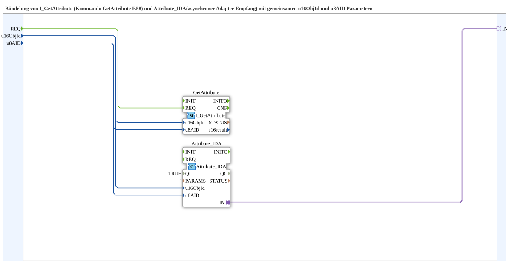

# I_GetAttribute_IDA

* * * * * * * * * *

## Einleitung

`I_GetAttribute_IDA` bündelt `I_GetAttribute` (Kommando *GetAttribute*, F.58) und `Attribute_IDA` (asynchroner Adapter-Empfang) mit gemeinsamen Parametern `u16ObjId` und `u8AID`. Mit `REQ` wird das Attribut eines VT-Objekts angefordert; die Antwort kommt asynchron über den Adapter `IN`.

## Schnittstellenstruktur

### **Ereignis-Eingänge**

- **INIT** (`EInit`): Initialisierungsanforderung (an `Attribute_IDA.INIT`)
- **REQ**: Serviceanforderung (an `GetAttribute.REQ`)

### **Ereignis-Ausgänge**

- **INITO** (`EInit`): Initialisierungsbestätigung (von `Attribute_IDA.INITO`)

Die Antwort selbst kommt über den Adapter-Plug.

### **Daten-Eingänge**

- **QI** (`BOOL`, Vorgabe `TRUE`): Quality Input, Freigabe des Dienstes (an `Attribute_IDA.QI`)
- **u16ObjId** (`UINT`, Vorgabe `ID_NULL`): Object-ID
- **u8AID** (`USINT`): Attribut-ID des Objekts

### **Daten-Ausgänge**

- **QO** (`BOOL`): Quality Output (von `Attribute_IDA.QO`)

### **Adapter**

- **IN** (Plug, `adapter::types::unidirectional::AD`): Eingangsdaten (Antwort) aus der Ressource

## Verwendete Funktionsbausteine (FBs)

- **GetAttribute**: `isobus::UT::I::I_GetAttribute` – sendet das Kommando *GetAttribute*
- **Attribute_IDA**: `isobus::UT::io::Attribute::Attribute_IDA` (`PARAMS=''`, `QI` kommt von der SubApp-Schnittstelle) – empfängt die Antwort asynchron als Adapter

## Programmablauf und Verbindungen

- `REQ` → `GetAttribute.REQ`
- `u16ObjId` → `GetAttribute.u16ObjId` und `Attribute_IDA.u16ObjId`
- `u8AID` → `GetAttribute.u8AID` und `Attribute_IDA.u8AID`
- `Attribute_IDA.IN` → `IN`
- `INIT` → `Attribute_IDA.INIT`; `Attribute_IDA.INITO` → `INITO`
- `QI` → `Attribute_IDA.QI`; `Attribute_IDA.QO` → `QO`

## Technische Besonderheiten

- Durch die gemeinsamen Parameter wird sichergestellt, dass Anforderung und Empfang auf dasselbe Objekt und Attribut zeigen.

## Anwendungsszenarien

- Auslesen eines Attributs eines VT-Objekts (z. B. aktueller Wert, Farbe) und Weiterverarbeiten der Antwort als `AD`-Adapterwert

## Fazit

`I_GetAttribute_IDA` kombiniert Anforderung und Empfang eines VT-Objektattributs in einer SubApp.
