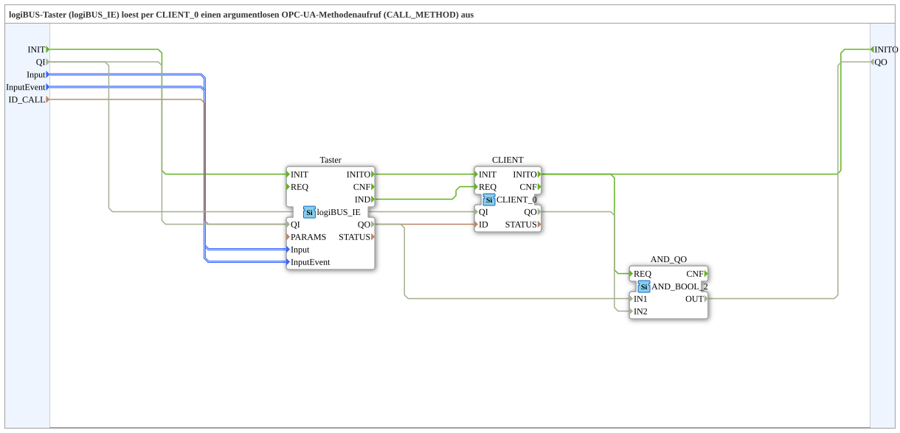

# Input_CLIENT_Method_IE

* * * * * * * * * *

## Einleitung

`Input_CLIENT_Method_IE` ist ein logiBUS-Taster (`logiBUS_IE`), der per `CLIENT_0` einen argumentlosen OPC-UA-Methodenaufruf (`CALL_METHOD`) auslöst. Der Baustein entspricht `Button_CLIENT_Method_IE`, verwendet aber `logiBUS_IE` statt `Button_IE` (Taster statt VT-Button). Er wurde aus [`logiBUS_AI_Calibrated_Subscribe_VT_OPC`](./logiBUS_AI_Calibrated_Subscribe_VT_OPC.md) herausgelöst, wo die Kombination aus `Button_IE` und `CLIENT_0` zweimal identisch vorkam. Das auslösende Tasterereignis ist der Parameter `InputEvent` (nicht hartcodiert auf `BT_PRESSED_LATCHED`), damit auch andere Aktivierungsarten wiederverwendbar sind.

## Schnittstellenstruktur

### **Ereignis-Eingänge**

- `INIT` (`EInit`): Initialization Request

### **Ereignis-Ausgänge**

- `INITO` (`EInit`): Initialization Confirm

### **Daten-Eingänge**

| Name | Typ | Beschreibung |
|------|-----|--------------|
| `QI` | `BOOL` | Quality Input - TRUE, um den Dienst freizugeben. Initialwert `TRUE`. |
| `Input` | `logiBUS::io::DI::logiBUS_DI_S` | Identifiziert den Eingang `Input_I1..I8`. Initialwert `logiBUS_DI::Invalid`. |
| `InputEvent` | `logiBUS::io::DI::logiBUS_DI_Events_S` | Welches Tasterereignis den Aufruf auslöst. Initialwert `BUTTON_PRESS_DOWN`. |
| `ID_CALL` | `WSTRING` | Methodenadresse (`ACTION=CALL_METHOD`, mit Endpunkt, auch `localhost`). |

### **Daten-Ausgänge**

| Name | Typ | Beschreibung |
|------|-----|--------------|
| `QO` | `BOOL` | Quality Output - Zusammengefasster Status der beteiligten Funktionsbausteine (`Taster.QO` UND `CLIENT.QO`, also der Verbindungsstatus von `CLIENT_0`). `QO` = TRUE bestätigt **nicht**, dass der Methodenaufruf erfolgreich war; die Ausführung der Anfrage bestätigt `CLIENT_0.CNF`, das hier nicht nach außen geführt wird. |

### **Adapter**

Keine vorhanden.

## Verwendete Funktionsbausteine (FBs)

- **Taster** (`logiBUS::io::DI::logiBUS_IE`): logiBUS-Taster, liefert bei dem gewählten Tasterereignis `IND`.
- **CLIENT** (`iec61499::net::CLIENT_0`): ruft die Methode `ID_CALL` per `CALL_METHOD` auf.
- **AND_QO** (`iec61131::booleanOperators::AND_BOOL_2`): verknüpft `Taster.QO` und `CLIENT.QO` zu `QO`.

## Programmablauf und Verbindungen

1. Initialisierung: `INIT` → `Taster.INIT`; `Taster.INITO` → `CLIENT.INIT`; `CLIENT.INITO` → `INITO` und → `AND_QO.REQ`.
2. Methodenaufruf: `Taster.IND` → `CLIENT.REQ`.
3. Qualifier: `QI` → `Taster.QI` und `CLIENT.QI`.
4. Daten: `Input` → `Taster.Input`; `InputEvent` → `Taster.InputEvent`; `ID_CALL` → `CLIENT.ID`.
5. Qualitätsauswertung: `Taster.QO` → `AND_QO.IN1`; `CLIENT.QO` → `AND_QO.IN2`; `AND_QO.OUT` → `QO`.

## Technische Besonderheiten

- Das Tasterereignis ist über `InputEvent` einstellbar, Vorgabe ist `BUTTON_PRESS_DOWN`.
- Die Methodenadresse enthält einen Endpunkt, auch ein Aufruf an `localhost` ist möglich.

## Anwendungsszenarien

- Allgemeines Muster, um aus einem logiBUS-Taster heraus eine OPC-UA-Methode aufzurufen.
- Auslösen einer Methode bei einem anderen Tasterereignis als dem Drücken, indem `InputEvent` angepasst wird.

## Zusammenfassung

`Input_CLIENT_Method_IE` ruft beim eingestellten Tasterereignis eines logiBUS-Tasters per `CLIENT_0` eine argumentlose OPC-UA-Methode auf.

---

### 🌐 Passende Themen-Unterseiten auf ms-muc-docs.de

- [🌐 Eclipse 4diac IDE & Farb-Referenz auf ms-muc-docs.de](https://www.ms-muc-docs.de/iec-61499/eclipse-4diac/)
