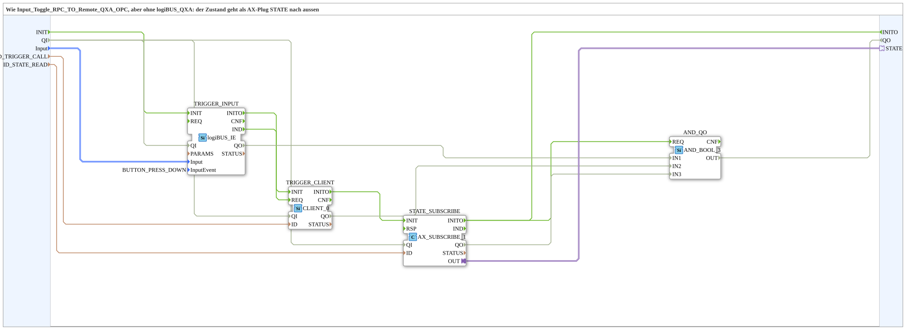

# Input_Toggle_RPC_TO_Remote_AX_OPC

* * * * * * * * * *

## Einleitung

`Input_Toggle_RPC_TO_Remote_AX_OPC` entspricht [`Input_Toggle_RPC_TO_Remote_QXA_OPC`](./Input_Toggle_RPC_TO_Remote_QXA_OPC.md), aber ohne `logiBUS_QXA`: Der Zustand geht als AX-Plug `STATE` nach außen, die Anzeige oder Weiterverarbeitung ist frei wählbar. Ein Tastendruck am logiBUS-Eingang `Input` ruft per `CLIENT_0` die Toggle-Methode `ID_TRIGGER_CALL` auf; der Flipflop-Zustand wird lokal per `AX_SUBSCRIBE_1` von `ID_STATE_READ` gelesen und direkt auf den Plug `STATE` gelegt.

## Schnittstellenstruktur

### **Ereignis-Eingänge**

- `INIT` (`EInit`): Initialization Request

### **Ereignis-Ausgänge**

- `INITO` (`EInit`): Initialization Confirm

### **Daten-Eingänge**

| Name | Typ | Beschreibung |
|------|-----|--------------|
| `QI` | `BOOL` | Quality Input - TRUE, um den Dienst freizugeben. Initialwert `TRUE`. |
| `Input` | `logiBUS::io::DI::logiBUS_DI_S` | Taster `Input_I1..I8` (Tastendruck ruft die Methode). Initialwert `logiBUS_DI::Invalid`. |
| `ID_TRIGGER_CALL` | `WSTRING` | Methodenadresse (`ACTION=CALL_METHOD`, mit Endpunkt). |
| `ID_STATE_READ` | `WSTRING` | Lokale Adresse (`BOOL`, `ACTION=READ`) für den Zustand. |

### **Daten-Ausgänge**

| Name | Typ | Beschreibung |
|------|-----|--------------|
| `QO` | `BOOL` | Quality Output - TRUE, wenn der Dienst erfolgreich ausgeführt wurde. |

### **Adapter**

| Adapter | Typ | Richtung | Beschreibung |
|---------|-----|----------|--------------|
| `STATE` | `adapter::types::unidirectional::AX` | Plug | Flipflop-Zustand (lokal gelesen). |

## Verwendete Funktionsbausteine (FBs)

- **TRIGGER_INPUT** (`logiBUS::io::DI::logiBUS_IE`, Parameter `InputEvent = BUTTON_PRESS_DOWN`): logiBUS-Taster, Ereignis beim Drücken.
- **TRIGGER_CLIENT** (`iec61499::net::CLIENT_0`): ruft die Methode `ID_TRIGGER_CALL` auf.
- **STATE_SUBSCRIBE** (`adapter::net::AX_SUBSCRIBE_1`): liest den Zustand lokal unter `ID_STATE_READ`.
- **AND_QO** (`iec61131::booleanOperators::AND_BOOL_3`): verknüpft `TRIGGER_INPUT.QO`, `TRIGGER_CLIENT.QO` und `STATE_SUBSCRIBE.QO` zu `QO`.

## Programmablauf und Verbindungen

1. Initialisierungskette: `INIT` → `TRIGGER_INPUT.INIT`; `TRIGGER_INPUT.INITO` → `TRIGGER_CLIENT.INIT`; `TRIGGER_CLIENT.INITO` → `STATE_SUBSCRIBE.INIT`; `STATE_SUBSCRIBE.INITO` → `INITO` und → `AND_QO.REQ`.
2. Methodenaufruf: `TRIGGER_INPUT.IND` → `TRIGGER_CLIENT.REQ`.
3. Qualifier: `QI` → `TRIGGER_INPUT.QI`, `TRIGGER_CLIENT.QI` und `STATE_SUBSCRIBE.QI`.
4. Daten: `Input` → `TRIGGER_INPUT.Input`; `ID_TRIGGER_CALL` → `TRIGGER_CLIENT.ID`; `ID_STATE_READ` → `STATE_SUBSCRIBE.ID`.
5. Zustand: `STATE_SUBSCRIBE.OUT` → Plug `STATE`.
6. Qualitätsauswertung: `TRIGGER_INPUT.QO` → `AND_QO.IN1`; `TRIGGER_CLIENT.QO` → `AND_QO.IN2`; `STATE_SUBSCRIBE.QO` → `AND_QO.IN3`; `AND_QO.OUT` → `QO`.

## Technische Besonderheiten

- Der Baustein enthält keinen physischen Ausgang; die Weiterverarbeitung des Zustands erfolgt über den Plug `STATE`.
- Der Zustand wird nicht im Baustein berechnet, sondern lokal von `ID_STATE_READ` gelesen.

## Anwendungsszenarien

- Tastergesteuerter Toggle auf einem Zielmodul ohne ISOBUS, wobei der Zustand frei weiterverwendet werden kann (z. B. für eine beliebige Anzeige).
- Variante von [`Input_Toggle_RPC_TO_Remote_QXA_OPC`](./Input_Toggle_RPC_TO_Remote_QXA_OPC.md), wenn kein `logiBUS_QXA` als Anzeige benötigt wird.

## Zusammenfassung

`Input_Toggle_RPC_TO_Remote_AX_OPC` ruft per logiBUS-Taster eine Toggle-Methode auf und stellt den lokal gelesenen Zustand als AX-Plug `STATE` bereit.

---

### 🌐 Passende Themen-Unterseiten auf ms-muc-docs.de

- [🌐 Eclipse 4diac IDE & Farb-Referenz auf ms-muc-docs.de](https://www.ms-muc-docs.de/iec-61499/eclipse-4diac/)
