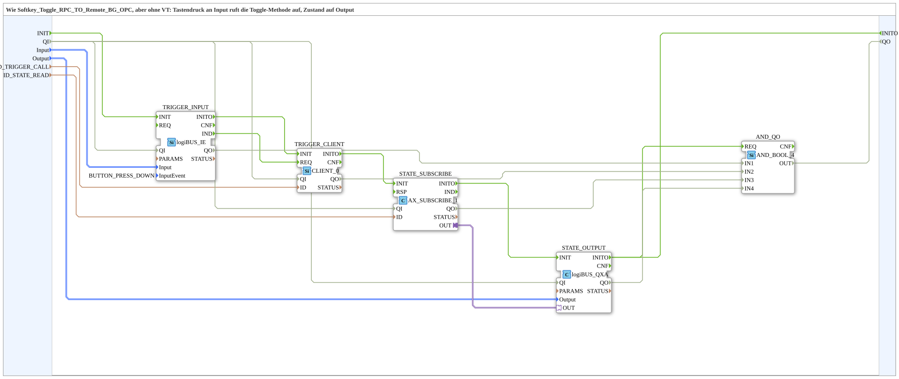

# Input_Toggle_RPC_TO_Remote_QXA_OPC

* * * * * * * * * *

## Einleitung

`Input_Toggle_RPC_TO_Remote_QXA_OPC` entspricht [`Softkey_Toggle_RPC_TO_Remote_BG_OPC`](./Softkey_Toggle_RPC_TO_Remote_BG_OPC.md), aber ohne VT: Ein Tastendruck an `Input` ruft die Toggle-Methode auf, der Zustand wird auf `Output` angezeigt. Statt `Softkey_IE` wird `logiBUS_IE` verwendet, statt `GreenWhiteBackground` ein `logiBUS_QXA` - für Tests ohne ISOBUS (Meins/OPC_UA_Lokal L03).

## Schnittstellenstruktur

### **Ereignis-Eingänge**

- `INIT` (`EInit`): Initialization Request

### **Ereignis-Ausgänge**

- `INITO` (`EInit`): Initialization Confirm

### **Daten-Eingänge**

| Name | Typ | Beschreibung |
|------|-----|--------------|
| `QI` | `BOOL` | Quality Input - TRUE, um den Dienst freizugeben. Initialwert `TRUE`. |
| `Input` | `logiBUS::io::DI::logiBUS_DI_S` | Taster `Input_I1..I8` (Tastendruck ruft die Methode). Initialwert `logiBUS_DI::Invalid`. |
| `Output` | `logiBUS::io::DQ::logiBUS_DO_S` | Anzeige des Flipflop-Zustands `Output_Q1..Q8`. Initialwert `logiBUS_DO::Invalid`. |
| `ID_TRIGGER_CALL` | `WSTRING` | Methodenadresse (`ACTION=CALL_METHOD`, mit Endpunkt). |
| `ID_STATE_READ` | `WSTRING` | Lokale Adresse (`BOOL`, `ACTION=READ`) für den Zustand. |

### **Daten-Ausgänge**

| Name | Typ | Beschreibung |
|------|-----|--------------|
| `QO` | `BOOL` | Quality Output - Zusammengefasster Status der beteiligten Funktionsbausteine (`TRIGGER_INPUT.QO`, `TRIGGER_CLIENT.QO`, `STATE_SUBSCRIBE.QO` und `STATE_OUTPUT.QO`, UND-verknüpft). `QO` = TRUE bestätigt **nicht**, dass der Methodenaufruf erfolgreich war; die Ausführung der Anfrage bestätigt `CLIENT_0.CNF`, das dieser Wrapper nicht nach außen führt. |

### **Adapter**

Keine vorhanden.

## Verwendete Funktionsbausteine (FBs)

- **TRIGGER_INPUT** (`logiBUS::io::DI::logiBUS_IE`, Parameter `InputEvent = BUTTON_PRESS_DOWN`): logiBUS-Taster, Ereignis beim Drücken.
- **TRIGGER_CLIENT** (`iec61499::net::CLIENT_0`): ruft die Methode `ID_TRIGGER_CALL` auf.
- **STATE_SUBSCRIBE** (`adapter::net::AX_SUBSCRIBE_1`): liest den Zustand lokal unter `ID_STATE_READ`.
- **STATE_OUTPUT** (`logiBUS::io::DQ::logiBUS_QXA`): zeigt den Zustand am Ausgang `Output` an.
- **AND_QO** (`iec61131::booleanOperators::AND_BOOL_4`): verknüpft die `QO` von `TRIGGER_INPUT`, `TRIGGER_CLIENT`, `STATE_SUBSCRIBE` und `STATE_OUTPUT` zu `QO`.

## Programmablauf und Verbindungen

1. Initialisierungskette: `INIT` → `TRIGGER_INPUT.INIT`; `TRIGGER_INPUT.INITO` → `TRIGGER_CLIENT.INIT`; `TRIGGER_CLIENT.INITO` → `STATE_SUBSCRIBE.INIT`; `STATE_SUBSCRIBE.INITO` → `STATE_OUTPUT.INIT`; `STATE_OUTPUT.INITO` → `INITO` und → `AND_QO.REQ`.
2. Methodenaufruf: `TRIGGER_INPUT.IND` → `TRIGGER_CLIENT.REQ`.
3. Qualifier: `QI` → `TRIGGER_INPUT.QI`, `TRIGGER_CLIENT.QI`, `STATE_SUBSCRIBE.QI` und `STATE_OUTPUT.QI`.
4. Daten: `Input` → `TRIGGER_INPUT.Input`; `Output` → `STATE_OUTPUT.Output`; `ID_TRIGGER_CALL` → `TRIGGER_CLIENT.ID`; `ID_STATE_READ` → `STATE_SUBSCRIBE.ID`.
5. Zustandsanzeige: `STATE_SUBSCRIBE.OUT` → `STATE_OUTPUT.OUT`.
6. Qualitätsauswertung: `TRIGGER_INPUT.QO` → `AND_QO.IN1`; `TRIGGER_CLIENT.QO` → `AND_QO.IN2`; `STATE_SUBSCRIBE.QO` → `AND_QO.IN3`; `STATE_OUTPUT.QO` → `AND_QO.IN4`; `AND_QO.OUT` → `QO`.

## Technische Besonderheiten

- Der Zustand wird nicht im Baustein berechnet, sondern lokal von `ID_STATE_READ` gelesen und nur angezeigt.
- Ohne `logiBUS_QXA` steht die Variante [`Input_Toggle_RPC_TO_Remote_AX_OPC`](./Input_Toggle_RPC_TO_Remote_AX_OPC.md) mit AX-Plug `STATE` zur Verfügung.

## Anwendungsszenarien

- Test der Toggle-RPC-Kette ohne ISOBUS-Terminal: logiBUS-Taster ruft die Methode auf, ein logiBUS-Ausgang zeigt den Zustand.

## Zusammenfassung

`Input_Toggle_RPC_TO_Remote_QXA_OPC` ersetzt VT-Softkey und Hintergrundfarbe von [`Softkey_Toggle_RPC_TO_Remote_BG_OPC`](./Softkey_Toggle_RPC_TO_Remote_BG_OPC.md) durch logiBUS-Taster und logiBUS-Ausgang.

## 🛠️ Zugehörige Übungen

- [Uebung_OPC_L03_AX](https://meisterschulen-am-ostbahnhof-munchen-docs.readthedocs.io/projects/4diac-exercises-docs/de/latest/Uebungen/test_AX/Meins/OPC_UA_Lokal/Uebung_OPC_L03_AX/)

---

### 🌐 Passende Themen-Unterseiten auf ms-muc-docs.de

- [🌐 Eclipse 4diac IDE & Farb-Referenz auf ms-muc-docs.de](https://www.ms-muc-docs.de/iec-61499/eclipse-4diac/)
