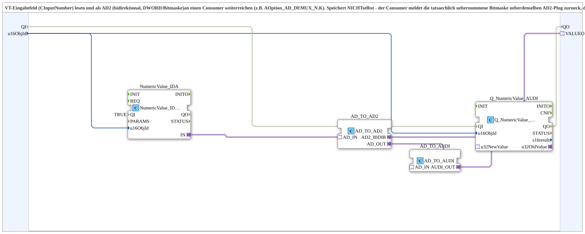

# NumericValue_TO_AD2

* * * * * * * * * *

## Einleitung

`NumericValue_TO_AD2` liest ein VT-Eingabefeld (CInputNumber) und reicht den Wert bidirektional als AD2-Adapter (DWORD/Bitmaske, `VALUEO`) an einen Consumer weiter (z. B. `AOption_AD_DEMUX_N.K`). Der Baustein speichert **nicht** selbst: Der Consumer meldet die tatsächlich übernommene Bitmaske über denselben AD2-Plug zurück, das Echo wird auf das VT-Feld zurückgeschrieben.

## Schnittstelle

### Eingangsvariablen

- `QI` (BOOL, Vorgabe `TRUE`): Quality Input - TRUE aktiviert den Dienst.
- `u16ObjId` (UINT, Default `ID_NULL`): ObjectID des VT-Eingabefelds.

### Ausgangsvariablen

- `QO` (BOOL): Quality Output - TRUE, wenn der Dienst erfolgreich ausgeführt wurde.

### Adapter

- **Plug `VALUEO`** (`adapter::types::bidirectional::AD2`): Bitmaske zum Consumer und Echo zurück.

Der Baustein besitzt keine eigenen Ereignisanschlüsse.

## Funktionsweise

1. `NumericValue_IDA` (`QI`=TRUE) liest das VT-Eingabefeld.
2. `AD_TO_AD2` wandelt den Wert in den bidirektionalen AD2-Adapter, der an `VALUEO` ausgegeben wird.
3. Das vom Consumer zurückgemeldete Echo erscheint an `AD_TO_AD2.AD_OUT`, wird per `AD_TO_AUDI` in UDINT gewandelt und von `Q_NumericValue_AUDI` (`u32NewValue`) unter `u16ObjId` auf das VT-Feld geschrieben.

`QI` wird an `Q_NumericValue_AUDI.QI` durchgereicht, `Q_NumericValue_AUDI.QO` an `QO`.

## Technische Besonderheiten

- DWORD-/Bitmasken-Pendant zu [`NumericValue_TO_AUI2`](./NumericValue_TO_AUI2.md) - für `AOption_AD_DEMUX_N` (Multi-Select) statt `AOption_AUI_DEMUX_N` (Single-Select).
- Kein `AD_TO_AUI`-Zwischenschritt nötig, da AD2 bereits direkt DWORD ist.
- Reine VT-zu-AD2-Brücke ohne Speicher-FB; vgl. [`NumericValue_TO_AR2`](./NumericValue_TO_AR2.md).

## Zusammenfassung

Bidirektionale Brücke vom VT-Eingabefeld zu einem AD2-Plug (Bitmaske) ohne eigene Persistierung.

---

### 🌐 Passende Themen-Unterseiten auf ms-muc-docs.de

- [🌐 Eclipse 4diac IDE & Farb-Referenz auf ms-muc-docs.de](https://www.ms-muc-docs.de/iec-61499/eclipse-4diac/)
