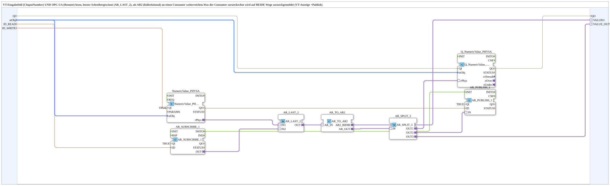

# NumericValue_TO_AR2_OPC

* * * * * * * * * *

## Einleitung

`NumericValue_TO_AR2_OPC` ist der VT+OPC-UA-Zwilling von [`NumericValue_TO_AR2`](./NumericValue_TO_AR2.md) (VT-only) und [`OPC_TO_AR2`](./OPC_TO_AR2.md) (OPC-only): sowohl das VT-Eingabefeld als auch ein per OPC-UA remote geschriebener Wert (`AR_SUBSCRIBE_1`) speisen `AR_LAST_2` - "letzter Schreiber gewinnt". Das Ergebnis geht als AR2-Adapter (`VALUEO`) an den Consumer; was dieser zurueckechot, wird auf BEIDE Wege zurueckgemeldet: VT-Anzeige (`Q_NumericValue_PHYSA`) und OPC-UA-Publish (`AR_PUBLISH_1`).

## Verwendete Funktionsbausteine (FBs)

- **NumericValue_PHYSA**: VT-Eingabefeld, lokaler Wert.
- **AR_SUBSCRIBE_1**: abonniert einen remote geschriebenen REAL-Wert unter `ID_READ`.
- **AR_LAST_2**: verschmilzt beide Quellen nach "letzter Schreiber gewinnt".
- **AR_TO_AR2**: wandelt den gemergten plain-AR-Wert in den bidirektionalen AR2-Adapter fuer den Consumer.
- **AR_SPLIT_2**: verzweigt das Echo des Consumers auf VT-Anzeige und OPC-Publish.
- **AR_PUBLISH_1**: publiziert den aktuellen/persistierten Wert unter `ID_WRITE` (getriggert von `AR_SUBSCRIBE_1.INITO`, damit auch der initiale Wert sofort publiziert wird).

## Technische Besonderheiten

- Merge-Strategie identisch zum bereits bestehenden VT/Web-Merge in `RampLimitFS_TO_logiBUS_QDA_PWM_OPC.SUB` (laut Quellcode-Kommentar).

## Ereignis- und Qualitätsanschlüsse (INIT/INITO, QI/QO)

Der Baustein besitzt den Dateneingang `QI` (`BOOL`, Vorgabe `TRUE`, Quality Input - TRUE aktiviert den Dienst) und den Datenausgang `QO` (`BOOL`, Quality Output - TRUE, wenn der Dienst erfolgreich ausgeführt wurde). `QI` geht an `NumericValue_PHYSA`, `AR_SUBSCRIBE_1`, `AR_PUBLISH_1` und `Q_NumericValue_PHYSA`. `QO` ist der Ausgang der Instanz `AND_QO` (`iec61131::booleanOperators::AND_BOOL_4`), die `Q_NumericValue_PHYSA.QO`, `NumericValue_PHYSA.QO`, `AR_SUBSCRIBE_1.QO` und `AR_PUBLISH_1.QO` verknüpft.

Zusätzlich besitzt der Baustein den Ereigniseingang `INIT` und den Ereignisausgang `INITO` (je `EInit`). Die Initialisierung läuft als Kette: `INIT` → `NumericValue_PHYSA.INIT`, `NumericValue_PHYSA.INITO` → `AR_SUBSCRIBE_1.INIT`, `AR_SUBSCRIBE_1.INITO` → `AR_PUBLISH_1.INIT`, `AR_PUBLISH_1.INITO` → `Q_NumericValue_PHYSA.INIT`, `Q_NumericValue_PHYSA.INITO` → `INITO` (und → `AND_QO.REQ`).

## Zusammenfassung

VT- und OPC-UA-Eingabe fuer denselben AR2-Consumer, mit Last-Writer-Wins-Merge und beidseitiger Echo-Rueckmeldung.

---

### 🌐 Passende Themen-Unterseiten auf ms-muc-docs.de

- [🌐 Eclipse 4diac IDE & Farb-Referenz auf ms-muc-docs.de](https://www.ms-muc-docs.de/iec-61499/eclipse-4diac/)
