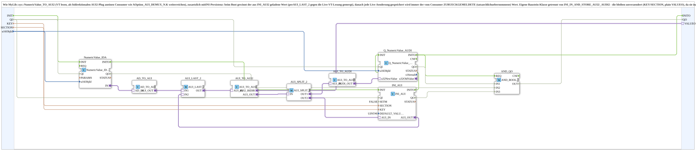

# NumericValue_TO_AUI2_AND_STORE

* * * * * * * * * *

## Einleitung

`NumericValue_TO_AUI2_AND_STORE` entspricht [`NumericValue_TO_AUI2`](./NumericValue_TO_AUI2.md) (VT lesen, als bidirektionalen AUI2-Plug `VALUEO` an einen Consumer wie `AOption_AUI_DEMUX_N.K` weiterreichen), ergänzt um INI-Persistenz: Beim Boot gewinnt der aus der INI-Datei geladene Wert (per `AUI_LAST_2` gegen die Live-VT-Lesung gemergt), danach jede Live-Änderung. Gespeichert wird immer der vom Consumer **zurückgemeldete** (tatsächlich übernommene) Wert. Der Baustein ist eine eigene Klasse getrennt von `INI_IN_AND_STORE_AUI2`/`_AUDI2`, die unverändert bleiben (KEY/SECTION, plain `VALUEO`), da sie in zahlreichen anderen Projekten verwendet werden.

Allgemeines Muster siehe [INI_IN_AND_STORE / NVS_IN_AND_STORE (gemeinsames Muster)](./INI-NVS-Speicherbausteine.md).

## Schnittstelle

### Eingangsvariablen

- `KEY` (STRING): Schlüsselname in der INI-Datei.
- `SECTION` (STRING): Abschnittsname in der INI-Datei.
- `u16ObjId` (UINT, Default `ID_NULL`): ObjectID des VT-Eingabefelds.

### Adapter

- **Plug `VALUEO`** (`adapter::types::bidirectional::AUI2`): Wert zum Consumer und Echo zurück.

Der Baustein besitzt keine eigenen Ereignisanschlüsse.

## Funktionsweise

1. `NumericValue_IDA` (`QI`=TRUE) liest das VT-Eingabefeld; `AD_TO_AUI` wandelt in AUI und liefert es an `AUI_LAST_2.IN1`.
2. `AUI_LAST_2` (Last-Writer-Wins) führt zusammen: `IN1` = Live-VT-Änderung, `IN2` = INI-Wert beim Boot. Der Ausgang geht an `AUI_TO_AUI2` (Brücke zum externen Consumer), dessen bidirektionaler Ausgang an `VALUEO`.
3. Das vom Consumer zurückgemeldete Ergebnis erscheint an `AUI_TO_AUI2.AUI_OUT` und wird per `AUI_SPLIT_2` verdoppelt: `OUT1` über `AUI_TO_AUDI` an `Q_NumericValue_AUDI` (`u32NewValue`, VT-Anzeige unter `u16ObjId`), `OUT2` an `INI_AUI` (`eclipse4diac::storage::INI_AUI`, `AUI_IN`; `QI`=TRUE, `SETM`=FALSE, `DEFAULT_VALUE`=`UINT#0`).
4. `INI_AUI.AUI_OUT` führt den geladenen Wert zu `AUI_LAST_2.IN2` zurück.

## Technische Besonderheiten

- `SETM`=FALSE: `INI_AUI` quittiert nur beim Boot automatisch (INIT → INITO → GET → GETO), nicht bei jedem späteren Schreibvorgang. Bei `SETM`=TRUE würde jeder Schreibvorgang ein neues Echo auslösen, das erneut bei `AUI_LAST_2` ankäme und Richtung `VALUEO` geschickt würde - ein Dauerkreislauf.
- Die Live-VT-Lesung geht direkt an `VALUEO` (ein einziges `AUI_TO_AUI2`); gespeichert wird erst das vom Consumer zurückgemeldete Ergebnis über den Split.
- Der Boot-Wert gewinnt in `AUI_LAST_2` einmalig gegen die Live-VT-Lesung.

## Zusammenfassung

Wie `NumericValue_TO_AUI2`, mit INI-Persistenz des vom Consumer bestätigten Werts und Boot-Wert-Merge.

## 🛠️ Zugehörige Übungen

- [Uebung_094b3b_AX](https://meisterschulen-am-ostbahnhof-munchen-docs.readthedocs.io/projects/4diac-exercises-docs/de/latest/Uebungen/test_AX/Uebungen_doc/Uebung_094b3b_AX/)
- [Uebung_094b4b_AX](https://meisterschulen-am-ostbahnhof-munchen-docs.readthedocs.io/projects/4diac-exercises-docs/de/latest/Uebungen/test_AX/Uebungen_doc/Uebung_094b4b_AX/)
- [Uebung_094c2b_AX](https://meisterschulen-am-ostbahnhof-munchen-docs.readthedocs.io/projects/4diac-exercises-docs/de/latest/Uebungen/test_AX/Uebungen_doc/Uebung_094c2b_AX/)

---

### 🌐 Passende Themen-Unterseiten auf ms-muc-docs.de

- [🌐 Eclipse 4diac IDE & Farb-Referenz auf ms-muc-docs.de](https://www.ms-muc-docs.de/iec-61499/eclipse-4diac/)
