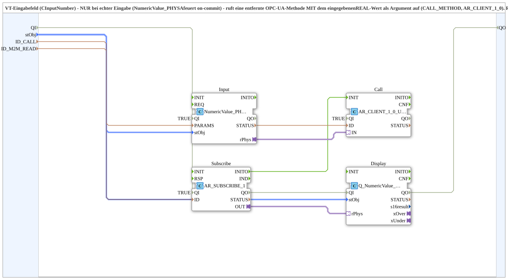

# NumericValue_TO_CLIENT_1_0_OPC

* * * * * * * * * *

## Einleitung

`NumericValue_TO_CLIENT_1_0_OPC` verbindet ein VT-Eingabefeld (`CInputNumber`) mit einer entfernten **OPC-UA-Methode**: **Nur bei einer echten Eingabe** (`NumericValue_PHYSA` feuert beim Commit) wird die Methode (`CALL_METHOD`, `AR_CLIENT_1_0`) mit dem eingegebenen `REAL`-Wert als Argument aufgerufen. Der Rückweg – Anzeige des tatsächlich wirksamen, bestätigten Werts auf demselben VT-Feld – läuft separat und unkritisch über einen normalen Subscribe (`Q_NumericValue_PHYSA`). Es gibt dadurch keinen Zirkelbezug und kein Merge/Last-Writer-Wins: Auf der Empfängerseite gibt es nur einen Aufrufer pro Methode, serialisiert durch den Methodenaufruf selbst.

## Schnittstellenstruktur

### **Ereignis-Eingänge**

- **INIT** (`EInit`): Initialization Request

### **Ereignis-Ausgänge**

- **INITO** (`EInit`): Initialization Confirm

### **Daten-Eingänge**

- **QI** (`BOOL`, Vorgabe `TRUE`): Quality Input - TRUE aktiviert den Dienst
- **stObj** (`logiBUS::utils::conversion::phys::NumericObjectPool_S`): Object-ID und Scale/Offset/Decimals des VT-Eingabefelds; wird für Ein- und Ausgabe verwendet (der bestätigte Wert wird hier zurückgeschrieben). Vorgabe: `(u16ObjId := ID_NULL, r32Scale := 1.0, i32Offset := 0, u8Decimals := 1)`
- **ID_CALL** (`WSTRING`): Remote-Methodenadresse (`ACTION=CALL_METHOD`); wird nur bei einer echten VT-Eingabe mit dem eingegebenen Wert als Argument aufgerufen
- **ID_M2M_READ** (`WSTRING`): Remote-Subscribe-Adresse (`REAL`, `ACTION=SUBSCRIBE`); liefert den tatsächlich wirksamen Wert zur Anzeige auf demselben VT-Feld zurück (reines Lesen)

### **Daten-Ausgänge**

- **QO** (`BOOL`): Quality Output - TRUE, wenn der Dienst erfolgreich ausgeführt wurde (UND von `Display.QO`, `Input.QO`, `Call.QO` und `Subscribe.QO`)

### **Adapter**

Dieser Funktionsblock verwendet keine Adapter-Sockets/-Plugs an der Schnittstelle; intern werden `AR`-Adapter verwendet.

## Verwendete Funktionsbausteine (FBs)

- **Input**: `isobus::UT::io::NumericValue::NumericValue_PHYSA` (`QI` vom Baustein-Eingang) – liefert den eingegebenen physikalischen Wert (`rPhys`) beim Commit
- **Call**: `adapter::net::AR_CLIENT_1_0_UNGATED` (`QI` vom Baustein-Eingang) – ruft die Remote-Methode mit dem Wert als Argument auf
- **Subscribe**: [`adapter::net::AR_SUBSCRIBE_1`](../../adapter/net/AR_SUBSCRIBE_1.md) (`QI` vom Baustein-Eingang) – abonniert den bestätigten Wert
- **Display**: `isobus::UT::Q::Q_NumericValue_PHYSA` – schreibt den Wert auf das VT-Feld
- **AND_QO**: `iec61131::booleanOperators::AND_BOOL_4` – verknüpft die `QO`-Ausgänge von `Display`, `Input`, `Call` und `Subscribe` per UND

## Programmablauf und Verbindungen

1. **Hinweg**: `Input.rPhys` → `Call.IN` (Eingabe → Methodenaufruf).
2. **Rückweg**: `Subscribe.OUT` → `Display.rPhys` (bestätigter Wert → VT-Anzeige).
3. Initialisierungskette: `INIT` → `Input.INIT`, `Input.INITO` → `Subscribe.INIT`, `Subscribe.INITO` → `Call.INIT` (der Client wird erst nach der Initialisierung des Subscribe initialisiert), `Call.INITO` → `Display.INIT`, `Display.INITO` → `INITO` und → `AND_QO.REQ`.
4. `stObj` → `Input.stObj` und `Display.stObj`; `ID_CALL` → `Call.ID`; `ID_M2M_READ` → `Subscribe.ID`.
5. `QI` → `Display.QI`, `Input.QI`, `Call.QI` und `Subscribe.QI`; `Display.QO` → `AND_QO.IN1`, `Input.QO` → `AND_QO.IN2`, `Call.QO` → `AND_QO.IN3`, `Subscribe.QO` → `AND_QO.IN4`; `AND_QO.OUT` → `QO`

## Technische Besonderheiten

- Hin- und Rückweg sind getrennt, deshalb ist kein Merge nötig.
- `AR_CLIENT_1_0_UNGATED` ist die ungegatete Variante des Clients.

## Anwendungsszenarien

- Sollwert-Eingabe am VT, die auf einer anderen Station per OPC-UA-Methode wirksam wird, mit Rückmeldung des tatsächlich gültigen Werts

## Fazit

`NumericValue_TO_CLIENT_1_0_OPC` schreibt VT-Eingaben per OPC-UA-Methodenaufruf zur Zielstation und zeigt den bestätigten Wert unabhängig davon über einen Subscribe an.
